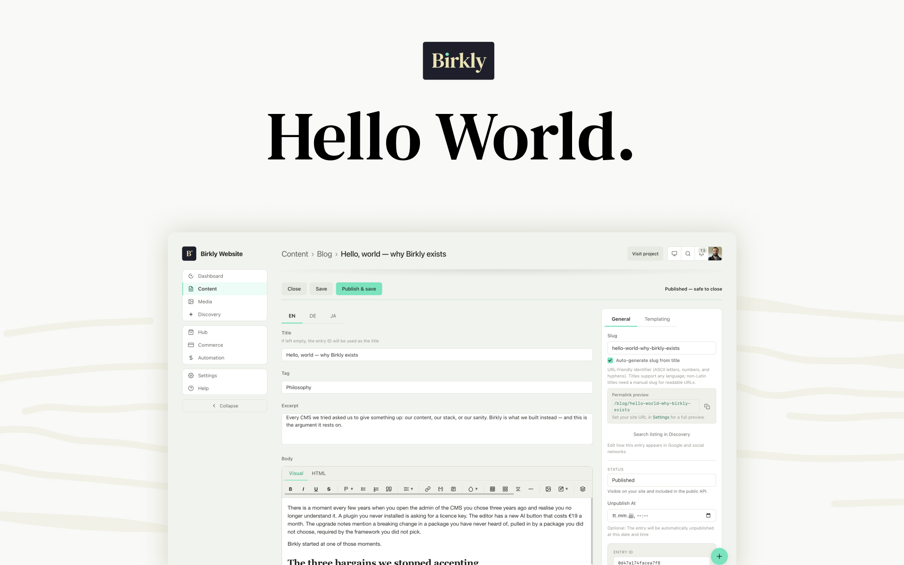

# Birkly

**An open-source CMS for humans and AI.**

A modular, API-first PHP CMS with a predictable architecture, no build step, no external core dependencies, and an optional database. Content lives as JSON on disk by default — upload a release zip, run, and manage everything from `/admin`.

### Admin

The admin is where you define collections, edit entries, manage media, and install plugins. The same Public API and MCP surface powers your site, automation, and AI agents.



### Content model

| Concept | What it is |
|---------|------------|
| **Collection** | A content type: field schema, permissions, and how entries are created (admin-only or public API). Stored under `content/collections/{handle}/`. |
| **Entry** | One item in a collection (e.g. a blog post or service page) — typically one JSON file in `entries/`, editable in admin or via API. |
| **Project** | Your public site files (`project/`): HTML, CSS, and templating wired to collections through `birkly-client.js` or direct API calls. |

See [What is Birkly?](https://docs.birkly.io/00-overview/what-is-birkly.html) in the docs for a longer introduction.

### Alpha release

Try the current self-host build: **[v0.0.2 (alpha)](https://github.com/Raaakete/Birkly/releases/tag/v0.0.2)** — download `birkly-release.zip`, extract, open **`0_START-HERE.html`**, then run `./start-server.sh`. Versioning: **0.0.x** alpha, **0.1.x** beta, **1.0.0** first stable — details in [RELEASE.md](RELEASE.md).

## Quick start

1. Extract the release zip on your server (or run locally).
2. Open **`0_START-HERE.html`** for setup steps.
3. Start the built-in server for local testing:

```bash
chmod +x ./start-server.sh
./start-server.sh
```

Admin: [http://localhost:8080/admin](http://localhost:8080/admin)

Create the first admin user when the browser setup has not done it yet:

```bash
BIRKLY_ADMIN_PASSWORD='YourPassword123!' php scripts/create-default-user.php
```

The default email is `admin@localhost`. Pass `--email=you@example.com` to use another. If an admin account already exists, the script leaves it unchanged.

## Where your site lives

| Path | Purpose |
|------|---------|
| `content/collections/` | Entries and collection schemas (JSON) |
| `project/` | Public website files (HTML, CSS, assets) |
| `media/` | Uploaded files |
| `plugins/` | Installed extensions (empty on fresh install) |
| `settings/` | Site and plugin configuration |

Install plugins from the [Birkly Marketplace](https://marketplace.birkly.cloud) or upload a plugin zip in **Settings → Plugins**.

## Documentation

- **[Birkly-Docs](https://github.com/Raaakete/Birkly-Docs)** — guides, API reference, plugin development
- **[GitHub Discussions](https://github.com/Raaakete/Birkly/discussions)** — community Q&A, ideas, and show-and-tell ([welcome thread](https://github.com/Raaakete/Birkly/discussions/931))
- **[CONTRIBUTING.md](CONTRIBUTING.md)** — issues and pull requests for the open-source CMS
- **[SECURITY.md](SECURITY.md)** — vulnerability reporting and secure self-hosting

## Production

1. Upload the release files to your web host (Apache or Nginx).
2. Apache: use the included `.htaccess` when available.
3. Nginx: see `nginx.conf.example` in the full development repository.
4. Point your domain at the install; admin is at `/admin`.

**Docker / Dokploy:** one volume at `/app/data` — see [docs/deployment/docker.md](docs/deployment/docker.md).

## Local development (maintainers)

Official plugin sources and the full test suite live in the private **Birkly-Marketplace** ops repository. Clone it alongside this repo and run CI from there — see `CONTRIBUTING.md`.

```bash
./scripts/install-dev-plugins.sh   # optional: install official plugins for dev
```

## Releases

Self-host builds are published on [GitHub Releases](https://github.com/Raaakete/Birkly/releases). Latest alpha: [v0.0.2](https://github.com/Raaakete/Birkly/releases/tag/v0.0.2). Versioning follows [RELEASE.md](RELEASE.md): **0.0.x** alpha, **0.1.x** beta, **1.0.0** first stable release.

## License

Birkly is released under the GNU Affero General Public License v3.0 or any later version. See [LICENSE](LICENSE).

The Map field includes [Leaflet](https://leafletjs.com) 1.9.4 so the admin map works without loading it from another website. Leaflet stays under the BSD 2-Clause license in `fieldtypes/Map/leaflet/LICENSE`. That license applies only to those files.