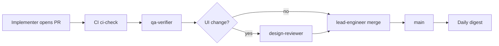

# Autonomous execution

Human-approved **2026-06-18** (Keven).

The human and **product-planner** define milestones and task IDs. The agent team **implements, reviews, tests, and merges** work within that contract **without per-PR human approval**.

Related: `docs/PROJECT_VALUES.md`, `docs/agent-ops/REPORTING.md`, `docs/roadmap/ROADMAP.md`.

## Two-tier governance

| Tier | Owner | Decides |
|------|-------|---------|
| **Plan** | Human + product-planner | Milestones, priorities, deferrals, values trade-offs, major scope |
| **Execute** | lead-engineer + specialists | Task implementation, review, test, merge within approved tasks |

**Human touchpoints:** daily digest (07:00 CEST), P0/P1 escalations, milestone planning sessions — **not** every pull request.

## Merge policy

**lead-engineer** merges to `main` when **all applicable gates pass**. Do not ask the human to review or approve routine PRs.

Implementers **must not** merge their own code without independent qa-verifier sign-off (four-eyes inside the team).

### Gate matrix

| Gate | Owner | When required |
|------|-------|----------------|
| **CI green** (`ci` workflow) | GitHub Actions | Every PR to `main` |
| `./scripts/ci-check.sh` | CI / lead before merge | Every merge |
| **qa-verifier** verdict `pass` | qa-verifier agent | Every implementation PR |
| **design-reviewer** verdict `approved` | design-reviewer agent | UI/CSS/admin template/marketing HTML changes |
| **bugbot** (optional) | bugbot subagent | CMS core, `api/`, security-sensitive diffs — run when lead judges risk non-trivial |
| **Values check** ✅ | Implementer in PR body | Every PR |
| **Scope check** | lead-engineer | Task ID `M[N]-T[N]` in title/body; no scope beyond roadmap task |

### Merge command

After gates pass:

```bash
gh pr merge <number> --squash --delete-branch
```

Use `--merge` if the repo convention changes; default is squash for a linear history.

Enable GitHub **auto-merge** when available: `gh pr merge --auto --squash`.

## Review chain (no human)



## PR body template (implementation)

```markdown
## Task
M[N]-T[N]: [title]

## Acceptance criteria
- [ ] …

## Verification
- [ ] ./scripts/ci-check.sh
- [ ] [task-specific checks]

## Reviews
- qa-verifier: pass | pending
- design-reviewer: approved | n/a

## Values check
✅ aligned — [one line]

## Related PRs
- …
```

**Do not** open PRs with “please review” directed at the human. Digest reports **what merged**, not review requests.

## Escalation (stop and ask human)

| Situation | Action |
|-----------|--------|
| Scope beyond approved task ID | P1 — do not merge |
| Values trade-off | P1 — do not merge |
| Security / secrets / data leak | P0 — stop all work on stream |
| Major roadmap change | product-planner proposes; wait for approval |
| Gate failure after **2 fix cycles** | P1 — options + recommendation |
| CI unavailable / branch protection blocks bot | P1 — human fixes GitHub settings |

Everything else: fix, re-test, merge.

## Testing (constant)

| Layer | Command | When |
|-------|---------|------|
| **CI bundle** | `./scripts/ci-check.sh` | Every PR; every merge |
| Session bootstrap | `./scripts/agent-smoke-test.sh` | Cloud session start |
| Auth boundary | `./scripts/auth-probe.sh` | Included in smoke/CI |
| Templates | `php test-new-template.php` | Included in smoke/CI |
| Task-specific | qa-verifier defines | Per acceptance criteria |

Expand in M5 (PHPUnit, fixtures). Until then, **CI + qa-verifier** are the merge bar.

## Rollback

If a merged change breaks `main`:

1. lead-engineer reverts on `main` immediately (no human wait): `git revert <sha>` + PR through same gates
2. Note in daily digest + roadmap task comment
3. Fix forward on a follow-up branch

## GitHub setup (human / infra)

For full autonomy on GitHub:

1. Cloud agent token with `contents: write` on platform repos
2. Branch protection on `main`: require status check **`CI`** (workflow name)
3. Do **not** require human approving reviews for agent merges
4. Optional: allow auto-merge when checks pass

Until branch protection is configured, lead-engineer merges in-session after local `./scripts/ci-check.sh` passes.

## Milestone completion

When all tasks in a milestone are merged:

1. lead-engineer sends **milestone paragraph** in the next daily digest (not per-PR)
2. product-planner updates roadmap checkboxes (small change — may merge autonomously)
3. Human optional ack — **not** required to start the next milestone if prior milestone acceptance criteria are met and documented in digest
