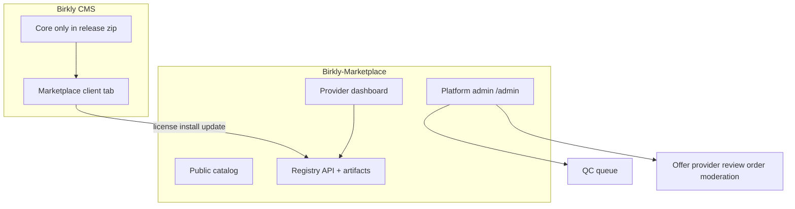

# Phase 10 — Marketplace go-live, plugin unbundling & platform admin

**Status:** **Approved (2026-07-07, Keven)** — autonomous execution P10-M0→M7  
**Repos:** **Birkly-Marketplace** (primary) · Birkly · Birkly-Docs · Birkly-Website · kekaba (embed)  
**Baseline:** P9 complete on `main` — Birkly **97 test suites** · Marketplace **8 test suites**  
**Handoff:** `docs/reviews/P10-lead-engineer-handoff.md`  
**Coupling register:** `docs/reviews/P10-plugin-coupling-register.md`  
**Release manifest:** `scripts/cms-release-manifest.json`  
**Verification matrix:** `Birkly-Marketplace/docs/P10-VERIFICATION-MATRIX.md`  
**Roadmap:** `docs/roadmap/ROADMAP.md` § Phase 10

---

## Locked decisions (Keven 2026-07-07)

| ID | Decision |
|----|----------|
| P10-D1 | Official plugin **source** stays in `Birkly/plugins/` for dev/CI; **excluded** from CMS release zip |
| P10-D2 | Refund model: **provider-primary** + platform request queue; **14-day** window (configurable) |
| P10-D3 | Official plugins (**commerce, events, automation, user_management**) = **free** licenses for v1 |
| P10-D4 | Fresh CMS install: **zero plugins**; onboarding suggests marketplace install |
| P10-D5 | Existing installs: **grandfather** local copies; updates via marketplace only |
| P10-D6 | kekaba embed sync **excludes** `plugins/`; dev script installs from marketplace/fixtures |
| P10-D7 | GitHub auto-publish: **defer** to P11; CI/tag → zip → registry in P10 |
| P10-D8 | Autonomous execution: human approves phase once; notify **once** at P10-M7 closure |
| P10-D9 | Manual QC required for **all non-official** provider offers before publish |
| P10-D10 | New **release** versions from third-party providers re-enter QC before registry goes live |
| P10-D11 | Review moderation: **soft-hide only** (audit preserved; no hard delete) |
| P10-D12 | Platform admin lives at **`/admin/*`** on marketplace domain only (not CMS admin) |
| P10-D13 | **Pause** = hide listing, install/update still allowed for licensed installs; **Suspend** = block install/update |

---

## Goals

1. **Unbundle official plugins** — CMS download ships without `plugins/`; install only via marketplace.
2. **Publish official offers** — commerce, events, automation, user_management on marketplace with CI release pipeline.
3. **Marketplace go-live** — production config, payments, refunds, reviews UI, provider contact.
4. **Platform admin** — QC inbox, offer/provider/review/order moderation, audit log.

---

## Architecture

### Distribution model

| Layer | Location |
|-------|----------|
| Source (official) | `Birkly/plugins/{commerce,events,automation,user_management}` |
| Build | `scripts/build-plugin-zip.sh` + CI on release tag |
| Publish | Marketplace registry API (official provider `prov_official_birkly`) |
| Install | CMS marketplace client only |
| CMS zip | `plugins/` excluded (empty README + `.gitkeep` only) |
| Third-party | Provider uploads zip in dashboard; QC before publish |

---

## Repo mapping

| Repo | P10 responsibility | Key paths |
|------|-------------------|-----------|
| **Birkly** | CMS unbundling, API gating, dev install script, plugin zip build, marketplace client UX | `scripts/cms-release-manifest.json` · `scripts/build-plugin-zip.sh` · `scripts/install-dev-plugins.sh` · `api/index.php` · `api/public.php` · `api/automation.php` · `api/marketplace.php` · `core/marketplace/` · `plugins/{commerce,events,automation,user_management}/` |
| **Birkly-Marketplace** | Official catalog entries, registry publish, go-live ops, platform admin UI, refunds | `catalog/` · `api/v1/registry.php` · `core/qc.php` · `core/admin_routes.php` · `views/admin/` · `docs/P10-VERIFICATION-MATRIX.md` |
| **Birkly-Docs** | Plugin install guide, refund policy, provider publishing | `03-plugins/` · marketplace buyer/provider guides |
| **Birkly-Website** | Marketplace CTA, featured official plugins | `beta/` collections · homepage links |
| **kekaba** | Client embed without `plugins/`; demo install path | `Birkly-0.1/` sync · `scripts/` or docs for post-sync plugin install |

**Dependency order:** Birkly M1 (unbundle) → Birkly M2 + Marketplace listings → Birkly M3 → Marketplace M4+M4b (parallel) → Docs/Website + kekaba → M7 closure.

**Branches:** `cursor/p10-m[N]-<slug>-030a` (all repos; same milestone id when cross-repo).

---

## Offer & provider status model

### Offer statuses

| Status | Catalog | Buy | Install/update (licensed) | Provider edit |
|--------|---------|-----|---------------------------|---------------|
| `draft` | Hidden | No | No | Yes |
| `pending_review` | Hidden | No | No | Limited |
| `pending_release_review` | Visible (current release) | Yes | Current version only | Limited |
| `published` | Visible | Yes | Yes | Yes |
| `paused` | Hidden | No | Yes | Yes |
| `suspended` | Hidden | No | No | No |
| `delisted` | Hidden | No | No | No |

### Provider statuses

| Status | Can login | Can publish | Offers |
|--------|-----------|-------------|--------|
| `active` | Yes | Yes | Normal |
| `suspended` | No | No | All auto-paused |
| `blocked` | No | No | All suspended |

---

## Platform admin (`/admin/*`)

Separate from Birkly CMS admin. Roles: `admin` (full), `moderator` (QC + reviews + pause offers).

| Section | URL | Purpose |
|---------|-----|---------|
| Dashboard | `/admin` | Pending QC, open refunds, counts |
| QC queue | `/admin/qc` | New offer / release review inbox |
| Offers | `/admin/offers` | Search, pause, suspend, delist, trust level |
| Providers | `/admin/providers` | Suspend, block, reinstate |
| Reviews | `/admin/reviews` | Hide, restore |
| Orders | `/admin/orders` | Purchases, refund queue, license revoke |
| Audit | `/admin/audit` | Admin action log |

P9 scaffold exists (`core/admin_auth.php`, `core/admin_routes.php`); views are stubs — P10 builds full UI.

---

## Refund workflow (v1)

1. Buyer submits refund request (order id + reason) within policy window.
2. Provider approves/denies in dashboard; official Birkly plugins may auto-approve.
3. On approval: Stripe refund → license `status: revoked` → review hidden if applicable.
4. Platform admin can force-refund on escalation.

---

## Milestones

| ID | Focus | Repo |
|----|--------|------|
| **P10-M0** | Coupling register, CMS release manifest, verification matrix shell | Birkly + Marketplace |
| **P10-M1** | Core unbundling — exclude plugins from CMS zip; graceful API gating; dev install script | Birkly |
| **P10-M2** | Official plugin zip pipeline + marketplace listings | Birkly + Marketplace |
| **P10-M3** | CMS marketplace UX — free install, updates, onboarding hint | Birkly |
| **P10-M4** | Marketplace go-live — production config, reviews UI, refunds, provider contact | Marketplace |
| **P10-M4b** | Platform admin UI — QC, offers, providers, reviews, orders, audit | Marketplace |
| **P10-M5** | Docs, legal, Birkly-Website marketplace pages | Birkly-Docs + Website |
| **P10-M6** | kekaba embed excludes plugins; dev install path | kekaba + Birkly |
| **P10-M7** | Verification matrix, closure, human notification | All |

**Order:** M0 → M1 → M2 → M3 ∥ M4+M4b → M5+M6 → M7

**Branches:** `cursor/p10-m[N]-<slug>-030a`

---

## Milestone detail

### P10-M0 — Planning gate

- [x] **P10-M0-T1** Core→plugin coupling register — `docs/reviews/P10-plugin-coupling-register.md`
- [x] **P10-M0-T2** CMS release manifest — `scripts/cms-release-manifest.json`
- [x] **P10-M0-T3** Verification matrix shell — `Birkly-Marketplace/docs/P10-VERIFICATION-MATRIX.md`

**Acceptance:** Coupling register lists all 25 in-scope couplings with gating strategy; manifest defines excludes/includes; matrix has M0–M7 rows with M0 **partial**.

### P10-M1 — Core unbundling

- [ ] **P10-M1-T1** Exclude `plugins/*` from CMS distribution / `sync-client-embed.sh` (configurable exclude list)
- [ ] **P10-M1-T2** Gate hard plugin requires — routes return 404/503 when plugin not installed
- [ ] **P10-M1-T3** Fresh install: no plugins in `settings/plugins.json`
- [ ] **P10-M1-T4** `scripts/install-dev-plugins.sh` — install from local zips for CI/dev
- [ ] **P10-M1-T5** CI: run tests with dev-plugins script before suite
- [ ] **P10-M1-T6** Migration note for existing installs (grandfather P10-D5)

**Acceptance:** Release zip matches manifest; no plugin fatals on fresh tree; CI runs `install-dev-plugins.sh` before tests; automation no longer default-active on discovery.

### P10-M2 — Official plugin packaging

- [ ] **P10-M2-T1** `scripts/build-plugin-zip.sh` — zip per plugin, semver, sha256
- [ ] **P10-M2-T2** Marketplace offers: `birkly-commerce`, `birkly-events`, `birkly-automation`, `birkly-user-management` (free)
- [ ] **P10-M2-T3** Declare dependencies (`events` → `commerce`) in manifests
- [ ] **P10-M2-T4** CI/tag workflow publishes release to registry API
- [ ] **P10-M2-T5** Remove `sample-plugin` from release zip (dev-only or marketplace hello-starter)

**Acceptance:** Four official slugs live on registry with free tier; CI publishes artifact + sha256 on tag; `events` manifest declares commerce dependency.

### P10-M3 — CMS marketplace UX

- [ ] **P10-M3-T1** Onboarding optional step: install recommended plugins from marketplace
- [ ] **P10-M3-T2** Marketplace tab: browse official, update badges
- [ ] **P10-M3-T3** One-click free install (auto-issue license for official free tier)
- [ ] **P10-M3-T4** Update flow with preflight + rollback on failure
- [ ] **P10-M3-T5** Tests: fresh install → marketplace install → update check

### P10-M4 — Marketplace operations

- [ ] **P10-M4-T1** Production config docs — Stripe live, webhooks, fee %, env template
- [ ] **P10-M4-T2** Deploy runbook — DNS, TLS, `marketplace.birkly.io`
- [ ] **P10-M4-T3** Reviews visible on catalog cards + offer detail
- [ ] **P10-M4-T4** Provider `support_email` + `support_url` on listings; contact CTA
- [ ] **P10-M4-T5** Refund request API + provider dashboard + admin queue
- [ ] **P10-M4-T6** Stripe refund + license revoke on full refund
- [ ] **P10-M4-T7** Provider sales/payout summary (Stripe Connect read)

### P10-M4b — Platform admin UI

- [ ] **P10-M4b-T1** Admin shell — layout, nav, login polish, dashboard counts
- [ ] **P10-M4b-T2** QC queue UI — preflight results, artifact download, approve/reject + notes
- [ ] **P10-M4b-T3** Offers admin — list, pause, suspend, delist, trust level, re-queue QC
- [ ] **P10-M4b-T4** Providers admin — suspend, block, reinstate
- [ ] **P10-M4b-T5** Reviews admin — hide, restore, filters
- [ ] **P10-M4b-T6** Orders admin — list, refund queue actions
- [ ] **P10-M4b-T7** Audit log for all admin mutations
- [ ] **P10-M4b-T8** QC required for all non-official publishes + new release review (P10-D9, D10)
- [ ] **P10-M4b-T9** CSRF on admin forms; change default password warning

### P10-M5 — Docs & website

- [ ] **P10-M5-T1** Birkly-Docs: installing plugins, refunds, provider publishing, admin ops
- [ ] **P10-M5-T2** Marketplace buyer ToS + refund policy pages
- [ ] **P10-M5-T3** Birkly-Website: marketplace CTA, featured official plugins

### P10-M6 — kekaba embed

- [ ] **P10-M6-T1** Embed sync excludes `plugins/`; document post-sync marketplace install
- [ ] **P10-M6-T2** kekaba dev smoke with commerce/events installed via marketplace client or dev script

### P10-M7 — Closure

- [ ] **P10-M7-T1** Full verification matrix execution
- [ ] **P10-M7-T2** E2E: fresh CMS → install free plugin → paid checkout → refund → license revoke
- [ ] **P10-M7-T3** `php tests/run.php` green (Birkly + Marketplace)
- [ ] **P10-M7-T4** Roadmap Phase 10 → complete
- [ ] **P10-M7-T5** `docs/reviews/P10-phase-closure-checklist.md`
- [ ] **P10-M7-T6** **Notify human once** — digest + closure artifact

---

## Out of scope (post-P10)

- GitHub App auto-publish from provider repos (P11)
- CMS cloud SSO / connected accounts
- Paid tiers for official plugins
- Self-service submissions without any QC
- Gift cards, B2B quotes, live Shopify/Woo API import

---

## Success criteria

1. CMS release zip contains **no** official plugins; fresh install has empty `plugins/`.
2. All four official plugins installable from marketplace (free license).
3. Third-party publish flows through QC queue; admin can approve/reject with notes.
4. Admin can pause/suspend/delist offers and block providers.
5. Reviews visible publicly; admin can hide/restore.
6. Refund flow revokes license on full refund.
7. Production deploy runbook complete; verification matrix green.
8. Human notified once at P10-M7.
