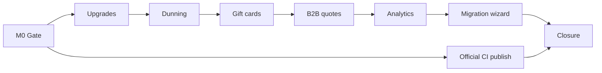
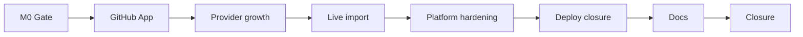

# Phase 11 & 12 — Complete platform plan

**Status:** **Approved (2026-07-07, Keven)** — autonomous execution P11-M0→M7, then P12-M0→M8  
**Baseline:** P10 complete on `main` (2026-07-07) — Birkly **100 test suites** · Marketplace **10 test suites**  
**Roadmap:** `docs/roadmap/ROADMAP.md` § Phase 11 · § Phase 12  
**Handoffs:** `docs/reviews/P11-P12-lead-engineer-handoff.md` (combined single wave) · `docs/reviews/P11-lead-engineer-handoff.md` · `docs/reviews/P12-lead-engineer-handoff.md`

---

## Executive summary

Phases 11 and 12 complete the post-marketplace backlog: **merchant-grade commerce** first (P11), then **ecosystem growth, migration tooling, and production closure** (P12).

| Phase | Theme | Primary repos |
|-------|--------|---------------|
| **P11** | Commerce production wave | Birkly (`plugins/commerce/`) · Birkly-Docs |
| **P12** | Marketplace automation, live import, deploy closure, platform hardening | Birkly-Marketplace · Birkly · kekaba · Birkly-Website |

**Cross-phase rule:** **P11 before P12-M3** (commerce APIs stable). Marketplace P12-M1–M2 may parallel with late P11.

**Execution:** Human approved **single-wave** (2026-07-07) — lead-engineer runs P11-M0→M7 then P12-M0→M8 **without pause**. Notify human **once** at **P12-M8** only. See `docs/reviews/P11-P12-lead-engineer-handoff.md`.

---

## Locked decisions (planner proposal — confirm on approval)

### Phase 11

| ID | Decision |
|----|----------|
| P11-D1 | Subscription **upgrades** v1: plan change on same product; proration = provider-reported or simple credit — no multi-product cart upgrade |
| P11-D2 | **Dunning** via automation plugin triggers (`commerce_subscription_payment_failed`, retry schedule) + optional built-in email templates |
| P11-D3 | **Gift cards** as commerce discount type + redeemable code (not separate fieldtype in v1) |
| P11-D4 | **B2B quotes** v1: order status `quote` → `pending_payment` → `paid`; no complex approval chains |
| P11-D5 | **Analytics** v1: admin dashboard widget + CSV export (revenue, orders, top products, affiliates) — no external BI |
| P11-D6 | Shop/Events migration wizard: **read-only** import from legacy plugin data → Commerce fieldtype entries; does not remove legacy plugins |
| P11-D7 | Official plugin **CI publish on git tag** (GitHub Actions in Birkly repo only; no third-party GitHub App) |
| P11-D8 | **Kekaba deferred** in P11 — deploy closure is P12-M5 |
| P11-D9 | **No separate P11 notification** — single closure at P12-M8 (P11-P12-D-EXEC) |

| P11-P12-D-EXEC | **Single wave** — develop P11 then P12 in one run; one human notification at P12-M8 |

### Phase 12

| ID | Decision |
|----|----------|
| P12-D1 | **Third-party GitHub App** — connect repo → release tag webhook → build zip → QC queue (provider opt-in) |
| P12-D2 | Live import: **Shopify + WooCommerce REST API** v1 (read products; map to Commerce fieldtype); credentials per site in admin |
| P12-D3 | Import = **scheduled sync** + manual “sync now”; no real-time webhooks from Shopify/Woo in v1 |
| P12-D4 | Production deploy: agent delivers **checklists + smoke scripts**; human runs DNS/Stripe/legal on live hosts |
| P12-D5 | Monitoring v1: health endpoint, disk/settings checks, optional email alert hook — no external APM |
| P12-D6 | Plugin **denylist** for spaces/collections in `settings/plugin_permissions.json` |
| P12-D7 | User plugin ↔ commerce: purchase → tier mapping uses existing PostPurchaseRouter; wire membership products in wizard |
| P12-D8 | CMS cloud SSO / connected accounts: **defer to P13** unless human elevates in approval |
| P12-D9 | Paid official plugin tiers: **defer to P13** — remain free in P11–P12 |
| P12-D10 | Notify human **once** at P12-M8 — combined P11+P12 closure |

---

# Phase 11 — Commerce production wave

**Goal:** Real merchants can run subscriptions with upgrades/dunning, gift cards, B2B quotes, analytics, and migrate from legacy Shop/Events plugins.

**Depends on:** P10 complete.



## Milestones

| ID | Focus | Repo |
|----|--------|------|
| **P11-M0** | Commerce gap register, verification matrix, subscription/quote model notes | Birkly |
| **P11-M1** | Subscription upgrades + plan change API | Birkly |
| **P11-M2** | Dunning — failed payment detection, automation triggers, email templates | Birkly |
| **P11-M3** | Gift cards / store credit — issue, redeem, balance, checkout apply | Birkly |
| **P11-M4** | B2B quotes — quote order flow, admin approve, convert to checkout | Birkly |
| **P11-M5** | Commerce analytics — dashboard widget, reports, CSV export | Birkly |
| **P11-M6** | Shop/Events → Commerce migration wizard | Birkly |
| **P11-M6b** | Official plugin CI publish on tag (GitHub Actions → marketplace registry) | Birkly + Marketplace |
| **P11-M7** | Docs, matrix, closure | Birkly + Birkly-Docs |

**Branches:** `cursor/p11-m[N]-<slug>-030a`

---

### P11-M0 — Planning gate

- [ ] **P11-M0-T1** `docs/reviews/P11-commerce-gap-register.md` — subscription upgrade edges, gift card rules, quote states
- [ ] **P11-M0-T2** `docs/reviews/P11-verification-matrix.md` shell
- [ ] **P11-M0-T3** Extend `docs/reviews/P6-commerce-scenarios-and-model.md` for P11 entities

### P11-M1 — Subscription upgrades

- [ ] **P11-M1-T1** `SubscriptionUpgradeService` — change `purchase_option` on active subscription record
- [ ] **P11-M1-T2** Provider shelf call for proration / plan change (Stripe subscription update)
- [ ] **P11-M1-T3** Admin UI: subscription detail → upgrade/downgrade picker
- [ ] **P11-M1-T4** `tests/commerce_subscription_upgrade_test.php`

**Acceptance:** Admin upgrades recurring yoga monthly → annual; status and next billing date update; provider webhook handled.

### P11-M2 — Dunning

- [ ] **P11-M2-T1** Webhook handler: `invoice.payment_failed` → subscription `past_due` + dunning record
- [ ] **P11-M2-T2** Automation triggers: `commerce_subscription_payment_failed`, `commerce_subscription_recovered`
- [ ] **P11-M2-T3** Built-in email templates (optional toggle) via automation or commerce notification helper
- [ ] **P11-M2-T4** Admin: dunning status on subscription list; manual retry action
- [ ] **P11-M2-T5** `tests/commerce_dunning_test.php`

**Acceptance:** Failed payment fires automation; recovery clears dunning state.

### P11-M3 — Gift cards / store credit

- [ ] **P11-M3-T1** `GiftCard` store — code generation, balance, expiry, partial redeem
- [ ] **P11-M3-T2** DiscountEngine integration — apply gift card as tender in checkout
- [ ] **P11-M3-T3** Admin: issue gift card, view balance, void
- [ ] **P11-M3-T4** Template function `commerce_gift_card_balance` (optional)
- [ ] **P11-M3-T5** `tests/commerce_gift_card_test.php`

**Acceptance:** Issue $50 card → checkout applies $30 → remaining $20 balance persisted.

### P11-M4 — B2B quotes

- [ ] **P11-M4-T1** Order status workflow: `quote` → `quote_sent` → `quote_accepted` → `pending_payment` → `paid`
- [ ] **P11-M4-T2** Admin: create quote from cart, set custom line prices, send quote link/email hook
- [ ] **P11-M4-T3** Public quote accept page (tokenized URL)
- [ ] **P11-M4-T4** `tests/commerce_quote_test.php`

**Acceptance:** Admin creates quote → customer accepts → pays via normal checkout shelf.

### P11-M5 — Commerce analytics

- [ ] **P11-M5-T1** Aggregate queries: revenue by period, order count, AOV, top entries, affiliate attribution
- [ ] **P11-M5-T2** Commerce admin tab: charts/tables (vanilla JS + CSS; no chart library dependency)
- [ ] **P11-M5-T3** CSV export for orders and revenue summary
- [ ] **P11-M5-T4** Dashboard plugin widget (opt-in, role-gated)
- [ ] **P11-M5-T5** `tests/commerce_analytics_test.php`

**Acceptance:** Widget shows last-30-day revenue; export downloads valid CSV.

### P11-M6 — Shop/Events migration wizard

- [ ] **P11-M6-T1** Detect legacy `shopping_cart` / `events` plugin data dirs
- [ ] **P11-M6-T2** Wizard UI in Commerce admin: preview mapping → import products/events as Commerce entries
- [ ] **P11-M6-T3** Idempotent import (skip existing slugs); rollback log
- [ ] **P11-M6-T4** `tests/commerce_migration_wizard_test.php`

**Acceptance:** Fixture legacy cart products → Commerce catalog entries with fieldtype values.

### P11-M6b — Official plugin CI publish

- [ ] **P11-M6b-T1** GitHub Actions workflow: on tag `plugin/*` or manual dispatch → `build-all-official-plugin-zips.sh` → upload to marketplace registry API
- [ ] **P11-M6b-T2** Document release process in `plugins/README.md` + Birkly-Docs
- [ ] **P11-M6b-T3** Smoke: tag triggers release row in registry (staging marketplace)

**Acceptance:** Tag `plugin/commerce/v1.2.0` publishes new release without manual zip upload.

### P11-M7 — Docs & closure

- [ ] **P11-M7-T1** Birkly-Docs: subscriptions, dunning, gift cards, quotes, analytics, migration
- [ ] **P11-M7-T2** AI context pack + plugin docs shelf updates
- [ ] **P11-M7-T3** Full P11 verification matrix green
- [ ] **P11-M7-T4** Roadmap § Phase 11 → complete
- [ ] **P11-M7-T5** **Notify human once**

---

## P11 success criteria

1. Subscription upgrade changes plan without new subscription row explosion.
2. Dunning automation triggers on failed payment; admin sees status.
3. Gift cards issue, redeem partially, and expire per rules.
4. B2B quote converts to paid order.
5. Analytics widget + CSV export work on demo data.
6. Migration wizard imports legacy Shop/Events fixture data.
7. Official plugin tag publish updates marketplace registry.
8. `php tests/run.php` green; P11 matrix complete.

---

## P11 out of scope

- Live Shopify/Woo API (P12)
- Third-party GitHub App (P12)
- kekaba production deploy (P12)
- Plugin denylist (P12)
- Multi-currency, warehouse inventory, marketplace paid tiers

---

# Phase 12 — Ecosystem growth, live import & production closure

**Goal:** Automate provider releases, import from external shops, close alpha deploy loop, harden plugin security and membership wiring.

**Depends on:** P11 complete.



## Milestones

| ID | Focus | Repo |
|----|--------|------|
| **P12-M0** | Gap register, import threat model, verification matrix | Birkly + Marketplace |
| **P12-M1** | Third-party GitHub App — repo connect, release webhook, QC enqueue | Marketplace |
| **P12-M2** | Marketplace provider growth — webhooks, payout dashboard, fee config | Marketplace |
| **P12-M3** | Live Shopify + WooCommerce API import | Birkly |
| **P12-M4** | Platform hardening — plugin denylist, user↔commerce membership wizard | Birkly |
| **P12-M5** | Production deploy closure — kekaba, marketplace prod smoke, monitoring | All |
| **P12-M6** | Birkly-Website production surface + legal refresh | Birkly-Website |
| **P12-M7** | Birkly-Docs full P11+P12 corpus sync | Birkly-Docs |
| **P12-M8** | Verification matrix, closure, human notification | All |

**Branches:** `cursor/p12-m[N]-<slug>-030a`

---

### P12-M0 — Planning gate

- [ ] **P12-M0-T1** `docs/reviews/P12-gap-register.md`
- [ ] **P12-M0-T2** `docs/reviews/P12-import-threat-model.md` — credential storage, SSRF, rate limits
- [ ] **P12-M0-T3** `docs/reviews/P12-verification-matrix.md` shell

### P12-M1 — Third-party GitHub App

- [ ] **P12-M1-T1** GitHub App registration docs + webhook endpoint `api/v1/github/release`
- [ ] **P12-M1-T2** Provider dashboard: connect repo, select tag pattern, map to offer slug
- [ ] **P12-M1-T3** Webhook: verify signature → download release asset or build from tag archive → `marketplace_qc_enqueue_offer`
- [ ] **P12-M1-T4** `tests/github_release_webhook_test.php`

**Acceptance:** Simulated release webhook enqueues QC item with artifact; admin approves → catalog updated.

### P12-M2 — Marketplace provider growth

- [ ] **P12-M2-T1** Provider webhooks (optional URL): `sale`, `refund`, `qc_result`, `payout`
- [ ] **P12-M2-T2** Provider dashboard: sales chart, payout history (Stripe Connect API read)
- [ ] **P12-M2-T3** Admin-configurable application fee tiers per provider (override default %)
- [ ] **P12-M2-T4** Buyer “report listing” → admin moderation queue
- [ ] **P12-M2-T5** `tests/provider_growth_test.php`

**Acceptance:** Provider sees last-30-day sales; admin sets custom fee for one provider.

### P12-M3 — Live Shopify + WooCommerce import

- [ ] **P12-M3-T1** Credential store in Commerce admin (encrypted); Shopify custom app + Woo REST keys
- [ ] **P12-M3-T2** `ShopifyImportAdapter` + `WooImportAdapter` — paginated product fetch
- [ ] **P12-M3-T3** Map external product → Commerce fieldtype entry (title, SKU, price, images URL ingest optional)
- [ ] **P12-M3-T4** Sync UI: connect → preview → import → schedule (cron token)
- [ ] **P12-M3-T5** `tests/commerce_live_import_test.php` (mock HTTP)

**Acceptance:** Mock Shopify API returns 10 products → 10 catalog entries created/updated.

### P12-M4 — Platform hardening

- [ ] **P12-M4-T1** Plugin denylist UI in Settings → Plugins → Security (`deny_collections`, `deny_spaces` stub)
- [ ] **P12-M4-T2** Enforce denylist on hooks, UI injections, service calls (check first per architecture plan)
- [ ] **P12-M4-T3** User plugin membership wizard: link Commerce `purchase_option` → user tier mapping
- [ ] **P12-M4-T4** PostPurchaseRouter: `register` fulfillment auto-assigns tier on `user_management` active
- [ ] **P12-M4-T5** `tests/plugin_denylist_test.php` · `tests/membership_commerce_test.php`

**Acceptance:** Denylisted collection blocks plugin write hook; membership purchase upgrades site user tier.

### P12-M5 — Production deploy closure

- [ ] **P12-M5-T1** `docs/reviews/P12-production-deploy-checklist.md` — marketplace + CMS + kekaba
- [ ] **P12-M5-T2** `scripts/production-smoke.sh` — health, admin login, registry, CMS marketplace tab
- [ ] **P12-M5-T3** CMS monitoring: `api/health.php` extended checks (writable dirs, plugin state, marketplace reachability)
- [ ] **P12-M5-T4** kekaba: production deploy doc + `check-production.sh` update for marketplace-installed plugins
- [ ] **P12-M5-T5** Human checklist items clearly marked (Stripe live, DNS, legal)

**Acceptance:** Smoke script exits 0 on staging; human checklist documented for prod.

### P12-M6 — Birkly-Website production

- [ ] **P12-M6-T1** Production deploy `DEV.md` / hosting notes
- [ ] **P12-M6-T2** Beta/legal copy refresh for marketplace + commerce features
- [ ] **P12-M6-T3** Featured plugins section pulls from marketplace registry (or static fallback)

### P12-M7 — Documentation

- [ ] **P12-M7-T1** Birkly-Docs: live import, GitHub publish, denylist, membership commerce
- [ ] **P12-M7-T2** Marketplace provider guide: GitHub connect, webhooks
- [ ] **P12-M7-T3** Help manifest + AI context pack updates

### P12-M8 — Closure

- [ ] **P12-M8-T1** Full P12 verification matrix green
- [ ] **P12-M8-T2** Combined P11+P12 examples index
- [ ] **P12-M8-T3** Roadmap § Phase 12 → complete
- [ ] **P12-M8-T4** **Notify human once** with deploy checklist + video index

---

## P12 success criteria

1. Third-party provider connects GitHub; release triggers QC pipeline.
2. Shopify/Woo live import creates Commerce entries from API (mocked CI + manual QA).
3. Plugin denylist blocks access to protected collections.
4. Membership product purchase assigns user tier.
5. Production smoke script + deploy checklists delivered.
6. Birkly-Docs and Website updated.
7. Birkly + Marketplace test suites green.

---

## P12 out of scope (P13+ backlog)

| Item | Notes |
|------|-------|
| CMS cloud SSO | P12-D8 defer |
| Paid official marketplace tiers | P12-D9 defer |
| Real-time Shopify/Woo inventory webhooks | Use scheduled sync only |
| Multi-store / multi-currency | Commerce backlog |
| Full APM / Sentry integration | Monitoring v1 only |
| NPM docs package | No consumer |

---

# Cross-phase ordering

```
P10 (complete)
  └── P11-M0→M7 (commerce) — CMS first
        └── P12-M0→M8 (ecosystem + deploy)
```

| Dependency | Reason |
|------------|--------|
| P11 before P12-M3 | Live import maps to Commerce fieldtype — stable after P11 |
| P11-M6b before P12-M1 | Official CI publish patterns inform GitHub App |
| P12-M5 last | Deploy closure assumes feature-complete platform |

---

# Verification artifacts

| Phase | Matrix |
|-------|--------|
| P11 | `docs/reviews/P11-verification-matrix.md` |
| P12 | `docs/reviews/P12-verification-matrix.md` |

---

# Values alignment

| Value | P11 | P12 |
|-------|-----|-----|
| Dependency-free core | Analytics uses vanilla JS; no chart npm | GitHub App is marketplace-only |
| Self-contained plugins | All commerce features in `plugins/commerce/` | Denylist in core settings contract |
| Security by default | Quote tokens signed; gift cards rate-limited | Import credentials encrypted; denylist checked first |
| UI decoupling | Admin templates + API for all new commerce UI | Marketplace admin extends existing shell |
