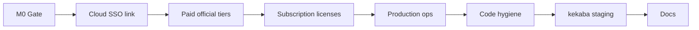
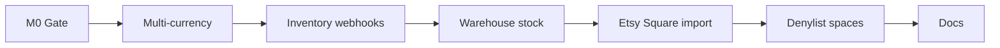
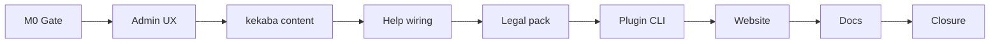

# Phase 13, 14 & 15 — Complete platform plan

**Status:** **Approved (2026-07-07, Keven)** — autonomous execution P13-M0→M7, then P14-M0→M7, then P15-M0→M8  
**Baseline:** P11+P12 complete on `main` (2026-07-07) — Birkly **110 test suites** · Marketplace **12 test suites**  
**Roadmap:** `docs/roadmap/ROADMAP.md` § Phase 13 · § Phase 14 · § Phase 15  
**Handoff:** `docs/reviews/P13-P15-lead-engineer-handoff.md` (combined single wave)

---

## Executive summary

Phases 13–15 close the alpha platform: **monetization and production hardening** (P13), **commerce scale and import depth** (P14), then **UX polish and alpha closure** (P15).

| Phase | Theme | Primary repos |
|-------|--------|---------------|
| **P13** | Platform accounts, marketplace monetization, production ops | Birkly · Birkly-Marketplace · kekaba |
| **P14** | Commerce scale — multi-currency, webhooks, warehouse, import adapters | Birkly (`plugins/commerce/`) |
| **P15** | Alpha closure — admin UX, Help wiring, legal, scaffolding CLI, website | Birkly · kekaba · Birkly-Docs · Birkly-Website |

**Cross-phase rule:** **P13 before P14-M2** (webhook endpoints need hardened health/ops). **P14 before P15-M2** (kekaba content may reference multi-currency commerce demos).

**Execution:** Human approved **single-wave** (2026-07-07) — lead-engineer runs P13-M0→M7, P14-M0→M7, P15-M0→M8 **without pause**. Notify human **once** at **P15-M8** only.

---

## Locked decisions

### Phase 13

| ID | Decision |
|----|----------|
| P13-D1 | **CMS cloud SSO** = optional **link** to Birkly cloud account; **local CMS accounts remain primary** (P9-D1 unchanged) |
| P13-D2 | **Paid official plugin tiers** — per-plugin pricing in marketplace manifest; human sets amounts later; agent ships plumbing + admin UI |
| P13-D3 | **Subscription marketplace licenses** — Stripe Billing via marketplace checkout; CMS validates active subscription on update checks |
| P13-D4 | **Code hygiene** — critical TODO/debug cleanup only; no broad refactors |
| P13-D5 | Production ops v2: health alert hook (email/webhook URL in settings), smoke script hardening, digest path for ops failures |
| P13-D6 | Agent delivers kekaba **staging** smoke + checklist updates; human runs live deploy |
| P13-D7 | **No separate P13 notification** — rolled into P15-M8 (P13-P15-D-EXEC) |

### Phase 14

| ID | Decision |
|----|----------|
| P14-D1 | **Multi-currency** v1 — site default + per–purchase-option currency; checkout shelf passes currency to provider; no FX conversion engine |
| P14-D2 | **Shopify/Woo inventory webhooks** — real-time stock sync on top of P12 scheduled import; HMAC verification required |
| P14-D3 | **Warehouse/stock v1** — single warehouse, SKU-level `quantity_on_hand`; decrement on paid order; no multi-warehouse routing |
| P14-D4 | **Etsy + Square API** import adapters — live API v1 (paginated fetch); CSV presets remain for fallback |
| P14-D5 | **Plugin denylist `deny_spaces`** — enforce on space-scoped hooks (stub from P12-M4 becomes functional) |
| P14-D6 | **No separate P14 notification** — P15-M8 only |

### Phase 15

| ID | Decision |
|----|----------|
| P15-D1 | **Admin dark mode** — finish theme toggle UI (light/dark/system), audit CSS variables; responsive pass on top 10 admin flows |
| P15-D2 | **kekaba content expansion** — 2–3 new collections/pages (blog, case studies, shop demo); baked static HTML |
| P15-D3 | **CMS Help → Birkly-Docs** — live manifest fetch with offline fallback; no npm in CMS |
| P15-D4 | **Closed-alpha legal pack** — terms, privacy, feedback widget polish; marketplace + website copy sync |
| P15-D5 | **Plugin scaffolding CLI** — `php scripts/scaffold-plugin.php` (minimal + privileged checklist output) |
| P15-D6 | **Birkly-Website production surface** — deploy notes, marketplace CTA, alpha signup flow |
| P15-D7 | Notify human **once** at P15-M8 — combined P13+P14+P15 closure |

| P13-P15-D-EXEC | **Single wave** — develop P13 then P14 then P15 in one run; one human notification at P15-M8 |

---

# Phase 13 — Platform accounts, monetization & production hardening

**Goal:** Optional cloud account link, paid official plugins, subscription marketplace licenses, production ops v2, kekaba staging readiness.

**Depends on:** P11+P12 complete.



## Milestones

| ID | Focus | Repo |
|----|--------|------|
| **P13-M0** | Gap register, SSO threat model, verification matrix | Birkly + Marketplace |
| **P13-M1** | CMS cloud SSO — optional account link, token exchange, unlink | Birkly |
| **P13-M2** | Paid official marketplace tiers — manifest, checkout, CMS install gate | Marketplace + Birkly |
| **P13-M3** | Subscription marketplace licenses — Stripe Billing, renewals, revoke | Marketplace + Birkly |
| **P13-M4** | Production ops v2 — health alerts, smoke hardening, ops digest | Birkly + Marketplace |
| **P13-M5** | Critical TODO/debug cleanup | Birkly |
| **P13-M6** | kekaba staging smoke + deploy checklist assist | kekaba + Birkly |
| **P13-M7** | Docs (no human notification) | Birkly-Docs |

**Branches:** `cursor/p13-m[N]-<slug>-030a`

---

### P13-M0 — Planning gate

- [ ] **P13-M0-T1** `docs/reviews/P13-platform-gap-register.md` — SSO, paid tiers, subscription license flows
- [ ] **P13-M0-T2** `docs/reviews/P13-sso-threat-model.md` — token storage, CSRF, local-account bypass
- [ ] **P13-M0-T3** `docs/reviews/P13-verification-matrix.md` shell

### P13-M1 — CMS cloud SSO (optional link)

- [ ] **P13-M1-T1** `core/cloud_account.php` — link state, token refresh, unlink; **no replacement of local login**
- [ ] **P13-M1-T2** Settings → Account: “Link Birkly cloud account” + status badge
- [ ] **P13-M1-T3** OAuth-style callback endpoint `api/cloud_account.php` (authorization code or device flow stub with mock in tests)
- [ ] **P13-M1-T4** Marketplace client: optional `installation_owner_email` sync when linked
- [ ] **P13-M1-T5** `tests/cloud_account_link_test.php`

**Acceptance:** Admin links cloud account → marketplace tab shows linked email; unlink restores local-only; local login always works without link.

### P13-M2 — Paid official marketplace tiers

- [ ] **P13-M2-T1** Official offer manifests: `pricing.model` = `one_time` with `amount_cents` > 0 for selected plugins (placeholder amounts; human adjusts)
- [ ] **P13-M2-T2** Marketplace checkout: paid official path (guest email + Stripe); license issuance unchanged
- [ ] **P13-M2-T3** CMS: paid official install requires license key or one-click claim after purchase token
- [ ] **P13-M2-T4** Admin marketplace tab: price badge, “Purchase” CTA for paid official
- [ ] **P13-M2-T5** `tests/marketplace_paid_official_test.php` (Marketplace + Birkly)

**Acceptance:** Paid official plugin cannot install without valid license; free official still one-click.

### P13-M3 — Subscription marketplace licenses

- [ ] **P13-M3-T1** Marketplace: Stripe Subscription checkout for `pricing.model` = `subscription`
- [ ] **P13-M3-T2** Webhooks: `customer.subscription.updated/deleted` → license `active`/`revoked`
- [ ] **P13-M3-T3** CMS update check: subscription lapsed → block update + admin warning
- [ ] **P13-M3-T4** Buyer portal: “My subscriptions” (email token or optional marketplace login)
- [ ] **P13-M3-T5** `tests/marketplace_subscription_license_test.php`

**Acceptance:** Monthly subscription purchase → license active; simulated cancellation → update blocked.

### P13-M4 — Production ops v2

- [ ] **P13-M4-T1** Settings → Monitoring: alert email + optional webhook URL on health `error`
- [ ] **P13-M4-T2** `api/health.php` — structured checks catalog; `scripts/production-smoke.sh` validates all required keys
- [ ] **P13-M4-T3** Marketplace `/health` parity + smoke script update
- [ ] **P13-M4-T4** Ops digest section in `scripts/send-agent-digest.php` when smoke fails (staging cron)
- [ ] **P13-M4-T5** `tests/health_alert_test.php`

**Acceptance:** Simulated writable-dir failure → health `error` → alert hook invoked (mock).

### P13-M5 — Code hygiene

- [ ] **P13-M5-T1** Audit `grep -r TODO\|FIXME\|console.log` in `admin/`, `core/`, `api/` — fix **critical** only (security, broken flows)
- [ ] **P13-M5-T2** Remove stray `console.log` from production admin JS (e.g. `theme.js`)
- [ ] **P13-M5-T3** Document remaining non-critical TODOs in `docs/reviews/P13-deferred-todos.md`

**Acceptance:** No `console.log` in shipped admin bundles; critical security TODOs closed.

### P13-M6 — kekaba staging assist

- [ ] **P13-M6-T1** `scripts/staging-smoke-kekaba.sh` — extends production smoke for staging URL
- [ ] **P13-M6-T2** Update `docs/client-sites/kekaba-deploy-checklist.md` — staging section, marketplace plugin order
- [ ] **P13-M6-T3** kekaba: verify `check-production.sh` covers new commerce routes post-P11

**Acceptance:** Staging smoke script exits 0 against documented staging fixture URLs.

### P13-M7 — Docs

- [ ] **P13-M7-T1** Birkly-Docs: cloud account link, paid official plugins, subscription licenses
- [ ] **P13-M7-T2** Marketplace provider guide: subscription pricing in manifest
- [ ] **P13-M7-T3** P13 verification matrix green (finalize in P15-M7)

---

## P13 success criteria

1. Optional cloud account link/unlink without breaking local login.
2. Paid official plugin requires license; free official unchanged.
3. Subscription marketplace license renews/revokes via Stripe webhooks.
4. Health alert hook fires on degraded health.
5. Staging smoke + kekaba checklist updated.
6. Birkly + Marketplace test suites green.

---

## P13 out of scope

- Replacing local CMS accounts with cloud-only auth
- Multi-currency (P14)
- Real-time import webhooks (P14)
- Admin dark mode full pass (P15)
- Live kekaba production deploy (human)

---

# Phase 14 — Commerce scale & import depth

**Goal:** Multi-currency checkout, real-time inventory webhooks, warehouse stock, Etsy/Square live import, denylist spaces enforcement.

**Depends on:** P13-M4 (ops baseline for webhooks).



## Milestones

| ID | Focus | Repo |
|----|--------|------|
| **P14-M0** | Commerce scale gap register, webhook threat model | Birkly |
| **P14-M1** | Multi-currency checkout | Birkly |
| **P14-M2** | Shopify/Woo inventory webhooks | Birkly |
| **P14-M3** | Warehouse/stock v1 | Birkly |
| **P14-M4** | Etsy + Square API import adapters | Birkly |
| **P14-M5** | Plugin denylist `deny_spaces` enforcement | Birkly |
| **P14-M6** | Docs | Birkly-Docs |
| **P14-M7** | Matrix green (no notification) | Birkly |

**Branches:** `cursor/p14-m[N]-<slug>-030a`

---

### P14-M0 — Planning gate

- [ ] **P14-M0-T1** `docs/reviews/P14-commerce-scale-gap-register.md`
- [ ] **P14-M0-T2** `docs/reviews/P14-webhook-threat-model.md` — HMAC, replay, IP allowlist optional
- [ ] **P14-M0-T3** `docs/reviews/P14-verification-matrix.md` shell

### P14-M1 — Multi-currency checkout

- [ ] **P14-M1-T1** Site setting `commerce_default_currency` + per–purchase-option override
- [ ] **P14-M1-T2** Checkout shelf passes currency to all providers; order records store currency
- [ ] **P14-M1-T3** Analytics/gift cards/quotes respect order currency (no cross-currency math)
- [ ] **P14-M1-T4** Admin UI: currency selector on purchase options
- [ ] **P14-M1-T5** `tests/commerce_multi_currency_test.php`

**Acceptance:** EUR and USD purchase options checkout independently; analytics CSV shows correct currency column.

### P14-M2 — Shopify/Woo inventory webhooks

- [ ] **P14-M2-T1** Webhook endpoints `api/commerce_webhooks.php` — Shopify `inventory_levels/update`, Woo `product.updated`
- [ ] **P14-M2-T2** HMAC/signature verification per platform
- [ ] **P14-M2-T3** Map external SKU → Commerce entry `quantity_available` (or warehouse row after M3)
- [ ] **P14-M2-T4** Admin: webhook registration helper + secret rotation UI
- [ ] **P14-M2-T5** `tests/commerce_inventory_webhook_test.php`

**Acceptance:** Mock webhook payload updates stock count without full scheduled sync.

### P14-M3 — Warehouse/stock v1

- [ ] **P14-M3-T1** `WarehouseStockStore` — SKU, `quantity_on_hand`, low-stock threshold
- [ ] **P14-M3-T2** Decrement on `order.paid`; restore on full refund
- [ ] **P14-M3-T3** Commerce admin: stock tab per product; bulk CSV import optional
- [ ] **P14-M3-T4** Checkout: block or warn when `quantity_on_hand` < cart qty
- [ ] **P14-M3-T5** `tests/commerce_warehouse_stock_test.php`

**Acceptance:** Paid order decrements stock; refund restores; out-of-stock blocks checkout.

### P14-M4 — Etsy + Square API import

- [ ] **P14-M4-T1** `EtsyImportAdapter` — OAuth/token + listings API (mocked in CI)
- [ ] **P14-M4-T2** `SquareImportAdapter` — Catalog API paginated fetch
- [ ] **P14-M4-T3** Reuse `CommerceLiveImportService` scheduling from P12
- [ ] **P14-M4-T4** Admin platform cards for Etsy + Square live connect
- [ ] **P14-M4-T5** `tests/commerce_etsy_square_import_test.php`

**Acceptance:** Mock APIs return products → Commerce entries created/updated.

### P14-M5 — Plugin denylist spaces

- [ ] **P14-M5-T1** Settings UI: manage `deny_spaces` (alongside collections)
- [ ] **P14-M5-T2** Enforce on space-scoped plugin hooks and admin injections
- [ ] **P14-M5-T3** `tests/plugin_denylist_spaces_test.php`

**Acceptance:** Denylisted space blocks plugin sidebar panel for that space.

### P14-M6 — Docs

- [ ] **P14-M6-T1** Birkly-Docs: multi-currency, webhooks, warehouse, Etsy/Square live import
- [ ] **P14-M6-T2** Extend `P12-import-threat-model.md` cross-reference for webhooks

### P14-M7 — Matrix

- [ ] **P14-M7-T1** Full P14 verification matrix green

---

## P14 success criteria

1. Multi-currency orders checkout and report in correct currency.
2. Inventory webhooks update stock in near real time.
3. Warehouse stock decrements/restores on pay/refund.
4. Etsy/Square live import works with mocked HTTP.
5. Denylist spaces enforced.
6. Commerce test suites green.

---

## P14 out of scope

- FX conversion / display currency ≠ charge currency
- Multi-warehouse routing
- Amazon/eBay import
- Full APM (Sentry)

---

# Phase 15 — Alpha closure & UX

**Goal:** Admin UX polish, kekaba content, Help wiring, legal pack, plugin CLI, website production surface, combined closure.

**Depends on:** P14 complete (commerce demos stable).



## Milestones

| ID | Focus | Repo |
|----|--------|------|
| **P15-M0** | Alpha closure gap register, UX audit | Birkly |
| **P15-M1** | Admin dark mode + responsive pass | Birkly |
| **P15-M2** | kekaba content expansion | kekaba |
| **P15-M3** | CMS Help → live Birkly-Docs | Birkly + Birkly-Docs |
| **P15-M4** | Closed-alpha legal + feedback polish | Birkly + Birkly-Website |
| **P15-M5** | Plugin scaffolding CLI | Birkly |
| **P15-M6** | Birkly-Website production surface | Birkly-Website |
| **P15-M7** | Full P13–P15 docs sync | Birkly-Docs |
| **P15-M8** | Combined verification, closure, **human notification** | All |

**Branches:** `cursor/p15-m[N]-<slug>-030a`

---

### P15-M0 — Planning gate

- [ ] **P15-M0-T1** `docs/reviews/P15-alpha-closure-gap-register.md`
- [ ] **P15-M0-T2** `docs/reviews/P15-admin-ux-audit.md` — top 10 flows for responsive/dark pass
- [ ] **P15-M0-T3** `docs/reviews/P15-verification-matrix.md` shell

### P15-M1 — Admin dark mode + responsive

- [ ] **P15-M1-T1** Theme toggle in admin shell (light / dark / system) — wire existing `Birkly.Theme`
- [ ] **P15-M1-T2** CSS audit: Commerce, Settings, Marketplace, ContentEditor side panels in dark mode
- [ ] **P15-M1-T3** Responsive pass: dashboard, entry list, commerce admin, settings (breakpoint 768px)
- [ ] **P15-M1-T4** design-reviewer sign-off on screenshots

**Acceptance:** Theme persists; no illegible contrast in dark mode on audited screens; mobile layout usable for top flows.

### P15-M2 — kekaba content expansion

- [ ] **P15-M2-T1** New collection(s): e.g. `blog-posts`, `case-studies` (or extend existing)
- [ ] **P15-M2-T2** 2–3 new public pages/templates wired to collections
- [ ] **P15-M2-T3** `php scripts/bake-static-html.php` + update `site-summary.txt`
- [ ] **P15-M2-T4** `check-production.sh` includes new routes

**Acceptance:** New pages render on local static server; baked HTML in `publish/`.

### P15-M3 — CMS Help → Birkly-Docs

- [ ] **P15-M3-T1** `settings/help_manifest.json` — versioned doc paths + public Birkly-Docs base URL
- [ ] **P15-M3-T2** Help panel fetches manifest topics live; offline fallback to bundled stub
- [ ] **P15-M3-T3** Birkly-Docs: publish manifest endpoint or static JSON in repo root for CMS fetch
- [ ] **P15-M3-T4** `tests/help_docs_wiring_test.php`

**Acceptance:** Help topic opens correct Birkly-Docs page; offline mode shows cached stub.

### P15-M4 — Closed-alpha legal + feedback

- [ ] **P15-M4-T1** Legal templates: alpha terms, privacy (marketplace + CMS admin footer links)
- [ ] **P15-M4-T2** Feedback widget polish — category, optional screenshot note, rate limit
- [ ] **P15-M4-T3** Birkly-Website legal pages sync

**Acceptance:** Footer links resolve; feedback submission stored and visible in admin.

### P15-M5 — Plugin scaffolding CLI

- [ ] **P15-M5-T1** `scripts/scaffold-plugin.php --id=my-plugin --title="My Plugin"`
- [ ] **P15-M5-T2** Outputs minimal plugin tree per `docs/plugin-system-architecture-plan.md` scaffold section
- [ ] **P15-M5-T3** `--privileged` flag prints capability/denylist checklist
- [ ] **P15-M5-T4** `tests/scaffold_plugin_test.php`

**Acceptance:** Scaffold creates valid `plugin.php` discoverable by bootstrap; test plugin activates.

### P15-M6 — Birkly-Website production

- [ ] **P15-M6-T1** Production deploy notes (`DEV.md` / hosting)
- [ ] **P15-M6-T2** Homepage: alpha signup CTA, marketplace featured plugins (registry or static fallback)
- [ ] **P15-M6-T3** Commerce + cloud account messaging refresh

### P15-M7 — Documentation

- [ ] **P15-M7-T1** Birkly-Docs full P13–P15 corpus sync
- [ ] **P15-M7-T2** AI context pack + Help manifest update
- [ ] **P15-M7-T3** All three verification matrices green

### P15-M8 — Combined closure

- [ ] **P15-M8-T1** `docs/reviews/P13-P15-phase-closure-checklist.md`
- [ ] **P15-M8-T2** Roadmap § Phase 13, 14, 15 → complete
- [ ] **P15-M8-T3** `docs/agent-ops/daily-reports/YYYY-MM-DD-p13-p15-closure.md`
- [ ] **P15-M8-T4** **Notify human once** — digest + deploy checklist + P13–P15 summary

---

## P15 success criteria

1. Admin theme toggle + responsive pass on audited flows.
2. kekaba new content baked and smoke-tested.
3. Help opens live Birkly-Docs with fallback.
4. Legal + feedback polished.
5. Plugin scaffold CLI generates activatable plugin.
6. Birkly-Website production-ready copy.
7. All matrices green; Birkly + Marketplace tests green.

---

## P15 out of scope

- Public self-service marketplace without QC
- NPM package for docs
- Full i18n / localization
- kekaba live production deploy (human checklist)

---

# Cross-phase ordering

```
P11+P12 (complete)
  └── P13-M0→M7 (platform monetization + ops)
        └── P14-M0→M7 (commerce scale)
              └── P15-M0→M8 (alpha closure)
```

| Dependency | Reason |
|------------|--------|
| P13-M4 before P14-M2 | Webhook endpoints need health/alert baseline |
| P13-M2/M3 before P15-M6 | Website copy references paid/subscription plugins |
| P14-M1 before P15-M2 | kekaba shop demos may show multi-currency |
| P14 complete before P15-M8 | Closure assumes feature-complete alpha |

---

# Verification artifacts

| Phase | Matrix |
|-------|--------|
| P13 | `docs/reviews/P13-verification-matrix.md` |
| P14 | `docs/reviews/P14-verification-matrix.md` |
| P15 | `docs/reviews/P15-verification-matrix.md` |

---

# Values alignment

| Value | P13 | P14 | P15 |
|-------|-----|-----|-----|
| Dependency-free core | SSO link is thin client; no npm | Webhooks in PHP only | Help fetch + CSS only |
| Self-contained plugins | Marketplace monetization in Marketplace repo | Commerce features in `plugins/commerce/` | Scaffold outputs plugin folder |
| Security by default | SSO threat model; subscription revoke | Webhook HMAC; encrypted import creds | Legal + feedback rate limits |
| UI decoupling | Account link in settings API | Stock/webhook admin via commerce API | Theme toggle decoupled from business logic |
