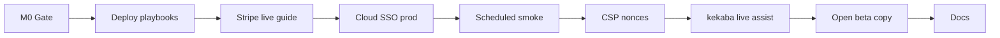
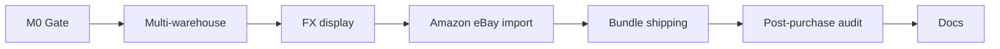
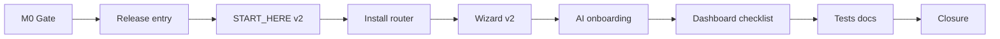

# Phase 16, 17, 18 & 19 — Complete platform plan

**Status:** **Approved (2026-07-07, Keven)** — autonomous execution P16-M0→M8, P17-M0→M7, P18-M0→M8, P19-M0→M8  
**Baseline:** P13–P15 complete on `main` (2026-07-07) — Birkly **121 test suites** · Marketplace **15 test suites**  
**Roadmap:** `docs/roadmap/ROADMAP.md` § Phase 16 · § Phase 17 · § Phase 18 · § Phase 19  
**Handoff:** `docs/reviews/P16-P19-lead-engineer-handoff.md` (combined single wave)

---

## Executive summary

Phases 16–19 move from **alpha closure** to **beta readiness**, **commerce depth**, **ecosystem scale**, and a **world-class first-run onboarding** experience.

| Phase | Theme | Primary repos |
|-------|--------|---------------|
| **P16** | Beta go-live & production operations | Birkly · Birkly-Marketplace · kekaba · Birkly-Website |
| **P17** | Commerce pro & fulfillment depth | Birkly (`plugins/commerce/`) |
| **P18** | Ecosystem scale & developer experience | Birkly · Birkly-Marketplace |
| **P19** | First-run & onboarding excellence | Birkly · Birkly-Docs |

**Cross-phase rule:** **P16 before P17 live merchant QA** (Stripe/deploy). **P19 can parallel late P16** after go-live runbooks exist, but **P19-M5 AI step** needs stable BYOAI settings from current `main`.

**Execution:** Human approved **single-wave** (2026-07-07) — lead-engineer runs P16→P17→P18→P19 **without pause**. Notify human **once** at **P19-M8** only.

---

## Locked decisions

### Phase 16 — Beta go-live

| ID | Decision |
|----|----------|
| P16-D1 | Agents deliver runbooks/scripts/checklists; **human executes** live DNS, Stripe, legal |
| P16-D2 | Open beta = invite/waitlist flow, not unbounded public signup |
| P16-D3 | No Sentry/npm in CMS — email/webhook health alerts only (extend P13-M4) |
| P16-D4 | CSP nonce pass scoped to admin — close `api/validate.php` TODO from P13-deferred-todos |
| P16-D5 | **No separate P16 notification** — P19-M8 only (P16-P19-D-EXEC) |

### Phase 17 — Commerce pro

| ID | Decision |
|----|----------|
| P17-D1 | Multi-warehouse v1 — allocate from first warehouse with stock; no cross-border routing |
| P17-D2 | FX v1 — optional display currency with **manual rate table** in admin; charge currency unchanged |
| P17-D3 | Amazon + eBay import — same adapter pattern as Etsy/Square (mocked CI) |
| P17-D4 | Bundle/shipping polish only — no new offer_type registry rewrite |
| P17-D5 | **No separate P17 notification** |

### Phase 18 — Ecosystem scale

| ID | Decision |
|----|----------|
| P18-D1 | Self-serve provider signup **with QC** — no auto-publish without review |
| P18-D2 | Review helpful votes v1 — simple upvote per verified purchase |
| P18-D3 | Plugin health checks — activation smoke + capability warnings in admin |
| P18-D4 | Theme/template_pack CMS install path — reuse marketplace client |
| P18-D5 | Spaces v1 — config stub + denylist integration; no full multi-tenant UI |
| P18-D6 | i18n foundation — lang key structure + admin string audit; **no full translation** |
| P18-D7 | NPM docs package — **go/no-go doc only**, no publish unless human approves later |
| P18-D8 | **No separate P18 notification** |

### Phase 19 — Onboarding excellence

| ID | Decision |
|----|----------|
| P19-D1 | **First file to open** = `START_HERE.html` (rename from `0_START-HERE.html` for sort order) + `README.md` pointer; ship in release zip |
| P19-D2 | Install paths: **local** (`start-server.sh`) vs **cloud/FTP** — user picks on START_HERE; choice passes to admin onboarding via query param |
| P19-D3 | Admin onboarding wizard v2 — use-case picker, improved progress, resume state, marketplace hint |
| P19-D4 | **AI connection optional in onboarding only** — full inline BYOAI mini-wizard (provider → key → test → role); **never** added to dashboard checklist (P5.6-D locked) |
| P19-D5 | Post-onboarding checklist on dashboard — essential steps only; AI appears only if user skipped onboarding AI step |
| P19-D6 | Notify human **once** at P19-M8 — combined P16–P19 closure |

| P16-P19-D-EXEC | **Single wave** — P16→P17→P18→P19; one human notification at P19-M8 |

---

# Phase 16 — Beta go-live & production operations

**Goal:** Production deploy playbooks, Stripe live config templates, cloud SSO prod wiring docs, scheduled smoke, CSP hardening, open-beta copy.

**Depends on:** P15 complete.



## Milestones

| ID | Focus | Repo |
|----|--------|------|
| **P16-M0** | Go-live gap register, prod secrets threat model | Birkly + Marketplace |
| **P16-M1** | Per-repo production deploy playbooks | All |
| **P16-M2** | Stripe live config guide + env templates | Marketplace + Birkly |
| **P16-M3** | Cloud SSO production endpoint docs + settings | Birkly |
| **P16-M4** | Scheduled smoke wrapper + ops digest cadence | Birkly + Marketplace |
| **P16-M5** | CSP nonce pass (admin) | Birkly |
| **P16-M6** | kekaba live deploy assist + embed sync verify | kekaba + Birkly |
| **P16-M7** | Open-beta website/admin copy | Birkly-Website + Birkly |
| **P16-M8** | Docs (no notification) | Birkly-Docs |

**Branches:** `cursor/p16-m[N]-<slug>-030a`

---

### P16-M0 — Planning gate

- [ ] **P16-M0-T1** `docs/reviews/P16-go-live-gap-register.md`
- [ ] **P16-M0-T2** `docs/reviews/P16-prod-secrets-threat-model.md`
- [ ] **P16-M0-T3** `docs/reviews/P16-verification-matrix.md` shell

### P16-M1 — Deploy playbooks

- [ ] **P16-M1-T1** `docs/reviews/P16-production-deploy-playbook.md` — master index
- [ ] **P16-M1-T2** Marketplace runbook cross-link + smoke checklist merge
- [ ] **P16-M1-T3** Birkly-Website `DEV.md` production section
- [ ] **P16-M1-T4** Human vs agent responsibility matrix per host

**Acceptance:** Human can deploy any repo following playbooks without reading source.

### P16-M2 — Stripe live config

- [ ] **P16-M2-T1** `docs/reviews/P16-stripe-live-config.md` — Connect, paid official prices, subscription price IDs
- [ ] **P16-M2-T2** `.env.example` updates (Marketplace + Birkly marketplace client)
- [ ] **P16-M2-T3** Admin doc: mapping manifest `amount_cents` → Stripe Price objects

**Acceptance:** Checklist covers every env var for live checkout + subscriptions.

### P16-M3 — Cloud SSO production

- [ ] **P16-M3-T1** Document `BIRKLY_CLOUD_OAUTH_*` production values
- [ ] **P16-M3-T2** Settings validation when cloud endpoint unreachable (graceful message)
- [ ] **P16-M3-T3** `tests/cloud_account_link_test.php` — prod URL fixture mode

### P16-M4 — Scheduled smoke

- [ ] **P16-M4-T1** `scripts/scheduled-production-smoke.sh` — cron-friendly, exit codes, log file
- [ ] **P16-M4-T2** Digest includes last smoke result timestamp
- [ ] **P16-M4-T3** Marketplace equivalent script

### P16-M5 — CSP nonce pass

- [ ] **P16-M5-T1** Admin: per-request nonce in layout; script tags use nonce where feasible
- [ ] **P16-M5-T2** Tighten `api/validate.php` CSP recommendations doc
- [ ] **P16-M5-T3** `tests/csp_nonce_test.php` — nonce present on admin shell

### P16-M6 — kekaba live assist

- [ ] **P16-M6-T1** Verify P15-M2 content on kekaba `main`; sync if drift
- [ ] **P16-M6-T2** `docs/client-sites/kekaba-deploy-checklist.md` — live section hardened
- [ ] **P16-M6-T3** Marketplace plugin install order for production shop/events

### P16-M7 — Open beta copy

- [ ] **P16-M7-T1** Birkly-Website: closed alpha → invite beta messaging
- [ ] **P16-M7-T2** Admin login footer / legal links for beta tier
- [ ] **P16-M7-T3** Waitlist CTA wiring (static form or existing collection)

### P16-M8 — Docs

- [ ] **P16-M8-T1** Birkly-Docs: go-live, Stripe live, smoke cron
- [ ] **P16-M8-T2** P16 verification matrix green

---

## P16 success criteria

1. Per-repo deploy playbooks complete.
2. Stripe live checklist documented.
3. Scheduled smoke scripts cron-ready.
4. CSP nonce on admin shell.
5. Open-beta copy live in website templates.

---

## P16 out of scope

- Agents running live DNS/Stripe
- Full Sentry/APM integration
- Public unreviewed marketplace listings

---

# Phase 17 — Commerce pro & fulfillment depth

**Goal:** Multi-warehouse, optional FX display, Amazon/eBay import, bundle/shipping polish, post-purchase orchestration audit.

**Depends on:** P16-M2 (live Stripe docs; dev/staging tests suffice for CI).



## Milestones

| ID | Focus | Repo |
|----|--------|------|
| **P17-M0** | Commerce pro gap register | Birkly |
| **P17-M1** | Multi-warehouse routing v1 | Birkly |
| **P17-M2** | Display currency + manual FX table | Birkly |
| **P17-M3** | Amazon + eBay import adapters | Birkly |
| **P17-M4** | Bundle admin UX + shipping zones v2 | Birkly |
| **P17-M5** | PostPurchase orchestration audit + idempotency tests | Birkly |
| **P17-M6** | Docs | Birkly-Docs |
| **P17-M7** | Matrix green | Birkly |

**Branches:** `cursor/p17-m[N]-<slug>-030a`

---

### P17-M0 — Planning gate

- [ ] **P17-M0-T1** `docs/reviews/P17-commerce-pro-gap-register.md`
- [ ] **P17-M0-T2** `docs/reviews/P17-verification-matrix.md` shell

### P17-M1 — Multi-warehouse

- [ ] **P17-M1-T1** `WarehouseStockStore` — multiple warehouses, SKU per warehouse
- [ ] **P17-M1-T2** Checkout allocates from first warehouse with sufficient qty
- [ ] **P17-M1-T3** Admin: warehouse CRUD, transfer between warehouses (simple)
- [ ] **P17-M1-T4** `tests/commerce_multi_warehouse_test.php`

### P17-M2 — Display currency / FX

- [ ] **P17-M2-T1** Settings: `commerce_display_currency` + manual rates JSON (`EUR:1, USD:1.08`)
- [ ] **P17-M2-T2** Catalog templates: optional `commerce_format_price_display()` with conversion
- [ ] **P17-M2-T3** Checkout still charges purchase-option currency (P17-D2)
- [ ] **P17-M2-T4** `tests/commerce_display_currency_test.php`

### P17-M3 — Amazon + eBay import

- [ ] **P17-M3-T1** `AmazonImportAdapter` + `EbayImportAdapter` (mock HTTP in CI)
- [ ] **P17-M3-T2** Admin platform cards + credential store extensions
- [ ] **P17-M3-T3** `tests/commerce_amazon_ebay_import_test.php`

### P17-M4 — Bundle & shipping polish

- [ ] **P17-M4-T1** Bundle admin: component validation UI, preview pricing
- [ ] **P17-M4-T2** Shipping zones v2: weight tiers, region picker UX
- [ ] **P17-M4-T3** `tests/commerce_bundle_shipping_test.php`

### P17-M5 — Post-purchase audit

- [ ] **P17-M5-T1** Audit `PostPurchaseRouter` / fulfillment handlers for idempotency
- [ ] **P17-M5-T2** Typed automation triggers documented + test coverage gaps closed
- [ ] **P17-M5-T3** `tests/commerce_post_purchase_idempotency_test.php`

### P17-M6 — Docs

- [ ] **P17-M6-T1** Birkly-Docs: multi-warehouse, display currency, Amazon/eBay

### P17-M7 — Matrix

- [ ] **P17-M7-T1** Full P17 verification matrix green

---

## P17 out of scope

- Live FX API feeds
- Tax engine rewrite
- Marketplace-native commerce

---

# Phase 18 — Ecosystem scale & developer experience

**Goal:** Marketplace self-serve with QC, review votes, plugin health, theme install, spaces stub, i18n foundation.

**Depends on:** P16 deploy baseline.

## Milestones

| ID | Focus | Repo |
|----|--------|------|
| **P18-M0** | Ecosystem gap register | Birkly + Marketplace |
| **P18-M1** | Self-serve provider onboarding (QC required) | Marketplace |
| **P18-M2** | Review helpful votes + moderation UX | Marketplace |
| **P18-M3** | Plugin health checks in CMS admin | Birkly |
| **P18-M4** | Theme/template_pack CMS install | Birkly + Marketplace |
| **P18-M5** | Activity stream for sub-entries | Birkly |
| **P18-M6** | Spaces v1 config stub | Birkly |
| **P18-M7** | i18n foundation + NPM docs go/no-go | Birkly + Birkly-Docs |
| **P18-M8** | Docs + matrix | Birkly-Docs |

**Branches:** `cursor/p18-m[N]-<slug>-030a`

---

### P18-M1 — Self-serve providers

- [ ] **P18-M1-T1** Public provider signup flow (email verify → Stripe Connect)
- [ ] **P18-M1-T2** First offer submission → QC queue (no bypass)
- [ ] **P18-M1-T3** `tests/provider_self_serve_test.php`

### P18-M2 — Review enhancements

- [ ] **P18-M2-T1** Helpful vote on verified reviews
- [ ] **P18-M2-T2** Admin moderation queue UX polish
- [ ] **P18-M2-T3** `tests/review_votes_test.php`

### P18-M3 — Plugin health

- [ ] **P18-M3-T1** `PluginHealthService` — activation smoke, missing deps, capability warnings
- [ ] **P18-M3-T2** Plugins admin: health badge per plugin
- [ ] **P18-M3-T3** `tests/plugin_health_test.php`

### P18-M4 — Theme install

- [ ] **P18-M4-T1** CMS marketplace client: `offer_type` theme/template_pack install path
- [ ] **P18-M4-T2** Extract to `themes/` or documented client site path
- [ ] **P18-M4-T3** `tests/marketplace_theme_install_test.php`

### P18-M5 — Activity stream

- [ ] **P18-M5-T1** Sub-entry hooks → `settings/activity_stream.json` append
- [ ] **P18-M5-T2** Admin timeline widget (optional, role-gated)
- [ ] **P18-M5-T3** `tests/activity_stream_test.php`

### P18-M6 — Spaces v1 stub

- [ ] **P18-M6-T1** `settings/spaces.json` — id, label, default collection scope
- [ ] **P18-M6-T2** Denylist + permissions aware of `space_id`
- [ ] **P18-M6-T3** `tests/spaces_stub_test.php`

### P18-M7 — i18n + NPM go/no-go

- [ ] **P18-M7-T1** Document lang key conventions; audit top 20 admin screens
- [ ] **P18-M7-T2** `docs/reviews/P18-npm-docs-go-no-go.md`

### P18-M8 — Docs

- [ ] **P18-M8-T1** Birkly-Docs ecosystem guides
- [ ] **P18-M8-T2** P18 matrix green

---

# Phase 19 — First-run & onboarding excellence

**Goal:** From zip download → correct folder → START_HERE → local or cloud install → advanced admin onboarding with **optional AI setup**.

**Depends on:** P16 runbooks (install paths accurate); BYOAI settings stable on `main`.



## Milestones

| ID | Focus | Repo |
|----|--------|------|
| **P19-M0** | Onboarding gap register + first-run UX audit | Birkly |
| **P19-M1** | Release zip entry point (`START_HERE.html` in manifest) | Birkly |
| **P19-M2** | START_HERE v2 — folder detection, unzip guidance, path picker | Birkly |
| **P19-M3** | Install path router → admin onboarding deep link | Birkly |
| **P19-M4** | Admin onboarding wizard v2 — use-case, resume, marketplace hint | Birkly |
| **P19-M5** | Optional AI mini-wizard in onboarding (BYOAI inline) | Birkly |
| **P19-M6** | Post-onboarding dashboard checklist v2 | Birkly |
| **P19-M7** | E2E tests + Birkly-Docs getting-started overhaul | Birkly + Birkly-Docs |
| **P19-M8** | Combined P16–P19 closure + **human notification** | All |

**Branches:** `cursor/p19-m[N]-<slug>-030a`

---

### P19-M0 — Planning gate

- [ ] **P19-M0-T1** `docs/reviews/P19-onboarding-gap-register.md`
- [ ] **P19-M0-T2** `docs/reviews/P19-first-run-ux-audit.md` — zip extract, wrong-folder, mobile
- [ ] **P19-M0-T3** `docs/reviews/P19-verification-matrix.md` shell

**Audit must cover:** `0_START-HERE.html` not in release zip today; README first-run pointer; onboarding.js flow; P5.6 AI optional rule.

### P19-M1 — Release entry point

- [ ] **P19-M1-T1** Rename `0_START-HERE.html` → `START_HERE.html` (keep redirect from old name)
- [ ] **P19-M1-T2** Add `START_HERE.html`, `start-server.sh`, `README.md` onboarding section to `cms-release-manifest.json`
- [ ] **P19-M1-T3** Root `README.md` — **"Open START_HERE.html first"** above the fold
- [ ] **P19-M1-T4** Optional `START_HERE.txt` — plain-text pointer for users who open zip in Explorer
- [ ] **P19-M1-T5** `tests/release_manifest_test.php` — START_HERE included in release build

**Acceptance:** `build-cms-release.sh` output contains `START_HERE.html` at zip root.

### P19-M2 — START_HERE v2

- [ ] **P19-M2-T1** **"Am I in the right folder?"** checker — detect `admin/`, `start-server.sh`, `server-router.php`
- [ ] **P19-M2-T2** Wrong-folder states: inside `admin/`, parent of project, double-nested unzip (`Birkly/Birkly/`)
- [ ] **P19-M2-T3** OS-specific unzip illustrations (accordion); link to Birkly-Docs
- [ ] **P19-M2-T4** Local path: PHP check via optional `api/setup_probe.php` (read-only, no auth)
- [ ] **P19-M2-T5** Cloud/FTP path: checklist with `.htaccess`, writable dirs, PHP version
- [ ] **P19-M2-T6** design-reviewer pass on START_HERE

**Acceptance:** User in wrong folder sees corrective message, not broken admin link.

### P19-M3 — Install path router

- [ ] **P19-M3-T1** START_HERE "Continue" links: `/admin/index.php?page=onboarding&install=local|cloud`
- [ ] **P19-M3-T2** Onboarding reads `install` param — tailors copy (localhost vs your domain)
- [ ] **P19-M3-T3** Persist `install_path` in `settings/onboarding.json` for checklist context
- [ ] **P19-M3-T4** `tests/onboarding_install_path_test.php`

### P19-M4 — Admin onboarding wizard v2

- [ ] **P19-M4-T1** **Use-case step** — blog, business site, shop, docs, developer (skippable)
- [ ] **P19-M4-T2** Demo content packs map to use-case (reuse existing demo installer)
- [ ] **P19-M4-T3** **Resume state** — partial wizard saved; return URL continues
- [ ] **P19-M4-T4** Marketplace hint step — official plugins, link to Plugins tab (P10)
- [ ] **P19-M4-T5** Progress indicator update for new step order
- [ ] **P19-M4-T6** Extend `tests/onboarding_e2e_test.php` + `onboarding_test.php`

**Proposed step order:** 0 first-user → 1 welcome → 2 install context (local/cloud summary) → 3 site info → 4 use-case + demo → 5 connect AI (optional) → complete

### P19-M5 — Optional AI onboarding (BYOAI inline)

- [ ] **P19-M5-T1** Reuse Settings BYOAI flow components in onboarding step (provider cards)
- [ ] **P19-M5-T2** Steps: pick provider → paste API key → test call → assign role → `require_approval` default **true**
- [ ] **P19-M5-T3** **Skip** and **Set up later** always visible; completion without AI valid
- [ ] **P19-M5-T4** Ollama/local path with link to `docs/ollama-quick-start.md`
- [ ] **P19-M5-T5** On success: create default AI connection; optional first chat teaser
- [ ] **P19-M5-T6** `tests/onboarding_ai_step_test.php`
- [ ] **P19-M5-T7** **Do NOT** add AI to dashboard essential checklist (P5.6-D, P19-D4)

**Acceptance:** Full BYOAI setup completes in onboarding; skip leaves admin usable with no AI connection.

### P19-M6 — Dashboard checklist v2

- [ ] **P19-M6-T1** Checklist items: create collection, add entry, install marketplace plugin (if empty), connect AI **only if skipped in wizard**
- [ ] **P19-M6-T2** Dismiss per item + "Hide checklist" persists
- [ ] **P19-M6-T3** Install path aware hints (local: start-server reminder; cloud: FTP permissions link to START_HERE)
- [ ] **P19-M6-T4** `tests/onboarding_checklist_test.php`

### P19-M7 — Tests & docs

- [ ] **P19-M7-T1** Update `docs/testing-onboarding.md` full checklist
- [ ] **P19-M7-T2** Birkly-Docs `00-overview/getting-started.md` — download → START_HERE → install → onboarding
- [ ] **P19-M7-T3** Help manifest topic for first-run
- [ ] **P19-M7-T4** Video script index entry (optional artifact path)

### P19-M8 — Combined closure

- [ ] **P19-M8-T1** `docs/reviews/P16-P19-phase-closure-checklist.md`
- [ ] **P19-M8-T2** All four verification matrices green
- [ ] **P19-M8-T3** Roadmap § Phase 16–19 → complete
- [ ] **P19-M8-T4** **Notify human once** — digest + go-live checklist + onboarding summary

---

## P19 success criteria

1. Release zip opens to `START_HERE.html` with clear README pointer.
2. Wrong-folder and double-unzip cases handled.
3. Local and cloud paths flow into tailored admin onboarding.
4. Use-case + demo + marketplace hints in wizard v2.
5. Optional AI mini-wizard completes BYOAI setup or skips cleanly.
6. Dashboard checklist essential-only; no forced AI.
7. Onboarding E2E tests green.

---

## P19 out of scope

- Outbound BYOAI OAuth (API keys only)
- AI in dashboard checklist as required step
- Automated hosting provisioning (FTP credentials remain user-owned)
- Full i18n of START_HERE (English v1; structure for later)

---

# Cross-phase ordering

```
P15 (complete)
  └── P16-M0→M8 (go-live ops)
        ├── P17-M0→M7 (commerce pro) — after P16-M2 docs
        ├── P18-M0→M8 (ecosystem) — parallel OK with P17 after P16-M1
        └── P19-M0→M8 (onboarding) — P19-M1–M2 after P16-M1 playbooks; P19-M5 anytime after P16-M0
              └── P19-M8 (single human notification)
```

| Dependency | Reason |
|------------|--------|
| P16-M1 before P19-M2 | FTP/cloud copy must match production playbooks |
| P16-M2 before P17-M1 live QA | Merchant features need Stripe doc |
| P19-M1 before P19-M2 | Release manifest includes START_HERE |
| All matrices before P19-M8 | Combined closure |

**Parallelism:** P17 and P18 can overlap after P16-M2. P19-M4–M6 can parallel P18 if no file conflicts in `admin/js/onboarding.js`.

---

# Verification artifacts

| Phase | Matrix |
|-------|--------|
| P16 | `docs/reviews/P16-verification-matrix.md` |
| P17 | `docs/reviews/P17-verification-matrix.md` |
| P18 | `docs/reviews/P18-verification-matrix.md` |
| P19 | `docs/reviews/P19-verification-matrix.md` |

---

# Values alignment

| Value | P16 | P17 | P18 | P19 |
|-------|-----|-----|-----|-----|
| Dependency-free core | Smoke/CSP in PHP + vanilla JS | Commerce in plugin | Health checks in core contract | START_HERE static HTML |
| Self-contained plugins | — | Commerce only | Marketplace in Marketplace repo | AI step uses existing BYOAI API |
| Security by default | Prod secrets threat model | Import creds encrypted | QC on self-serve | AI approval default true |
| UI decoupling | — | Admin via commerce API | Health badges via API | Wizard steps via onboarding API |
