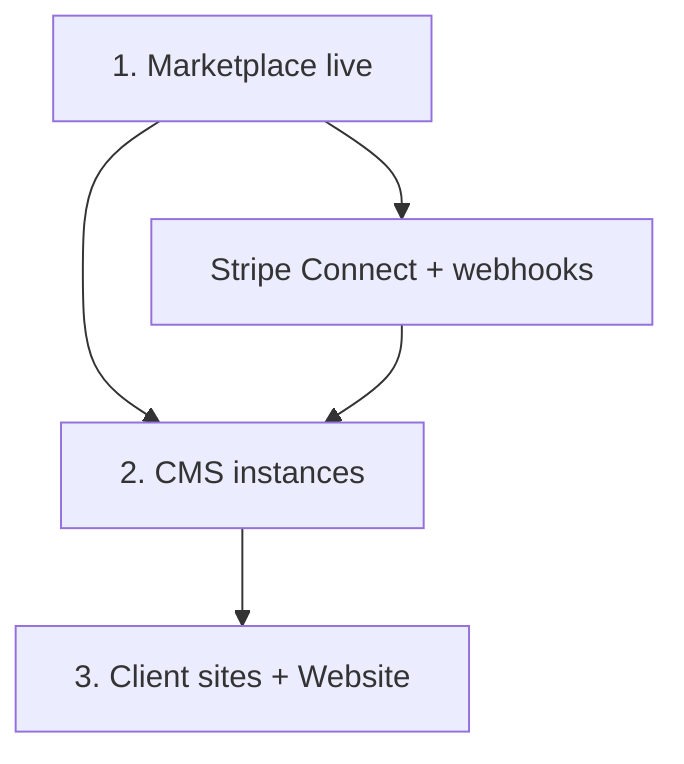

# P16 — Production deploy playbook (master index)

**Date:** 2026-07-07 · **Phase:** P16-M1 beta go-live  
**Threat model:** `docs/reviews/P16-prod-secrets-threat-model.md`  
**Stripe live:** `docs/reviews/P16-stripe-live-config.md`  
**Cloud SSO:** `docs/reviews/P16-cloud-sso-production.md`

Human executes live DNS, TLS, Stripe, and legal steps (P16-D1). Agents deliver runbooks, scripts, and checklists only.

---

## Repos and production surfaces

| Repo | Production host (default) | Runbook |
|------|---------------------------|---------|
| **Birkly** | Per-install CMS (`/admin`, `/api`) | This doc § CMS |
| **Birkly-Marketplace** | `marketplace.birkly.io` | `Birkly-Marketplace/docs/PRODUCTION-RUNBOOK.md` |
| **Birkly-Website** | `birkly.com` (static) + CMS origin | `Birkly-Website/DEV.md` § Production deploy |
| **kekaba** | `service.kekaba.com` (+ embed `Birkly-0.1/`) | `docs/client-sites/kekaba-deploy-checklist.md` |

---

## Human vs agent responsibility matrix

| Step | Birkly CMS | Marketplace | Birkly-Website | kekaba |
|------|------------|-------------|----------------|--------|
| Merge platform fixes to `main` | Agent | Agent | Agent | Agent |
| Write/update deploy docs | Agent | Agent | Agent | Agent |
| DNS / TLS certificates | **Human** | **Human** | **Human** | **Human** |
| Set production secrets (`.env`) | **Human** | **Human** | **Human** (CMS origin) | **Human** |
| Stripe live keys + Connect | — | **Human** | — | **Human** (commerce) |
| FTP / hosting upload | **Human** | **Human** | **Human** | **Human** |
| Embed sync (`sync-client-embed.sh`) | Agent (script) | — | Agent (script) | Agent (script) |
| `production-smoke.sh` / scheduled smoke | Agent (CI/cron) | Agent (CI/cron) | Agent (CI) | Agent (CI) |
| Marketplace plugin install (prod) | **Human** (admin UI) | — | **Human** | **Human** |
| Legal / terms review | **Human** | **Human** | **Human** | **Human** |
| Open-beta waitlist moderation | **Human** | — | **Human** | — |

---

## Deploy order (ecosystem)



1. **Marketplace** — registry, checkout, webhooks (`P16-stripe-live-config.md`).
2. **CMS installs** — Birkly core or embedded `Birkly-0.1/` on each host.
3. **Client sites** — kekaba, Birkly-Website marketing origin; register domains in CMS Settings.

---

## Birkly CMS — production deploy

### Pre-deploy (agent / local)

```bash
cd /path/to/Birkly
./scripts/ci-check.sh
php tests/run.php
```

### Pre-deploy (human)

- [ ] Back up runtime: `users/`, `settings/`, `content/`, `media/`, `cache/`, `logs/`
- [ ] Note install path (root vs subdir e.g. `/Birkly-0.1/`)

### Upload bundle

Upload PHP/JS/admin/core/api from `main`. **Do not overwrite** runtime data or secrets.

| Include | Exclude |
|---------|---------|
| `admin/`, `api/`, `core/`, `fieldtypes/`, `birkly-client.js`, `server-router.php`, `.htaccess` | `users/`, `settings/`, `content/`, `media/`, `cache/`, `logs/`, `temp/`, `.env`, `config.php` |

### Post-deploy smoke

```bash
./scripts/production-smoke.sh https://your-domain.com[/subdir]
# Cron: ./scripts/scheduled-production-smoke.sh
```

Checks: `api/health.php`, `api/build_info.php`, marketplace reachability.

### Post-deploy configuration (human)

- [ ] Settings → Domains: production host(s)
- [ ] Settings → Security: rotate defaults; enable CSRF
- [ ] Settings → Marketplace: `marketplace_url` → production registry
- [ ] Settings → Account: optional cloud link (`P16-cloud-sso-production.md`)
- [ ] Admin → Plugins → Marketplace: install required official plugins

---

## Birkly-Marketplace

See **`Birkly-Marketplace/docs/PRODUCTION-RUNBOOK.md`** (environment, deploy steps, admin URLs).

**Smoke:**

```bash
cd /path/to/Birkly-Marketplace
./scripts/production-smoke.sh https://marketplace.birkly.io
# Cron: ./scripts/scheduled-production-smoke.sh
```

**Merge with CMS smoke checklist:** After marketplace deploy, run Birkly `production-smoke.sh` against a CMS that points at the live registry URL.

---

## Birkly-Website

See **`Birkly-Website/DEV.md`** § Production deploy.

Summary:

1. Build/sync docs from Birkly-Docs (`sync-docs.sh`).
2. Deploy static HTML/CSS/JS to marketing host.
3. Deploy CMS to PHP origin; update `birkly-client.js` `data-cms-url`.
4. Seed or publish beta collections; rotate `beta_waitlist` API key.
5. Smoke: homepage, waitlist form, `/docs/`, legal pages.

---

## kekaba client site

See **`docs/client-sites/kekaba-deploy-checklist.md`** (staging + live sections).

**Plugin install order (production shop/events):**

1. commerce  
2. events  
3. automation (optional)  
4. user_management (optional)

---

## Scheduled operations

| Job | Script | Cadence |
|-----|--------|---------|
| CMS + marketplace health | `Birkly/scripts/scheduled-production-smoke.sh` | Cron (e.g. hourly) |
| Marketplace-only | `Birkly-Marketplace/scripts/scheduled-production-smoke.sh` | Cron |
| Agent digest | `Birkly/scripts/send-agent-digest.php` | Daily 06:45 CEST |

Digest includes last smoke timestamp when `logs/last-production-smoke.json` exists.

---

## Related

- `docs/reviews/P16-go-live-gap-register.md`
- `docs/reviews/P16-verification-matrix.md`
- `docs/client-sites/cms-vendoring.md`
- Birkly-Docs `07-operations/production-deploy-checklist.html` (P16-M8)
