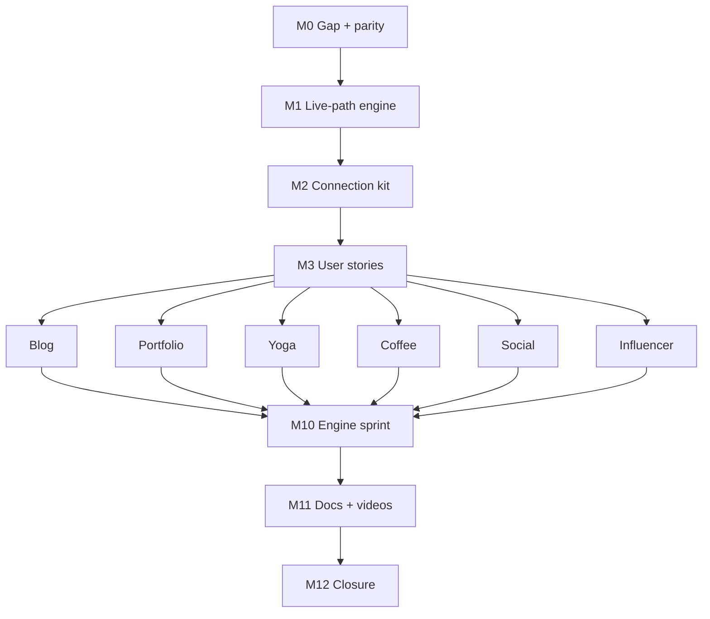

# Phase 20 — Templating excellence & reference projects

**Status:** **Approved (2026-07-08, Keven)** — autonomous execution P20-M0→M12  
**Baseline:** P16–P19 complete on `main` (2026-07-07) — Birkly **138 test suites** · Marketplace **17 test suites**  
**Roadmap:** `docs/roadmap/ROADMAP.md` § Phase 20  
**Handoff:** `docs/reviews/P20-lead-engineer-handoff.md`

**Not in scope:** Open beta launch, waitlist, production DNS/Stripe, kekaba production deploy.

---

## Executive summary

Phase 20 makes the **templating language and CMS↔project connection** fast, flexible, and robust **out of the box** — without requiring hydrate, snapshots, or bake steps.

Six **reference projects** (blog, portfolio, yoga/events, coffee/commerce, social/user+commerce, influencer/all plugins) are built using **Birkly templating only**. User stories expose edge cases; engine fixes land in P20-M10; walkthrough videos prove each project.

| Theme | Deliverable |
|-------|-------------|
| **Live default** | `birkly-client.js` only — no hydrate/snapshot meta on reference sites |
| **Performance** | ≤ 5 API round-trips first paint per reference page (bundle + batched TFs) |
| **Plugins** | events, commerce, user_management template functions work on live path |
| **Proof** | 6 reference sites + 6 walkthrough videos + gap register |

---

## Locked decisions

| ID | Decision |
|----|----------|
| P20-D1 | Reference sites use **templating + `data-birkly-*` only** — no hand-written `fetch()` to CMS APIs |
| P20-D2 | Plugins per scenario installed via dev/marketplace scripts (events, commerce, user_management) |
| P20-D3 | Each project: `reference-projects/<slug>/` with `collections/`, `website/`, `USER_STORIES.md` |
| P20-D4 | Videos = screen walkthroughs (content create → template → browser proof), stored in `docs/reviews/artifacts/` |
| P20-D5 | Engine fixes prioritized by user-story severity (blocker > awkward > polish) |
| P20-D6 | PHP vs JS parity: document explicitly; **fix client-first** (public sites), admin second |
| P20-D7 | Notify human **once** at P20-M12 with video index + gap register |
| **P20-D8** | **Default = live templating only.** One script: `birkly-client.js` + `data-cms-url`. No `birkly-baked`, no hydrate, no snapshots on reference projects |
| **P20-D9** | **Performance is core.** Reference sites meet round-trip budgets without bake/hydrate |
| **P20-D10** | Hydrate / snapshots / bake remain as **optional advanced** production tools — not in getting-started or reference projects |
| **P20-D11** | If a story only passes with hydrate/snapshots → **client/templating bug**, not valid workaround |

---

## Connection kit (canonical — all reference projects)

```html
<script src="/birkly-client.js" data-cms-url="http://localhost:8080"></script>
```

**Forbidden on reference projects:** `birkly-hydrate.js`, `<meta name="birkly-baked">`, `page_snapshot.php` dependency, site-specific loader branching (kekaba-style `birkly-loader.js` route tables).

**Optional advanced (document only, P20-M11):** `docs/advanced/production-optimization.md` — bake, hydrate, snapshots for CDN/SEO.

---

## Performance budgets (PERF-* acceptance)

| Metric | Target |
|--------|--------|
| Scripts | `birkly-client.js` only |
| First-paint API round-trips | **≤ 5** (typical index: bundle + TF meta + batched calls) |
| Serial per-collection `list_entries` | **0** — via auto `page_bundle.php` |
| Admin edit → browser refresh | Change visible **without** re-bake |
| Local TTI (fixture data) | **< 2s** |

---



---

# Milestones

| ID | Focus | Repo |
|----|--------|------|
| **P20-M0** | Gap register, JS↔PHP parity matrix, user-story template | Birkly |
| **P20-M1** | Live-path engine — auto bundle, client fixture tests, perf budgets | Birkly |
| **P20-M2** | Project connection kit + install script for reference data | Birkly |
| **P20-M3** | User story catalog (all projects + PERF-*) | Birkly |
| **P20-M4** | Reference: **Blog** + video V-TPL-01 | Birkly |
| **P20-M5** | Reference: **Portfolio** + video V-TPL-02 | Birkly |
| **P20-M6** | Reference: **Yoga** (events) + video V-TPL-03 | Birkly |
| **P20-M7** | Reference: **Coffee shop** (commerce) + video V-TPL-04 | Birkly |
| **P20-M8** | Reference: **Social** (user+commerce) + video V-TPL-05 | Birkly |
| **P20-M9** | Reference: **Influencer** (all plugins) + video V-TPL-06 | Birkly |
| **P20-M10** | Engine sprint from gap register | Birkly |
| **P20-M11** | Birkly-Docs templating corpus + advanced optimization doc | Birkly-Docs |
| **P20-M12** | Matrix green, closure, human notification | All |

**Branches:** `cursor/p20-m[N]-<slug>-030a`

---

## P20-M0 — Planning gate

- [ ] **P20-M0-T1** `docs/reviews/P20-templating-gap-register.md`
- [ ] **P20-M0-T2** `docs/reviews/P20-js-php-parity-matrix.md` — directive × engine (client / admin PHP)
- [ ] **P20-M0-T3** `docs/reviews/P20-verification-matrix.md` shell
- [ ] **P20-M0-T4** Audit hydrate/snapshot usage; list what kekaba added vs core defaults

---

## P20-M1 — Live-path engine

- [ ] **P20-M1-T1** Auto `page_bundle` request generation from template scan (reduce manual prefetch)
- [ ] **P20-M1-T2** Template function batching defaults; clear errors when TF fails
- [ ] **P20-M1-T3** `tests/client_template_render_test.php` — fixture HTML → expected output (loops, conditionals, `{from get}`)
- [ ] **P20-M1-T4** `tests/client_page_bundle_budget_test.php` — round-trip count assertions
- [ ] **P20-M1-T5** Retire/archive stale docs: `docs/templates.html`, conflicting `TEMPLATE_FUNCTIONS_*` analysis
- [ ] **P20-M1-T6** Align `docs/TEMPLATE_LANGUAGE_SPEC.md` with Birkly-Docs canonical syntax

**Acceptance:** Demo blog index loads with ≤ 5 API calls, no snapshot, all collections render.

---

## P20-M2 — Project connection kit

- [ ] **P20-M2-T1** `reference-projects/README.md` — structure, connection snippet, install command
- [ ] **P20-M2-T2** `scripts/install-reference-project.php <slug>` — copy collections + symlink/copy website
- [ ] **P20-M2-T3** `docs/reviews/P20-project-connection-checklist.md` — domain auth, cms-url, plugin install order

---

## P20-M3 — User story catalog

- [ ] **P20-M3-T1** `docs/reviews/P20-user-story-catalog.md` — all stories below with acceptance criteria
- [ ] **P20-M3-T2** PERF-01 through PERF-05 applied to every reference project

---

# Reference projects & user stories

## Global performance stories (every project)

| ID | Story | Acceptance |
|----|-------|------------|
| PERF-01 | Page loads with only `birkly-client.js` | No hydrate script in HTML |
| PERF-02 | ≤ 5 `api/` requests on first load | Documented in project README |
| PERF-03 | Admin edit → refresh shows change | No re-bake |
| PERF-04 | No empty template shells | All loops/conditionals resolve |
| PERF-05 | Plugin TFs within budget when active | Batched calls, parallel wall-clock |

---

## 1. Blog — `reference-projects/blog/`

**Plugins:** none

| ID | User story | Edge cases |
|----|------------|------------|
| B-01 | Publish post → appears on blog listing newest-first | `ordered by newest`, draft vs published |
| B-02 | Hero/nav from `site_elements` | `{from 'site_elements' get entry 'hero'}` |
| B-03 | Single post via `?slug=` | `{query.'slug'}`, 404 empty state |
| B-04 | Language switch | `data-birkly-language-select`, `{current.language}` |
| B-05 | Tags on cards | `{if entry has 'tags'}`, nested fields |
| B-06 | Contact form submission | `data-birkly-form` |

---

## 2. Portfolio — `reference-projects/portfolio/`

**Plugins:** none

| ID | User story | Edge cases |
|----|------------|------------|
| P-01 | Featured projects on grid | `{if entry.featured = true}` |
| P-02 | Project detail + image sub-entries | `{for each entry in 'images' of 'projects'.current}` |
| P-03 | ContentEditor HTML in body field | raw HTML in `{'content'}` |
| P-04 | Category filter on listing | field conditions / `with` |
| P-05 | Empty portfolio message | zero entries |
| P-06 | Deferred sub-entries (if needed live) | must work via client, not snapshot prefetch only |

---

## 3. Yoga teacher — `reference-projects/yoga/`

**Plugins:** `events`

| ID | User story | Edge cases |
|----|------------|------------|
| Y-01 | Upcoming class schedule | `{upcoming_events}`, date ordering |
| Y-02 | Class detail: capacity, venue | `event_*` template functions |
| Y-03 | RSVP via form | `data-birkly-form` → registration |
| Y-04 | Past/cancelled hidden | `with status = published` |
| Y-05 | Recurring class display | events TF / iCal link |
| Y-06 | Workshop vs class types | multiple collections or filters |

---

## 4. Coffee roaster — `reference-projects/coffee-shop/`

**Plugins:** `commerce`

| ID | User story | Edge cases |
|----|------------|------------|
| C-01 | Product grid from Commerce entries | price, SKU fields in template |
| C-02 | Product detail + purchase options | variants / sub-entries |
| C-03 | Add to cart from template | commerce TF or `data-birkly-commerce-*` |
| C-04 | Cart count in header | `{commerce_cart_count}` prefetch |
| C-05 | Display currency (P17) | formatted price in template |
| C-06 | Out-of-stock hides buy | quantity / warehouse fields |

---

## 5. Social media — `reference-projects/social/`

**Plugins:** `user_management` + `commerce`

| ID | User story | Edge cases |
|----|------------|------------|
| S-01 | Guest feed vs member actions | `{user_logged_in}` |
| S-02 | Register / login on static pages | user plugin forms |
| S-03 | Profile page | `{user_current}` and user TFs |
| S-04 | Member-only post blur for guests | conditional + TF |
| S-05 | Tip jar / digital product | commerce + user on same page |
| S-06 | Sidebar member list | TF without N+1 (batched) |

---

## 6. Influencer premium — `reference-projects/influencer/`

**Plugins:** `events` + `commerce` + `user_management`

| ID | User story | Edge cases |
|----|------------|------------|
| I-01 | Free vs premium content | tier / membership TF |
| I-02 | Membership purchase unlocks posts | PostPurchaseRouter + template |
| I-03 | Paid member-only event | events + commerce + user |
| I-04 | Subscriber event list | combined TFs |
| I-05 | Expired membership renew CTA | subscription state TF |
| I-06 | Guest vs member checkout paths | session + cart |

---

## P20-M4–M9 — Build reference projects

Each milestone:

- [ ] Collections + schemas under `reference-projects/<slug>/collections/`
- [ ] `website/*.html` — templating only, connection kit only
- [ ] `USER_STORIES.md` — pass/fail per story
- [ ] `scripts/install-reference-project.php <slug>` works
- [ ] PERF-* green on localhost
- [ ] Walkthrough video artifact path documented

**Video IDs:** V-TPL-01 (blog) … V-TPL-06 (influencer)

---

## P20-M10 — Engine sprint

Fix **blockers** from gap register discovered during M4–M9. Typical candidates:

- Auto bundle misses collection referenced only in `{from get}`
- TF load order when commerce + user on same page
- Sub-entry loop parity
- Template function error messages in DOM
- `{query.'slug'}` single-entry resolution
- Plugin TF catalog for Help/Docs

- [ ] **P20-M10-T1** All blocker gaps closed or documented with follow-up ID
- [ ] **P20-M10-T2** Re-run PERF-* on all six projects

---

## P20-M11 — Documentation

- [ ] **P20-M11-T1** Birkly-Docs `03-templating/` — live path first, connection kit, plugin TFs
- [ ] **P20-M11-T2** `docs/advanced/production-optimization.md` — hydrate/snapshot/bake as **optional**, not default
- [ ] **P20-M11-T3** AI context pack — templating + reference project index
- [ ] **P20-M11-T4** Plugin `help-templating.md` shelf sync (commerce, events, user)

---

## P20-M12 — Closure

- [ ] **P20-M12-T1** `docs/reviews/P20-phase-closure-checklist.md`
- [ ] **P20-M12-T2** Full P20 verification matrix green
- [ ] **P20-M12-T3** Roadmap § Phase 20 → complete
- [ ] **P20-M12-T4** `docs/agent-ops/daily-reports/YYYY-MM-DD-p20-closure.md`
- [ ] **P20-M12-T5** **Notify human once** — video index + gap register summary

---

## Success criteria

1. Six reference projects run on **live `birkly-client.js` only**.
2. All user stories + PERF-* pass without hydrate/snapshots.
3. Client template fixture tests in CI.
4. ≤ 5 API round-trips documented per reference index page.
5. Six walkthrough videos delivered.
6. Docs: live path default; optimization path advanced.
7. Birkly test suites green.

---

## Out of scope

- Open beta / waitlist / production go-live
- kekaba loader simplification (follow-up after P20 proves live path)
- PHP parser template function integration (document client-only unless blocker)
- Full i18n of reference sites
- Sentry/APM

---

## Values alignment

| Value | P20 |
|-------|-----|
| Dependency-free core | Client tests in PHP harness; no npm in CMS |
| UI decoupled | Templates in HTML; data via API |
| Self-contained plugins | Template functions per plugin; reference projects prove integration |
| Simple default | One script, live render — no bake required |
