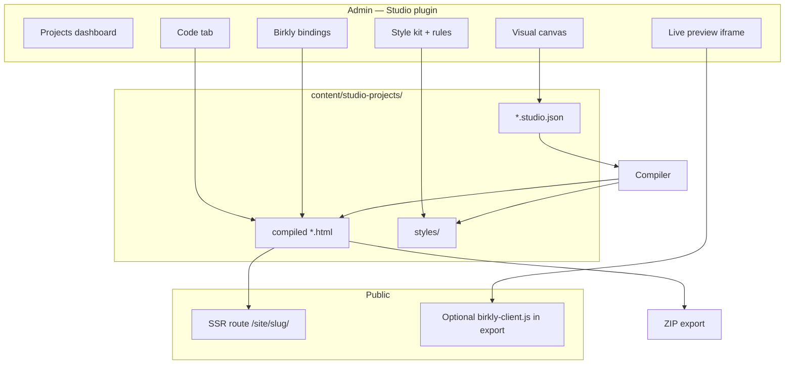

# P22 — Studio plugin (visual site builder)

**Status:** Proposed (2026-07-08) — awaiting human approval  
**Baseline:** P20 + P21 complete — reference projects, bundle v2, live client, SSR-ready platform  
**Human rule:** Execute P22-M0→M12 autonomously after approval. Notify human **once** at **P22-M12** only.

**Handoff:** `docs/reviews/P22-lead-engineer-handoff.md`  
**Matrix:** `docs/reviews/P22-verification-matrix.md`

---

## Vision

Ship a **deactivatable Studio plugin** so marketers and developers can design, build, and publish websites **inside Birkly** — immediately connected to collections, live preview, and **server-side rendering** — without Elementor-style lock-in or mandatory bake scripts.

**Primary users:** both — visual canvas for marketers; **code tab** for developers (HTML + Birkly template tags).

**Big benefit:** project files live under `content/studio-projects/` inside the CMS. No external folder sync. Export is available; in-CMS copy remains the source of truth.

---

## What Studio is (and is not)

| Studio **is** | Studio **is not** |
|---------------|-------------------|
| Plugin (`plugins/studio/`) — optional, deactivatable | Core CMS requirement |
| Visual layout + style tools + Birkly bindings | Full Elementor/Divi clone (popups, theme builder, 100 widgets) |
| Compiles to **HTML + CSS + Birkly template tags** | Proprietary runtime JSON on the public site |
| Live preview via `birkly-client.js` (P21 path) | Hydrate/bake required for normal use |
| SSR public route for fast first paint | Replacement for hand-coded `reference-projects/` |
| Style kits (Bootstrap, minimal, Tailwind-lite) | npm/webpack build step at runtime |

---

## Locked decisions (proposed — approve before execution)

| ID | Decision |
|----|----------|
| **P22-D1** | **Plugin-only** — `plugins/studio/`; deactivate → static compiled files remain readable |
| **P22-D2** | **Projects in CMS content tree** — `content/studio-projects/{project-id}/` (backed up with content; not outside Birkly) |
| **P22-D3** | **Dual editor** — Visual canvas + **Code** tab; round-trip without data loss |
| **P22-D4** | **Canvas JSON = editor source**; **compiled HTML/CSS = publish artifact** (hand-editable) |
| **P22-D5** | **Style kits = vendored static CSS** in plugin — no npm/composer at runtime (aligns `PROJECT_VALUES`) |
| **P22-D6** | **v1 kits:** `minimal` (Birkly defaults), `bootstrap` (vendored BS 5.3), `tailwind-lite` (curated pre-built utility CSS — not full Tailwind build) |
| **P22-D7** | **Public modes:** (a) **SSR** default for Studio sites — plugin route serves rendered HTML; (b) **live client** for admin preview and optional static export |
| **P22-D8** | **Thin core shelf** — `register_public_route()` + `server-router.php` hook so plugins can serve HTML without forking router per plugin |
| **P22-D9** | **Export** — ZIP download + “copy to folder” script; export never deletes in-CMS project |
| **P22-D10** | **Reuse layout patterns** from `fieldtypes/ContentEditor/layout/` (grid/table tools) — do not move Studio into ContentEditor fieldtype |
| **P22-D11** | **Template parity** — SSR uses PHP renderer aligned with `docs/reviews/P20-js-php-parity-matrix.md`; gaps logged, not silent breakage |
| **P22-D12** | **Single human notification** at P22-M12 only |

---

## Project storage layout

```
content/studio-projects/{project-id}/
├── project.json          # name, slug, style_kit, domain, routes, revision
├── styles/
│   ├── kit.css           # copied from selected style kit on create
│   └── custom.css        # rules from style editor
├── pages/
│   ├── index.studio.json # canvas source (sections, layout, bindings)
│   └── index.html        # compiled publish artifact
├── website/              # optional mirror for static serve / export
│   ├── index.html
│   └── styles.css
└── collections/          # optional project-scoped collection seeds (install on create)
```

**Slug rules:** `project-id` = lowercase `[a-z0-9-]`; public URL base `/site/{project-slug}/` (configurable in `project.json`).

---

## Style kits (v1 feature scope)

| Kit | Delivery | Editor | Export |
|-----|----------|--------|--------|
| **minimal** | Birkly base tokens + reset | Full | `styles.css` only |
| **bootstrap** | Vendored `bootstrap.min.css` (+ optional JS for components) | Class picker for BS utilities | Vendored copy in export |
| **tailwind-lite** | Pre-built `tailwind-lite.css` (~layout, spacing, type, colors) | Class picker limited to kit | Same file in export |

**Tailwind note:** Full Tailwind JIT requires a build chain. v1 ships a **curated utility bundle**. v2+ may add optional “compile on export” without npm in core (PHP class scanner → minimal CSS).

---

## Visual editor tools (v1 feature scope)

Not demo pages — **product features**:

| Area | v1 tools |
|------|----------|
| **Projects** | Create, rename, duplicate, delete, list dashboard |
| **Pages** | Add, reorder, delete, set home page, slug per page |
| **Layout** | Sections, rows, columns; CSS grid + flex presets (from ContentEditor layout patterns) |
| **Elements** | Text, image, button, link, spacer, divider, HTML block |
| **Styles** | Class list, spacing, colors, typography, border, display; **custom CSS rules** panel |
| **Birkly** | Insert collection loop, single entry, `site_elements`, template function block |
| **Preview** | Admin iframe — live `birkly-client.js` + P21 bundle |
| **Publish** | Compile → SSR route live; revision bump busts P21 client cache |

---

## Architecture



### Init waterfall (public SSR)

```
Request /site/{project}/{page}
  → StudioRenderer loads compiled HTML
  → PHP template scan → single page_bundle (reuse P21 runner)
  → render loops/conditionals (PHP parity layer)
  → response HTML (no client required for content)
```

Interactive forms (commerce cart, login) may still load `birkly-client.js` on SSR pages where plugins require it.

---

## Milestones

| ID | Focus | Repo |
|----|--------|------|
| **P22-M0** | Gap register, architecture, parity requirements for SSR | Birkly |
| **P22-M1** | Core `register_public_route()` + plugin scaffold + admin nav | Birkly |
| **P22-M2** | Projects + pages CRUD + `content/studio-projects/` storage | Birkly (`plugins/studio`) |
| **P22-M3** | Style kits — minimal, bootstrap, tailwind-lite (vendored assets) | Birkly (`plugins/studio`) |
| **P22-M4** | Visual layout editor — sections, grid, flex, element palette | Birkly (`plugins/studio`) |
| **P22-M5** | Style & rules editor — classes, tokens, custom CSS | Birkly (`plugins/studio`) |
| **P22-M6** | Birkly bindings UI + compiler (loops, site_elements, TF blocks) | Birkly (`plugins/studio`) |
| **P22-M7** | Dual editor — visual ↔ code round-trip | Birkly (`plugins/studio`) |
| **P22-M8** | Live preview iframe (P21 client path) | Birkly (`plugins/studio`) |
| **P22-M9** | SSR public route + `StudioRenderer` (PHP + page_bundle) | Birkly |
| **P22-M10** | Export ZIP + folder mirror; publish revision hook | Birkly (`plugins/studio`) |
| **P22-M11** | Tests, Birkly-Docs, video V-STU-01 | Birkly + Birkly-Docs |
| **P22-M12** | Matrix green, closure, single human notification | Birkly |

**Branches:** `cursor/p22-m[N]-<slug>-030a`

---

## Milestone detail

### P22-M0 — Planning gate

- [ ] **P22-M0-T1** `docs/reviews/P22-studio-gap-register.md` — SSR parity gaps, ContentEditor reuse map
- [ ] **P22-M0-T2** Confirm locked decisions P22-D1–D12 with human
- [ ] **P22-M0-T3** Verification matrix shell green columns

### P22-M1 — Core shelf + plugin shell

- [ ] **P22-M1-T1** `core/plugin_public_routes.php` — `register_public_route($prefix, $handler)`
- [ ] **P22-M1-T2** `server-router.php` — delegate registered prefixes before static file check
- [ ] **P22-M1-T3** `plugins/studio/plugin.json` — nav, capabilities (`manage_studio_projects`, `publish_studio_sites`)
- [ ] **P22-M1-T4** Admin page shell `plugins/studio/admin/studio.html` + CSP-safe JS loader
- [ ] **P22-M1-T5** Tests: route registration, 404 when plugin deactivated

### P22-M2 — Projects & pages

- [ ] **P22-M2-T1** `StudioProjectRepository` — CRUD, flat-file `project.json`
- [ ] **P22-M2-T2** Page list UI — add, reorder, delete, home page
- [ ] **P22-M2-T3** Create project wizard — name, slug, style kit pick
- [ ] **P22-M2-T4** Duplicate project (copy tree)
- [ ] **P22-M2-T5** Tests: CRUD, slug validation, path traversal blocked

### P22-M3 — Style kits

- [ ] **P22-M3-T1** `plugins/studio/kits/minimal/`, `bootstrap/`, `tailwind-lite/` assets
- [ ] **P22-M3-T2** Kit picker on create + change kit (copies base CSS)
- [ ] **P22-M3-T3** Class suggestion panel per kit
- [ ] **P22-M3-T4** Tests: kit files exist, no external CDN required at runtime

### P22-M4 — Layout editor

- [ ] **P22-M4-T1** Canvas model — sections → rows → columns → elements
- [ ] **P22-M4-T2** Adapt grid/flex tools from ContentEditor layout modules (import or shared copy per D10)
- [ ] **P22-M4-T3** Element palette — text, image, button, link, spacer, divider, raw HTML
- [ ] **P22-M4-T4** Drag reorder sections/elements; delete/duplicate
- [ ] **P22-M4-T5** Tests: canvas JSON schema validation

### P22-M5 — Style & rules editor

- [ ] **P22-M5-T1** Inspector — typography, spacing, colors, border, display
- [ ] **P22-M5-T2** Class manager — add/remove classes on selected node
- [ ] **P22-M5-T3** Custom CSS rules tab → `styles/custom.css`
- [ ] **P22-M5-T4** Tests: CSS sanitization (no `expression`, `javascript:` URLs)

### P22-M6 — Birkly bindings + compiler

- [ ] **P22-M6-T1** Binding blocks — collection list, filtered list, single entry, `site_elements`
- [ ] **P22-M6-T2** Template function insert UI (discover from active plugins)
- [ ] **P22-M6-T3** `StudioCompiler` — canvas JSON → HTML with `{for each …}` tags
- [ ] **P22-M6-T4** Write `pages/*.html` + merge styles on compile
- [ ] **P22-M6-T5** Tests: compiler fixtures → expected HTML

### P22-M7 — Dual editor

- [ ] **P22-M7-T1** Code tab — Monaco or textarea with syntax highlight (no npm — vendored editor or lightweight)
- [ ] **P22-M7-T2** Code → canvas parse (best-effort for layout; full round-trip for bindings)
- [ ] **P22-M7-T3** Visual edit → code refresh; code save → reparse or “code overrides” flag
- [ ] **P22-M7-T4** Tests: round-trip on binding blocks without tag corruption

### P22-M8 — Live preview

- [ ] **P22-M8-T1** Preview iframe — compiled HTML + `birkly-client.js` + `data-cms-url`
- [ ] **P22-M8-T2** Auto-refresh on compile; device width toggles
- [ ] **P22-M8-T3** Performance: preview uses P21 bundle (≤2 cold RTTs on simple page)

### P22-M9 — SSR public serve

- [ ] **P22-M9-T1** `StudioRenderer` — load HTML, scan templates, `page_bundle` server-side
- [ ] **P22-M9-T2** PHP render layer for loops, conditionals, `{from get}` (parity matrix scope)
- [ ] **P22-M9-T3** Route `/site/{project-slug}/{page}` → rendered HTML; 404 when unpublished
- [ ] **P22-M9-T4** `publish` action sets `published: true` + revision for cache bust
- [ ] **P22-M9-T5** Tests: SSR smoke — request returns 200 with collection content in body

### P22-M10 — Export

- [ ] **P22-M10-T1** Export ZIP — `website/`, styles, README with connection snippet
- [ ] **P22-M10-T2** Optional `birkly-client.js` script tag in export for static hosting
- [ ] **P22-M10-T3** In-CMS project unchanged after export
- [ ] **P22-M10-T4** Tests: ZIP structure, no path traversal

### P22-M11 — Docs & video

- [ ] **P22-M11-T1** `plugins/studio/README.md` — install, capabilities, storage layout
- [ ] **P22-M11-T2** Birkly-Docs — `04-studio/getting-started.md` (Summary + Beginner + Advanced)
- [ ] **P22-M11-T3** Video V-STU-01 — create project → layout → bind blog → preview → SSR → export

### P22-M12 — Closure

- [ ] **P22-M12-T1** All matrix rows green
- [ ] **P22-M12-T2** `tests/run.php` includes studio test suites
- [ ] **P22-M12-T3** `docs/reviews/P22-phase-closure-checklist.md`
- [ ] **P22-M12-T4** Single human notification (digest / email per `REPORTING.md`)

---

## Acceptance criteria (phase)

1. User creates a Studio project, picks Bootstrap kit, builds a 3-section home page with a blog loop, previews live, publishes SSR URL, exports ZIP — **without terminal**.
2. Developer edits compiled HTML in code tab; bindings survive round-trip.
3. Deactivating plugin leaves files on disk; SSR returns 503 with clear message.
4. Studio tests green; no regression in P21 performance budgets on non-Studio pages.
5. Values check: dependency-free, UI decoupled, self-contained plugin.

---

## Dependencies

```
P20 (templating, parity matrix, reference patterns)
  → P21 (bundle v2, perf — preview + SSR bundle)
    → P22-M0 → M1 → M2 → M3
         → M4 + M5 (parallel after M3)
         → M6 → M7 → M8
         → M9 → M10 (parallel after M6)
         → M11 → M12
```

---

## Risks & mitigations

| Risk | Mitigation |
|------|------------|
| SSR PHP ≠ client JS parity | Parity matrix scope; log gaps; fallback script tag in export |
| Tailwind expectations vs no-build | `tailwind-lite` kit + docs on full Tailwind export |
| Scope creep (Elementor parity) | Locked v1 element list; plugin block registry in v2 |
| Large vendored CSS in plugin | Kits lazy-loaded per project; one kit copied on create |

---

## Out of scope (v1)

- Theme builder (headers/footers as global synced partials) — v2
- Popup/funnel builder
- Responsive breakpoint per-property editor (v1: preview widths only)
- Marketplace block packs
- Multi-user realtime co-editing
- Replacing `reference-projects/` — they remain the code-first examples

---

## Values check (planned)

| Value | Alignment |
|-------|-----------|
| Dependency-free core | Kits vendored; thin core route shelf only |
| UI decoupled | Studio admin UI separate from SSR output HTML |
| Self-contained plugin | Deactivatable; no core registration edits for features |
| Platform-first | SSR reuses `page_bundle_runner`, not per-site hacks |

**Trade-off requiring approval:** P22-D8 adds a small core hook (`register_public_route`) — justified as shared shelf for future plugins (commerce storefronts, etc.).
