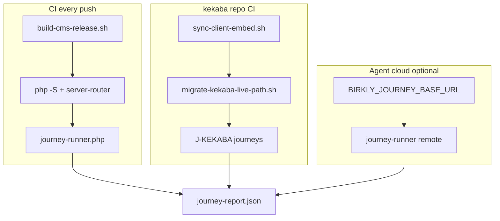

# P28 — Beta launch automation & product gaps

**Status:** Proposed (2026-07-13) — awaiting human approval  
**Baseline:** P27 complete (156 suites) · P26 Studio **paused** · Human handles DNS/Stripe/legal (Part 1)  
**Human rule:** Execute P28-M0→M20 autonomously after approval. Notify human **once** at **P28-M20** with **video review pack links**.

**Real projects policy:** `docs/reviews/P28-real-projects-and-video-policy.md`

**Gap register:** `docs/reviews/P28-beta-launch-gap-register.md`  
**Journey catalog:** `docs/reviews/P28-user-journey-catalog.md`  
**Handoff:** `docs/reviews/P28-lead-engineer-handoff.md`  
**Matrix:** `docs/reviews/P28-verification-matrix.md`

---

## Vision

Close the gap between **“platform code is beta-ready”** and **“agents prove it works end-to-end without human deploy steps.”**

Three pillars (human Part 1 excluded):

| Pillar | Goal |
|--------|------|
| **A — Journey automation** | Executable user journeys in CI + against staging URLs; kekaba on live client path |
| **B — Ops optimization** | Scheduled smoke, journey subset, digest alerts, admin ops visibility |
| **C — Product gaps** | Fix remaining non-Studio blockers (marketplace install path, updates, embed sync, catalog) |

**No Studio P26 work** in P28 unless a journey requires a breadcrumb fix.

---

## Locked decisions (proposed)

| ID | Decision |
|----|----------|
| **P28-D1** | **Journey runner** — `scripts/journey-runner.php` + `tests/journeys/*.php`; **real disk state** (zip extract, `install-reference-project.sh`, real plugin install) — HTTP asserts outcomes |
| **P28-D2** | Journeys run in **CI** against local `php -S` CMS; optional `BIRKLY_JOURNEY_BASE_URL` for staging |
| **P28-D3** | **kekaba live-path migration** — automated script removes `birkly-baked`; site uses live `birkly-client.js` + `page_bundle` |
| **P28-D4** | kekaba CI job: sync embed → migrate live-path → `journey-runner` kekaba journeys → fail on bake meta |
| **P28-D5** | **Six reference project journeys** map 1:1 to `docs/reference-projects/user-stories.md` — **real collections + website files** |
| **P28-D6** | **Fresh-install journey** — **real release zip** extract → onboarding → marketplace installs **real plugin ZIP** (registry fixture, not API mock) |
| **P28-D7** | **Ops:** `scheduled-production-smoke.sh` runs journey **health subset** (J-HEALTH-*) after production-smoke |
| **P28-D8** | **Ops:** failed scheduled smoke → `core/health_alerts.php` email/webhook (extend P13-M4) |
| **P28-D9** | **Ops:** Admin Settings → Operations tab shows `last-production-smoke.json` + last journey run |
| **P28-D10** | **Product:** Update system E2E test — download/apply/rollback against fixture zip |
| **P28-D11** | **Product:** Marketplace install journey — commerce plugin from registry fixture in CI |
| **P28-D12** | **Product:** Birkly-Website static deploy script + smoke (waitlist link, legal anchors) |
| **P28-D13** | **Product:** Fix `studio_renderer_test` home-page flake; README → `START_HERE.html` |
| **P28-D14** | **Product:** Marketplace seed catalog audit — official offers installable; document gaps |
| **P28-D15** | Human Part 1 (DNS, Stripe live, legal) **out of scope** — agents deliver preflight checklist only |
| **P28-D16** | **Video evidence** — V-BETA-01…09 screen recordings + `docs/reviews/artifacts/v-beta-*.md` step docs |
| **P28-D17** | **Human review pack** — `P28-human-review-pack.md` with video index + local replay commands |
| **P28-D18** | qa-verifier + computerUse **mandatory** for all V-BETA videos before M20 closure |
| **P28-D19** | Single notification at **P28-M20** (includes video links for human review) |

---

## Milestones (18 — one wave)

| ID | Focus |
|----|--------|
| **P28-M0** | Gap register + user journey catalog + matrix shell |
| **P28-M1** | `journey-runner.php` framework (assertions, reporting, JSON output) |
| **P28-M2** | **J-INSTALL** — fresh zip → START_HERE → onboarding → admin login |
| **P28-M3** | **J-BLOG, J-PORTFOLIO** — reference project visitor journeys |
| **P28-M4** | **J-COFFEE, J-YOGA** — commerce + events plugin journeys |
| **P28-M5** | **J-SOCIAL, J-INFLUENCER** — user_management + commerce journeys |
| **P28-M6** | **J-ADMIN** — content editor, media upload, publish entry |
| **P28-M7** | **J-MARKETPLACE** — install free official plugin from registry fixture |
| **P28-M8** | **J-INVITE** — admin invite → `invite.php` accept → login |
| **P28-M9** | kekaba **live-path migration** script + remove bake from site HTML |
| **P28-M10** | **J-KEKABA** journeys — homepage, blog, service (live client assertions) |
| **P28-M11** | Wire journeys into `ci-check.sh` + `agent-smoke-test.sh` |
| **P28-M12** | Staging mode: `BIRKLY_JOURNEY_BASE_URL` runs against service.kekaba.com in agent cloud |
| **P28-M13** | **Ops** — scheduled smoke + journey subset + health alert on fail |
| **P28-M14** | **Ops** — Admin Operations panel (last smoke, last journey, cron hint) |
| **P28-M15** | **Product** — update system E2E test + README/START_HERE fix |
| **P28-M16** | **Product** — Birkly-Website deploy script + smoke; marketplace catalog audit |
| **P28-M17** | **Video evidence** — V-BETA-01…09 recordings + `artifacts/v-beta-*.md` (qa-verifier + computerUse) |
| **P28-M18** | **Human review pack** — `P28-human-review-pack.md` (video index + replay commands) |
| **P28-M19** | `scripts/beta-launch-preflight.sh` — human Part 1 checklist + automated pre-checks |
| **P28-M20** | Matrix green, closure, ROADMAP, single notification **with video links** |

**Branches:** `cursor/p28-m[N]-<slug>-030a`

---

## User journeys (summary)

Full catalog: `docs/reviews/P28-user-journey-catalog.md`

| ID | Persona | Journey | Automated by |
|----|---------|---------|--------------|
| J-INSTALL | New owner | Extract zip → wizard → first login | M2 |
| J-BLOG | Visitor | Home → blog list → post by slug | M3 |
| J-PORTFOLIO | Visitor | Gallery → project detail | M3 |
| J-COFFEE | Shopper | Products → variant → add to cart | M4 |
| J-YOGA | Visitor | Upcoming events → event detail | M4 |
| J-SOCIAL | Member | Register → login → post → feed | M5 |
| J-INFLUENCER | Fan | Link-in-bio → merch cart | M5 |
| J-ADMIN | Editor | Create entry → publish → public API | M6 |
| J-MARKETPLACE | Admin | Install commerce from marketplace | M7 |
| J-INVITE | Invitee | Accept invite → set password → admin | M8 |
| J-KEKABA | Visitor | kekaba.com pages without bake; live bundle | M9–M10 |
| J-HEALTH | Ops | health.php + writable dirs + marketplace ping | M13 |

---

## How Part 2 works (automated, not manual)



1. **Local/CI:** Spin **real** CMS (release zip or dev tree), **install reference projects** (`install-reference-project.sh`), **install real plugins**, run HTTP steps — same disk state a human would have.
2. **kekaba repo:** Migration script strips `birkly-baked`, wires canonical `birkly-client.js`; CI fails if bake meta returns.
3. **Staging:** Agents set `BIRKLY_JOURNEY_BASE_URL` — same journeys against live host.
4. **CI evidence:** `journey-report.json` + matrix rows.
5. **Human evidence:** V-BETA videos + review pack so you can **see every solution** and replay locally.

---

## Part 4 — Ops optimization (M13–M14)

| Today | P28 target |
|-------|------------|
| `scheduled-production-smoke.sh` logs only | Also runs J-HEALTH-* journey subset |
| Failures stay in log file | Trigger `health_alerts.php` email/webhook |
| No admin visibility | Settings → Operations: last run, pass/fail, cron example |
| Manual cron setup | Document + ship `docs/agent-ops/PRODUCTION_CRON.md` |

---

## Part 5 — Product gaps (M15–M16)

| Gap | Fix |
|-----|-----|
| Update system untested on real path | `tests/update_system_e2e_test.php` with fixture zip |
| kekaba on legacy bake | M9–M10 migration |
| Birkly-Website not deployed | `Birkly-Website/scripts/deploy-smoke.sh` |
| Marketplace catalog holes | Audit script + install journey |
| README says `0_START-HERE` | Align to `START_HERE.html` |
| `studio_renderer_test` flake | Fix cache path / home slug assertion |
| UX flow matrix stale (P4) | Refresh from P28 journey results |

---

## Out of scope (P28)

- Studio P26 creative suite
- Human DNS / Stripe live / legal sign-off (preflight doc only)
- Full browser Playwright farm (curl/HTTP sufficient for v1)
- npm in CMS runtime

---

## Acceptance criteria

1. `./scripts/ci-check.sh` runs ≥10 user journeys green locally.
2. kekaba `main` has no `birkly-baked` on primary pages; J-KEKABA passes.
3. Scheduled smoke + journey subset + alert wired.
4. Update system E2E test passes.
5. Marketplace install journey passes with registry fixture.
6. `beta-launch-preflight.sh` documents human Part 1 with automated pre-checks.
7. **V-BETA-01…09 videos** recorded; human review pack delivered.
8. Human notified once at P28-M20 with video index.

---

## Dependencies

```
P27 complete
  → M0 → M1
  → M2 ∥ M3 (after M1)
  → M4 → M5
  → M6 ∥ M7 ∥ M8
  → M9 → M10
  → M11 → M12
  → M13 → M14
  → M15 → M16 → M17 (videos, after M11 green)
  → M18 (human review pack)
  → M19 → M20
```

P26 Studio resumes after P28-M18 (or in parallel only if human approves).
