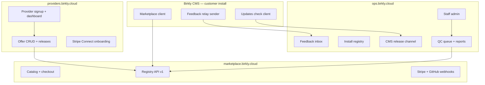

# P34 — Birkly Ops & platform production

**Status:** Approved for planning (2026-07-22, Keven) — **next strategic phase**  
**Baseline:** P10 marketplace complete · VPS live at `ops.birkly.cloud` (interim all-in-one deploy)  
**Repos:** **Birkly-Marketplace** (primary — future `Birkly-Ops`) · Birkly · Birkly-Docs · Birkly-Website  
**Handoff:** `docs/reviews/P34-lead-engineer-handoff.md`  
**Matrix:** `docs/reviews/P34-verification-matrix.md`  
**Vision backlog:** `Birkly-Marketplace/docs/BIRKLY_OPS_VISION.md`

---

## Why this phase now

Without a **production Ops platform**, Birkly cannot ship a coherent product:

- Official plugins and themes need a **live registry** CMS installs can reach
- **Updates**, feedback, and install identity need a **central receiver** (CMS stubs exist; Ops endpoints do not)
- **QC and staff operations** must not live inside customer CMS admin
- **Providers** need a dedicated seller surface — separate from internal Ops

CMS admin polish (P33) and beta journeys (P28) remain valuable but **block on platform readiness**. P34 unblocks marketplace install, updates, and closed-alpha operations.

---

## Vision

Split today's monolithic marketplace deploy into **three public surfaces** from **one codebase** (same `data/`, shared registry), each on its own hostname:

| Surface | Hostname (proposed) | Audience | Routes / modules |
|---------|---------------------|----------|------------------|
| **Birkly Ops** | `ops.birkly.cloud` | Birkly staff | `/admin/*`, feedback inbox, install registry, CMS releases, QC escalation, audit, internal APIs |
| **Provider Studio** | `providers.birkly.cloud` | Marketplace sellers | `/provider/*` — signup, Stripe Connect, offers, GitHub, payouts, agreement |
| **Public Marketplace** | `marketplace.birkly.cloud` | Buyers + CMS clients | `/`, `/catalog`, `/offers/*`, `/buy/*`, `/api/v1/*`, webhooks |



**CMS stays thin:** local accounts unchanged (P9-D1). CMS only calls **public marketplace** for registry/licenses and **Ops APIs** for feedback/updates when configured.

---

## Locked decisions (Keven 2026-07-22)

| ID | Decision |
|----|----------|
| **P34-D1** | **One repo, three surfaces** — extend `Birkly-Marketplace`; do not fork CMS logic |
| **P34-D2** | **Ops is staff-only** — `ops.birkly.cloud` must not expose provider signup or public catalog as primary UX |
| **P34-D3** | **Provider Studio is separate hostname** — `providers.birkly.cloud`; not a path on Ops |
| **P34-D4** | **Public marketplace** — `marketplace.birkly.cloud` for catalog, buyers, registry API (CMS default URL) |
| **P34-D5** | **Shared data layer** — one `data/` store on VPS (or shared volume); surfaces are routing/auth boundaries, not separate databases in v1 |
| **P34-D6** | **Host-based surface routing** — `MARKETPLACE_SURFACE` env and/or `HTTP_HOST` map in bootstrap |
| **P34-D7** | **CMS marketplace URL** — default `https://marketplace.birkly.cloud` (not ops hostname) |
| **P34-D8** | **Feedback triage moves to Ops** — remove owner-only inbox from CMS admin when Ops receiver live |
| **P34-D9** | **P33 pauses** at current milestone until P34-M22; resume P33 after platform green |
| **P34-D10** | **P28 pauses** until P34-M22 (marketplace journey needs live registry) |
| **P34-D11** | Human notified **once** at P34-M22 closure |
| **P34-D12** | Repo rename `Birkly-Ops` deferred to P34-M21 (docs + GitHub rename); code namespace stays `marketplace_*` until later refactor |

---

## Surface routing (canonical)

### Config

```bash
# Per vhost / container
MARKETPLACE_SURFACE=ops|provider|public|all   # production: never use all
MARKETPLACE_BASE_URL=https://ops.birkly.cloud  # must match vhost
MARKETPLACE_HOST_MAP=ops.birkly.cloud:ops,providers.birkly.cloud:provider,marketplace.birkly.cloud:public
```

### Route allowlists

| Surface | Allowed |
|---------|---------|
| **ops** | `/admin/*`, `/api/ops/v1/*` (new), `/health`, deny `/provider/*`, `/catalog`, `/` home |
| **provider** | `/provider/*`, `/health`, deny `/admin/*`, deny public checkout except legal links |
| **public** | `/`, `/catalog`, `/offers/*`, `/buy/*`, `/legal/*`, `/api/v1/*`, `/webhooks/*`, deny `/admin/*`, deny `/provider/*` |

Wrong-host requests → `404` or redirect to canonical URL (e.g. provider login on ops host → redirect to providers host).

### Sessions

Separate cookie names per surface (already one session name — split to `birkly_ops`, `birkly_provider`, `birkly_marketplace`) so staff/provider/buyer sessions do not collide on shared parent domain if ever used.

---

## Milestones (23 — one wave, M0→M22)

### Planning & deploy foundation

| ID | Focus | Repo |
|----|--------|------|
| **P34-M0** | Gap register + verification matrix + hostname/DNS checklist | Birkly, Marketplace |
| **P34-M1** | Surface router (`marketplace_surface()`, host map, route guards) | Marketplace |
| **P34-M2** | Split session cookies + base URL per surface | Marketplace |
| **P34-M3** | Production nginx vhost template (3 hosts → one PHP root) | Marketplace `docs/` |
| **P34-M4** | Harden `ops.birkly.cloud` — TLS, secrets, non-default admin password, `.env` runbook | Marketplace |
| **P34-M5** | Deploy `providers.birkly.cloud` vhost + smoke test provider signup/login | Infra + Marketplace |
| **P34-M6** | Deploy `marketplace.birkly.cloud` vhost + catalog/registry smoke | Infra + Marketplace |

### Marketplace & plugins (public surface)

| ID | Focus | Repo |
|----|--------|------|
| **P34-M7** | Seed official catalog on production `data/` | Marketplace |
| **P34-M8** | Stripe live keys + webhooks on **public** host only | Marketplace |
| **P34-M9** | GitHub App webhooks pointed at public host | Marketplace |
| **P34-M10** | CMS `BIRKLY_MARKETPLACE_URL` → production; settings default update | Birkly |
| **P34-M11** | End-to-end: CMS admin → browse registry → install official plugin ZIP | Birkly + Marketplace |

### Provider Studio (provider surface)

| ID | Focus | Repo |
|----|--------|------|
| **P34-M12** | Provider branding pass — header/footer, links to public marketplace, no admin links | Marketplace |
| **P34-M13** | Provider agreement + Stripe Connect flow on providers host | Marketplace |
| **P34-M14** | Offer create → QC submit → staff approve on Ops → publish on public catalog | Marketplace |

### Birkly Ops modules (ops surface)

| ID | Focus | Repo |
|----|--------|------|
| **P34-M15** | **Feedback relay receiver** — `POST /api/ops/v1/feedback` HMAC, inbox UI in `/admin/feedback` | Marketplace |
| **P34-M16** | **Install registry** — `POST /api/ops/v1/installations/register`, admin list, link to feedback | Marketplace |
| **P34-M17** | **CMS release channel v1** — upload signed CMS ZIP, channel tags (alpha/beta/stable), `GET /api/ops/v1/releases/check` | Marketplace |
| **P34-M18** | Wire CMS updates client + feedback relay to production Ops URLs | Birkly |
| **P34-M19** | Remove or gate CMS owner feedback triage when relay active (P34-D8) | Birkly |

### Docs, closure, rename

| ID | Focus | Repo |
|----|--------|------|
| **P34-M20** | Birkly-Docs — provider publishing, CMS marketplace install, Ops runbook | Birkly-Docs |
| **P34-M21** | Update AGENTS.md, CLOUD_ENV_REPOS, README; plan GitHub repo rename | Marketplace, Birkly |
| **P34-M22** | Verification matrix green, phase closure, human review pack | All |

---

## CMS integration contracts (v1)

### Already implemented (sender side)

| Feature | CMS file | Ops receiver (P34) |
|---------|----------|-------------------|
| Registry / licenses | `core/marketplace.php`, `api/marketplace.php` | Public `/api/v1/*` (exists) |
| Feedback relay | `api/feedback.php` | **P34-M15** |
| Updates check | `api/updates.php` (if present) or new | **P34-M17** |
| `installation_id` | `core/marketplace.php` | **P34-M16** |
| Cloud account OAuth | `core/cloud_account.php` | **Deferred P35** — stub only in P34 |

### Production config (customer install)

```json
{
  "marketplace_url": "https://marketplace.birkly.cloud",
  "feedback_relay_url": "https://ops.birkly.cloud/api/ops/v1/feedback",
  "updates_url": "https://ops.birkly.cloud/api/ops/v1/releases/check"
}
```

Relay secret issued per install or per alpha cohort from Ops admin.

---

## Infrastructure (current VPS)

Keven has a European VPS. Interim state: entire app on `ops.birkly.cloud`. P34-M3–M6 split vhosts:

```
/etc/nginx/sites-enabled/
  ops.birkly.cloud      → MARKETPLACE_SURFACE=ops
  providers.birkly.cloud → MARKETPLACE_SURFACE=provider
  marketplace.birkly.cloud → MARKETPLACE_SURFACE=public
```

Shared: PHP-FPM pool, `data/`, `artifacts/`, `.env` (surface-specific overrides in vhost fastcgi_param).

**DNS:** A/AAAA records for three subdomains → same VPS IP. TLS via Let's Encrypt cert per host.

**Backups:** daily `data/` + `artifacts/` to object storage (document in runbook).

---

## Out of scope (P34)

| Item | Home |
|------|------|
| Managed cloud hosting / instance provisioning | P35+ |
| Cloud account OAuth production (`cloud.birkly.io`) | P35 |
| Repo rename to `Birkly-Ops` on GitHub | P34-M21 docs only; rename when convenient |
| Multi-VPS HA | Future |
| PostgreSQL migration | When JSON limits hit |
| P33 remaining milestones | Resume after P34-M22 |
| P28 journey runner | Resume after P34-M22 |

---

## Risks

| Risk | Mitigation |
|------|------------|
| Single VPS single point of failure | Accept for alpha; backups + documented restore |
| Surface routing bugs expose admin | Integration tests per host; deny-by-default router |
| Stripe webhook URL change | Configure on public host before go-live |
| CMS still points at localhost | P34-M10 forces production default in docs + smoke |

---

## Success criteria (P34-M22)

1. Three hostnames live with correct surface isolation
2. CMS install can browse and install an official plugin from production registry
3. Provider can sign up on providers host, submit offer, staff approves on Ops, offer visible on public catalog
4. Feedback from CMS alpha install appears in Ops inbox
5. Install registry shows CMS version + `installation_id`
6. CMS updates check returns channel-aware response (even if no new ZIP yet)
7. Documentation and runbook updated; human review pack delivered

---

## Cross-repo dependency order

```
P34-M1–M6 (surfaces + deploy)
  → P34-M7–M11 (public marketplace + CMS client)
  → P34-M12–M14 (provider studio)
  → P34-M15–M19 (ops modules + CMS wire-up)
  → P34-M20–M22 (docs + closure)
```
