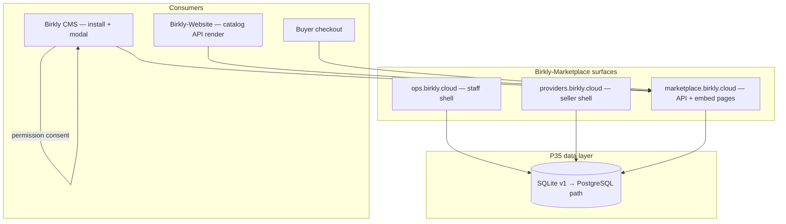

# P35 — Marketplace & Ops excellence

**Status:** Proposed for approval (2026-07-23, Keven) — **next phase after P34 closure**  
**Baseline:** P34 deployed on Dokploy (`ops` / `providers` / `marketplace` on `*.birkly.cloud`) · 19 Marketplace test suites · CMS production URL + feedback relay wired  
**Repos:** **Birkly-Marketplace** (primary) · Birkly · Birkly-Website · Birkly-Docs  
**Handoff:** `docs/reviews/P35-lead-engineer-handoff.md`  
**Matrix:** `docs/reviews/P35-verification-matrix.md`  
**Gap register:** `docs/reviews/P35-gap-register.md`

---

## Current status (verified 2026-07-23)

### P34 — largely complete (awaiting M22 sign-off)

| Delivered | Pending |
|-----------|---------|
| Three-surface deploy on VPS (Dokploy) | Stripe live keys + webhooks |
| Ops: feedback inbox, installations, releases admin | Paid checkout E2E on production |
| Provider Studio branding on providers host | CMS E2E install from production (human) |
| Public catalog + registry API live | P34 formal closure sign-off |
| CMS default `marketplace.birkly.cloud` | |

See `docs/reviews/P34-human-review-pack.md`.

### Known pain points (drives P35)

| Issue | Root cause | P35 target |
|-------|------------|------------|
| Ops/Provider UI feels unlike Birkly admin | Custom dark `marketplace.css`, no shared shell | **P35-M1–M6** admin design system port |
| Cannot set per-provider fees reliably | Nested `<form>` inside table row (invalid HTML); possible CSRF gap | **P35-M7** |
| Uploading commerce/automation zips fails | Naive security scan flags `base64_decode(` in CredentialStore; folder zip structure wrong | **P35-M15–M18** |
| Single env admin only | `marketplace_create_admin()` exists, no UI | **P35-M8–M10** |
| JSON file storage for orders/licenses | No transactions, weak concurrency | **P35-M11–M14** |
| Dedicated `/catalog` SSR page redundant | Website should consume API like CMS | **P35-M19–M22** |
| Offer pages basic (plain text description) | No provider page builder; CMS modal renders minimal inline HTML | **P35-M23–M27** |
| No install-time permission consent | `plugin.json` permissions not surfaced to buyer | **P35-M16–M18** |
| Official plugins still in Birkly `plugins/` dev tree | P10 excluded from release zip but not ecosystem-complete | **P35-M28–M30** |
| Paid offers untested on production | Stripe keys not configured | **P35-M31–M33** |

---

## Vision

Make the Birkly marketplace ecosystem **production-solid**: Ops and Provider Studio **look and behave like Birkly admin**, commerce data lives in a **real database with hardened security**, providers can **publish rich offer pages** and **upload plugins through a clear path**, buyers see **transparent permissions before install**, and **official Birkly plugins** exist only on the marketplace — not bundled in the CMS repo workflow.



**North-star outcome:** A Birkly team member can manage Ops on a familiar admin UI, a provider can publish commerce-quality offers with rich pages, a CMS user can browse/install with permission transparency, and Keven can remove `plugins/commerce` et al. from the CMS dev dependency path.

---

## Locked decisions (proposed — approve before execution)

| ID | Decision |
|----|----------|
| **P35-D1** | **UI parity** — Ops + Provider Studio use Birkly admin shell patterns (sidebar, topbar, cards, design tokens), not the current standalone marketplace theme |
| **P35-D2** | **Database v1 = SQLite** on VPS (`data/marketplace.db`); design migration path to PostgreSQL; JSON files remain for artifacts/catalog cache during transition |
| **P35-D3** | **API-first catalog** — `/api/v1/registry` + enriched offer endpoints are canonical; SSR `/catalog` becomes redirect or minimal landing; Birkly-Website renders catalog from API |
| **P35-D4** | **Rich offer pages** — providers edit structured page content; public `GET /offers/{slug}` supports `?embed=1` for CMS modal iframe |
| **P35-D5** | **Permission manifest v2** — `plugin.json` declares `permissions`, `data_access`, `hooks`; QC validates; CMS shows consent UI before install |
| **P35-D6** | **Security scan v2** — context-aware (allow crypto `base64_decode`, flag real `eval`/`shell_exec`); provider docs for `build-plugin-zip.sh` packaging |
| **P35-D7** | **Ops admin users** — CRUD in `/admin/users`; roles `admin`, `moderator`, `support`; no shared env password in production |
| **P35-D8** | **Per-provider fee %** — fix UI + persist in DB; audit log entry on change |
| **P35-D9** | **Official plugin cutover** — Birkly provider account owns commerce, automation, events, user_management, studio on marketplace; CMS dev tree stops shipping them as first-class |
| **P35-D10** | **Paid offer verification** — Stripe test-mode E2E in CI + one live smoke before M33 closure |
| **P35-D11** | Human notified **once** at **P35-M33** |
| **P35-D12** | P28 resumes after P35-M28 (marketplace install path solid) |

---

## UI/UX — match Birkly admin (P35-M1–M6)

Port (not npm-build) the CMS admin presentation layer:

| Source (Birkly) | Target (Marketplace) |
|-----------------|----------------------|
| `admin/css/tokens.css`, theme variables | `assets/css/birkly-tokens.css` |
| Sidebar + topbar layout | `views/shared/admin-shell.php` |
| `.card`, `.button`, tables, forms | `assets/css/birkly-components.css` |
| Dark mode toggle (optional M6) | Ops + Provider surfaces |

**Surfaces:**
- **Ops** (`/admin/*`) — full staff chrome, nav: Dashboard, QC, Offers, Providers, Orders, Reviews, Feedback, Installations, Releases, **Users**, Audit
- **Provider Studio** (`/provider/*`) — same chrome family, provider nav: Dashboard, Offers, Payouts, Settings
- **Public** — minimal chrome for checkout + **embed offer pages only** (no heavy catalog site)

**Out of scope:** Pixel-perfect clone of every CMS page; focus on shell, forms, tables, and offer editor.

---

## Database & security (P35-M11–M14)

### Migrate to SQLite (v1)

| Domain | Tables (draft) |
|--------|----------------|
| Identity | `admins`, `providers`, `buyers`, `sessions` |
| Commerce | `offers`, `offer_releases`, `orders`, `licenses`, `subscriptions` |
| Trust | `reviews`, `qc_submissions`, `audit_log` |
| Ops | `installations`, `feedback_items`, `cms_releases` |

- WAL mode, `0600` permissions, backup hook in runbook
- Migration script: import existing `data/**/*.json` → SQLite (idempotent)
- Payment writes use transactions; license activation idempotent

### Security hardening

- CSRF tokens on all POST forms (fixes fee-tier form)
- Rate limits on login, checkout, feedback relay, registry API
- Argon2id password hashing (admins, providers)
- Webhook signature verification audit
- Structured security log (failed auth, QC rejections)
- Document threat model update in `docs/SECURITY.md`

**PostgreSQL path (document only in P35):** env `MARKETPLACE_DATABASE_URL`; same schema via migration tool in P36 if needed.

---

## Ops admin users (P35-M8–M10)

| Feature | Route |
|---------|-------|
| List admins | `GET /admin/users` |
| Create invite | `POST /admin/users` |
| Change role | `POST /admin/users/{id}/role` |
| Deactivate | `POST /admin/users/{id}/deactivate` |
| Self password change | `GET/POST /admin/account` |

- Bootstrap: first admin from env only on empty DB; then env password ignored
- Roles: `admin` (full), `moderator` (QC, reviews, providers), `support` (feedback, installations read-only)

---

## API-first catalog & website (P35-M19–M22)

### API enhancements

| Endpoint | Purpose |
|----------|---------|
| `GET /api/v1/registry` | Existing — add `include=ratings,pricing` query params |
| `GET /api/v1/offers/{slug}` | Full offer + page content + reviews + provider public profile |
| `GET /api/v1/offers/{slug}/embed` | HTML fragment or JSON for embed consumers |
| `GET /api/v1/categories` | Category list for website filters |

**CORS:** allow `birkly.com`, `www.birkly.com`, CMS origins for read-only GET.

### Catalog page fate

- `marketplace.birkly.cloud/` → short landing + link to birkly.com/marketplace (or API docs)
- `/catalog` → 302 to website marketplace section **or** thin API-driven page (decision at M19)
- Checkout/buyer flows stay on marketplace host (PCI boundary)

### Birkly-Website

- New section: fetch registry API, render cards (like CMS plugins tab, no install button)
- Link offer detail → website page or embed modal pattern

### CMS modal

- Click offer in Plugins → Marketplace opens `marketplace.birkly.cloud/offers/{slug}?embed=1` in modal iframe (or fetch embed API)
- Install button remains in CMS chrome (outside iframe)

---

## Rich offer pages (P35-M23–M27)

### Provider offer page editor

Structured sections (stored in DB + manifest):

| Section | Fields |
|---------|--------|
| Hero | title, subtitle, hero image |
| Features | bullet list |
| Description | Markdown body |
| Screenshots | image URLs (upload to artifact storage) |
| Requirements | Birkly version, PHP, dependencies |
| Permissions summary | auto from latest `plugin.json` |
| Reviews | read-only from API |
| Pricing | synced from offer manifest |

Provider route: `/provider/offers/{slug}/page` — preview + publish.

### Public offer page

- `GET /offers/{slug}` — full page (checkout CTA)
- `GET /offers/{slug}?embed=1` — chromeless embed for CMS modal
- Reviews section with verified-purchase badge

### Schema

- Extend `offer-manifest.schema.json` with optional `page` object **or** store page in DB with manifest sync on publish

---

## Plugin upload path & permissions (P35-M15–M18)

### Security scan v2

Replace substring blocklist with:

1. **Tier A (block):** `eval(`, `shell_exec(`, `system(`, `passthru(`, `proc_open(`, `php://input` includes
2. **Tier B (warn → QC review):** `exec(`, `base64_decode(` outside known crypto paths
3. **Tier C (allowlist file):** `CredentialStore.php` patterns documented

### Packaging requirements (provider docs)

1. Run `Birkly/scripts/build-plugin-zip.sh <plugin_id>` **or** zip plugin folder with `plugin.json` at archive root
2. Upload via Provider Studio → preflight shows errors inline before submit
3. QC queue shows scan report + permission manifest diff

### Permission manifest v2 (`plugin.json`)

```json
{
  "permissions": ["manage_commerce", "view_commerce_orders"],
  "data_access": {
    "entries": "read_write",
    "media": "read",
    "users": "none",
    "settings": "read"
  },
  "hooks": ["after_entry_save", "plugin_activated"]
}
```

- QC: declared permissions must match static analysis heuristics (hook files, API calls)
- CMS install modal: **Permission consent** step — user must accept before ZIP extracts
- Store acceptance in local `settings/marketplace_consent.json` per offer version

---

## Paid offers & Stripe (P35-M31–M33)

| Task | Detail |
|------|--------|
| Test mode CI | Checkout → license activate → install (mock Stripe already exists; wire full path) |
| Production smoke | One paid offer ($1 test) with live keys in staging provider |
| Provider fee verification | Custom 10% fee provider → order shows correct `application_fee_cents` |
| Subscription offer | Monthly official plugin tier E2E |
| Refund path | Admin refund → license revoked |

Human: Stripe live keys + webhook URL (from P34 gap G34-08).

---

## Official plugin ecosystem cutover (P35-M28–M30)

| Plugin | Marketplace slug | Notes |
|--------|------------------|-------|
| commerce | `birkly-commerce` | Paid tiers optional |
| automation | `birkly-automation` | Free |
| events | `birkly-events` | Depends commerce |
| user_management | `birkly-user-management` | Free |
| studio | `birkly-studio` | Free or paid — product decision |

**Birkly repo changes:**
- `plugins/README.md` — marketplace-only install
- `scripts/install-dev-plugins.sh` — pulls from production registry or local seed
- CI: no tests assuming bundled plugin files unless explicitly installed in fixture step
- Coupling register P10 updated to **ecosystem complete**

**Not in P35:** Delete plugin source from Birkly repo (keep source for building zips; stop treating as shipped with CMS).

---

## Milestones (34 — M0→M33)

| ID | Focus |
|----|--------|
| **P35-M0** | Gap register + matrix + UI audit checklist |
| **P35-M1** | Extract Birkly admin tokens + base components into Marketplace assets |
| **P35-M2** | Shared admin shell layout (sidebar, topbar, content area) |
| **P35-M3** | Ops admin pages migrated to new shell |
| **P35-M4** | Provider Studio pages migrated to new shell |
| **P35-M5** | Forms, tables, alerts, sticky actions parity |
| **P35-M6** | Responsive + dark mode pass (match CMS breakpoints) |
| **P35-M7** | Fix provider fee-tier form (CSRF, no nested forms, DB-backed) |
| **P35-M8** | Ops admin users list + create |
| **P35-M9** | Ops admin roles + deactivate |
| **P35-M10** | Admin account settings + drop env default password in prod |
| **P35-M11** | SQLite schema + migration from JSON |
| **P35-M12** | Repositories layer (providers, orders, licenses, offers) |
| **P35-M13** | Security hardening (CSRF, rate limits, Argon2id) |
| **P35-M14** | Backup + restore runbook for DB |
| **P35-M15** | Security scan v2 + upload preflight UI |
| **P35-M16** | Permission manifest v2 schema + QC validation |
| **P35-M17** | CMS install permission consent UI |
| **P35-M18** | Provider packaging guide + `build-plugin-zip` integration in Studio |
| **P35-M19** | Registry API enhancements + CORS |
| **P35-M20** | Offer detail API + embed endpoint |
| **P35-M21** | Deprecate SSR catalog; landing redirect |
| **P35-M22** | Birkly-Website marketplace section (API-driven) |
| **P35-M23** | Offer page content model + DB storage |
| **P35-M24** | Provider offer page editor |
| **P35-M25** | Public offer page + reviews layout |
| **P35-M26** | Embed mode for CMS modal iframe |
| **P35-M27** | CMS plugins tab → iframe/embed offer detail |
| **P35-M28** | Publish all official plugins from Birkly provider account |
| **P35-M29** | CMS dev/CI marketplace-only plugin install path |
| **P35-M30** | Update coupling register + docs — ecosystem cutover complete |
| **P35-M31** | Stripe test-mode paid checkout E2E tests |
| **P35-M32** | Production paid smoke + fee tier verification |
| **P35-M33** | Verification matrix green, human review pack, closure |

---

## Out of scope (P35)

| Item | Home |
|------|------|
| PostgreSQL production migration | P36 |
| Managed cloud hosting | P36+ |
| Full website redesign | Birkly-Website separate track |
| Repo rename to Birkly-Ops | Optional anytime |
| Provider markdown WYSIWYG beyond basic sections | P36 polish |

---

## Success criteria (P35-M33)

1. Ops and Provider Studio visually align with Birkly admin (sidebar, cards, typography)
2. Multiple ops admin users manageable without SSH/env edits
3. Per-provider fee % saves and applies to checkout
4. Commerce plugin uploads via `build-plugin-zip.sh` pass QC
5. CMS shows permission consent before plugin install
6. Birkly-Website renders marketplace from API (no dedicated marketplace catalog site required)
7. CMS offer modal shows rich embed page with reviews
8. SQLite backs orders, licenses, accounts; JSON migration complete
9. Paid checkout verified (test CI + one live smoke)
10. Official plugins installable from marketplace only; CMS dev workflow updated
11. Human review pack approved

---

## Dependency order

```
M0 → M1–M6 (UI shell)
M7–M10 (ops fixes + admin users) — parallel with M11–M14 (DB) after M1
M11–M14 before M31–M32 (payments on DB)
M15–M18 (upload/permissions) — parallel with M19–M22 (API)
M23–M27 (offer pages) after M19–M20
M28–M30 (cutover) after M15–M18 + M27
M31–M33 (payments + closure) last
```
