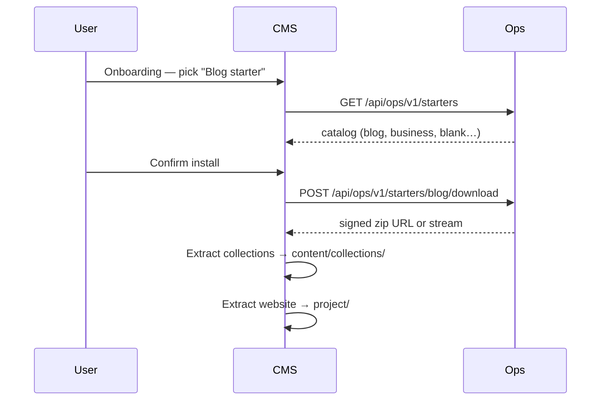

# P36 — CMS productization & platform depth

**Status:** Proposed for approval (2026-07-24, Keven) — **next phase after P35**  
**Baseline:** P35 largely complete — Birkly admin shell on Ops/Provider, SQLite, permissions, offer pages, official plugin seeds  
**Repos:** Birkly · Birkly-Marketplace · Birkly-Docs · Birkly-Website  
**Handoff:** `docs/reviews/P36-lead-engineer-handoff.md`  
**Matrix:** `docs/reviews/P36-verification-matrix.md`  
**Gap register:** `docs/reviews/P36-gap-register.md`

---

## Current status (verified 2026-07-24)

### Completed recently

| Area | Status |
|------|--------|
| **P34** | Three surfaces live on `*.birkly.cloud` (Dokploy) |
| **P35 Marketplace** | Admin shell ported, SQLite + repos, CSRF, admin users, fee fix, security scan v2, permission manifest, offer pages + embed, official plugin zips in catalog |
| **P35 CMS** | Permission consent, offer embed modal, marketplace URL, install-dev from registry |
| **P35 gaps** | Stripe live smoke on production, full UI polish pass, grouped Ops nav |

### Still wrong for end users

| Issue | Today |
|-------|--------|
| CMS release zip includes `demo-content/**` (~140 files) | Bloated download |
| CMS release includes `AGENTS.md`, agent scripts | Internal, not customer-facing |
| Dev repo still contains full `plugins/` tree | Confusing; zip excludes but repo messy |
| Ops sidebar is flat list of 13 links | No topic grouping |
| Demo starters read from local `demo-content/` | Cannot update demos without CMS release |
| Birkly-Docs marketplace pages point at `marketplace.birkly.io` | Stale URLs; no plugin **economy** curriculum |
| Website folder naming inconsistent | Code uses `demo-website/`; product language says "project" |

---

## Vision

**P36 makes Birkly shippable as a clean product** and **deepens both platforms** without another foundational rewrite.

1. **CMS download** — minimal, professional, no agent/plugin/demo baggage  
2. **Ops** — CMS-grade UI with **grouped navigation** and **starter/template ops**  
3. **Provider Studio** — same polish bar + seller growth features  
4. **Docs** — authoritative plugin economy & development section  
5. **Starters** — Ops-hosted packs, not bundled in CMS zip  

---

## Locked decisions (proposed)

| ID | Decision |
|----|----------|
| **P36-D1** | CMS release zip = **runtime only** — no `docs/`, `tests/`, `plugins/*`, `demo-content/`, agent files |
| **P36-D2** | Official plugin **source** moves to `packages/official-plugins/` (dev/CI only, never in zip) |
| **P36-D3** | **Starter packs** hosted on Ops; CMS downloads on demand during onboarding |
| **P36-D4** | Standard paths: `content/collections/` + **`project/`** (public site files); deprecate `demo-website/` |
| **P36-D5** | Ops sidebar uses **grouped sections** (Marketplace · Platform · Marketing · System) |
| **P36-D6** | Provider Studio gets matching shell polish + dedicated feature wave |
| **P36-D7** | Birkly-Docs new section **06-plugin-economy/** (multi-page curriculum) |
| **P36-D8** | Template packs (paid, later) reuse same Ops artifact + CMS install path as starters |
| **P36-D9** | Human notified **once** at **P36-M28** |
| **P36-D10** | P28 resumes after **P36-M18** (clean CMS + starter install path) |

---

## Part A — CMS cleanup & productization

### A1. Release manifest v2

**Remove from customer zip:**

| Path | Reason |
|------|--------|
| `demo-content/**` | Ops-hosted starters (P36-D3) |
| `AGENTS.md` | Agent internal |
| `scripts/agent-smoke-test.sh` | Agent internal |
| `scripts/send-agent-digest.php` | Agent internal |
| `scripts/cms-release-manifest.json` | Build metadata only |
| `.cursor/**`, `.github/**` | Already excluded |

**Keep in customer zip:**

| Path | Reason |
|------|--------|
| `0_START-HERE.html`, `README.md` | Onboarding |
| `start-server.sh`, `server-router.php` | Local dev |
| `admin/`, `api/`, `core/`, `fieldtypes/` | Product |
| `plugins/README.md` + `.gitkeep` | Empty plugins dir |
| `project/.gitkeep` | Empty project skeleton |
| `content/.gitkeep` | Empty content skeleton |

**Customer README** — rewrite for self-hosters (no agent/marketplace dev jargon).

### A2. Dev repo layout (not in zip, cleaner tree)

```
packages/official-plugins/   # commerce, automation, events, user_management, studio
plugins/                     # README + .gitkeep only (runtime target)
docs/agent-ops/              # agent docs (unchanged, excluded from zip)
docs/reviews/                # phase plans (excluded from zip)
```

- `scripts/build-plugin-zip.sh` reads from `packages/official-plugins/`
- `scripts/install-dev-plugins.sh` unchanged (marketplace or local zips)
- CI updated paths

### A3. Legacy path migration

- `demo-website/` → `project/` in core + onboarding + docs
- Migration on first admin load or onboarding: move if `demo-website` exists

---

## Part B — Demo & template install concept

### Your idea (empty project + Ops download)

**Yes — this is the right direction**, with small refinements.

### Recommended architecture



| Layer | Responsibility |
|-------|----------------|
| **Ops** | Store starter packs (zip), version, channel, manifest (collections list, requires plugins) |
| **CMS** | Thin client: list starters, download, extract, wire onboarding flags |
| **Marketplace** (later) | Paid `template_pack` offers use **same install handler** with license check |

### Pack zip structure (canonical)

```
blog-starter-1.0.0.zip
├── manifest.json          # id, version, collections[], optional required_plugins[]
├── collections/           # → content/collections/
│   ├── blog/
│   └── site_elements/
└── project/               # → project/  (HTML/CSS/JS, birkly-client templates)
    ├── index.html
    └── styles.css
```

### Why this beats bundling in CMS

| Bundled `demo-content/` | Ops-hosted starters |
|-------------------------|---------------------|
| Larger zip forever | Minimal CMS download |
| Demo updates need CMS release | Update starters on Ops independently |
| Same demos for all versions | Channel-specific (alpha vs stable) |
| Templates = special case | Same pipeline for free starters + paid template packs |

### Offline / blank

- **Start blank** always works offline (empty `content/` + `project/`)
- Starters require network — acceptable at onboarding (show clear message)

### Empty skeleton in CMS repo

Ship:

```
content/.gitkeep
project/.gitkeep
project/README.html        # "Your site files live here"
```

No demo files in zip.

---

## Part C — Ops platform: navigation IA + feature backlog

### C1. Sidebar groups (P36-D5)

Replace flat `shell_nav.php` list with sections:

| Section | Links |
|---------|--------|
| **Overview** | Dashboard |
| **Marketplace** | QC inbox · Offers · Providers · Orders · Reviews · Listing reports |
| **Platform** | Installations · Feedback · Activity · CMS releases |
| **Marketing** | Starter packs · Featured offers · Website catalog API · Announcements |
| **System** | Users · Audit log · Integrations (Stripe/GitHub health) · Settings · Backups |

Implementation: `shell_nav.php` returns grouped structure; `admin-shell-start.php` renders section labels + collapsible groups (match CMS sidebar patterns).

### C2. Ops UI polish (complete P35 gaps)

- Dark mode toggle (CMS parity)
- Tablet drawer @ 1280px
- Sticky action bars on long forms
- Empty states + loading skeletons on all admin tables
- Global search (installations, offers, providers, feedback)
- Notification badges (QC queue, open feedback, failed webhooks)
- Settings page (env status, surface URLs, feature flags) — replace scattered docs-only config

### C3. Ops new features (prioritized backlog)

**P36 build (high)**

| Feature | Value |
|---------|--------|
| **Starter pack manager** | Upload/version starter zips; API for CMS onboarding |
| **Featured offers API** | Curate homepage/marketplace section for Birkly-Website |
| **Installation detail page** | Drill-down: version, plugins, feedback, license events |
| **Feedback → ticket workflow** | Status, assignee, link to installation |
| **CMS release upload UX** | Drag-drop ZIP, channel tags, release notes, rollback |
| **Provider onboarding pipeline** | KYC status, agreement version, first-offer checklist |
| **Revenue dashboard** | GMV, fees, refunds, top offers (read-only charts, no npm) |
| **Webhook health monitor** | Stripe/GitHub last success, retry queue |
| **Email template preview** | License receipt, provider notices |

**P36 build (medium)**

| Feature | Value |
|---------|--------|
| Alpha cohort / invite codes | Push program tier to installations |
| Automated QC rule editor | Toggle scan tiers, custom block patterns |
| Fraud alerts | Velocity on checkout, license activations |
| Announcement banners API | CMS admin banner optional |
| Export CSV | orders, installations, providers |
| Scheduled DB backup UI | trigger + last backup status |

**Later (P37+)**

| Feature | Value |
|---------|--------|
| Support SLA dashboard | |
| Managed instance provisioning | Hetzner API |
| Multi-region starters | |
| A/B featured catalog experiments | |

---

## Part D — Provider Studio: feature backlog

### D1. UI polish (match CMS bar)

- Grouped sidebar: **Selling** · **Account** · **Resources**
- Offer editor → tabbed layout (Details · Page · Releases · Reviews · Analytics)
- Media library for screenshots (reuse Ops artifact storage patterns)
- Inline validation + preflight preview before upload
- Mobile-responsive provider dashboard

### D2. Provider new features (prioritized)

**P36 build (high)**

| Feature | Value |
|---------|--------|
| **Offer analytics** | Views, install clicks, conversion (from API telemetry) |
| **Release management** | Deprecate version, rollback, % rollout (draft) |
| **Payout & sales detail** | Per-order breakdown, fee line, Stripe dashboard deep links |
| **GitHub release log** | Webhook delivery status per tag |
| **Draft offers** | Work in progress before QC submit |
| **Dependency declaration** | "Requires birkly-commerce" on offer manifest |
| **Buyer messages** | Simple inbox for pre-sales questions (optional) |
| **Tax / business profile** | Stripe Connect status summary |

**P36 build (medium)**

| Feature | Value |
|---------|--------|
| Team members (invite co-maintainer) | |
| Coupon / launch pricing | |
| Offer comparison with competitors (self-serve SEO fields) | |
| Changelog rich editor | |
| Webhook subscriptions (provider-owned endpoint on publish) | |

**Later**

| Feature | Value |
|---------|--------|
| A/B offer page variants | |
| Affiliate links | |

---

## Part E — Birkly-Docs: plugin economy section

New curriculum under **`06-plugin-economy/`** (sync to `content/`):

| Page | Audience | Topics |
|------|----------|--------|
| `overview.html` | Everyone | CMS vs marketplace vs Ops; thin client model |
| `for-site-owners.html` | Buyers | Browse, license, install, consent, updates |
| `for-providers.html` | Sellers | Studio, packaging, QC, payouts (refresh existing guide) |
| `plugin-development.html` | Developers | `plugin.json`, hooks, permissions, `data_access` |
| `theme-and-template-packs.html` | Developers | offer types, project folder, starters |
| `security-and-review.html` | Providers | Scan tiers, QC, supply chain |
| `official-plugins.html` | Everyone | Birkly-maintained offers, dependencies |
| `api-reference.html` | Integrators | Registry, embed, starter API (links to Ops) |

**Updates across corpus:**

- Replace `marketplace.birkly.io` → `marketplace.birkly.cloud` / `providers.birkly.cloud`
- Cross-link from `06-extensibility/plugins.html`
- Help manifest entries for admin Help shelf

---

## Milestones (29 — M0→M28)

| ID | Focus | Repo |
|----|--------|------|
| **P36-M0** | Gap register + matrix + CMS zip audit | Birkly |
| **P36-M1** | Release manifest v2 — strip demo/agent files | Birkly |
| **P36-M2** | Move official plugins to `packages/official-plugins/` | Birkly |
| **P36-M3** | Ship empty `content/` + `project/` skeleton; customer README | Birkly |
| **P36-M4** | `demo-website/` → `project/` migration | Birkly |
| **P36-M5** | Ops starters schema + admin UI (upload, version, publish) | Marketplace |
| **P36-M6** | Ops API `GET/POST starters` for CMS | Marketplace |
| **P36-M7** | CMS onboarding downloads starters from Ops | Birkly |
| **P36-M8** | Migrate bundled demos to Ops packs; remove `demo-content/` from repo zip path | Birkly + Marketplace |
| **P36-M9** | Ops grouped sidebar navigation | Marketplace |
| **P36-M10** | Ops UI polish pass (dark mode, drawer, empty states) | Marketplace |
| **P36-M11** | Ops starter pack + featured offers + settings pages | Marketplace |
| **P36-M12** | Ops installation detail + feedback workflow upgrade | Marketplace |
| **P36-M13** | Ops revenue + webhook health dashboard | Marketplace |
| **P36-M14** | Provider grouped sidebar + tabbed offer editor | Marketplace |
| **P36-M15** | Provider analytics + payout detail + GitHub log | Marketplace |
| **P36-M16** | Provider draft offers + media library | Marketplace |
| **P36-M17** | Birkly-Docs `06-plugin-economy/` section (8 pages) | Birkly-Docs |
| **P36-M18** | Birkly-Website featured catalog + starter links | Birkly-Website |
| **P36-M19** | Docs URL refresh (`*.birkly.cloud`) | Birkly-Docs |
| **P36-M20** | Template pack install path (license-gated, same as starters) | Birkly + Marketplace |
| **P36-M21** | Release zip size test + manifest CI gate | Birkly |
| **P36-M22** | `build-cms-release.sh` smoke on clean tree | Birkly |
| **P36-M23** | Cross-repo verification matrix | All |
| **P36-M24** | Human review pack | Birkly |
| **P36-M25–M28** | Buffer for polish, Stripe live closure, P28 unblock marker | — |

*Note: M25–M28 reserved for overflow from human review; renumber if scope splits.*

---

## Success criteria (P36-M24)

1. CMS release zip contains **no** demo-content, plugins source, or agent files  
2. Fresh install: empty content + project; onboarding installs blog starter **from Ops**  
3. Ops sidebar grouped into Marketplace / Platform / Marketing / System  
4. Provider Studio has grouped nav + offer analytics page  
5. Birkly-Docs plugin economy section live (8 pages)  
6. Official plugin source only in `packages/official-plugins/`  
7. `project/` is canonical public site folder  
8. Human approves clean download on real unzip test  

---

## Out of scope (P36)

| Item | Home |
|------|------|
| PostgreSQL migration | P37 |
| Managed cloud hosting | P37+ |
| Provider team accounts | P37 |
| Full marketing automation | P37 |
| Delete `docs/reviews/` from dev repo | Keep for agents; excluded from zip |

---

## Dependency order

```
M1–M4 (CMS manifest + layout)
  → M5–M8 (Ops starters + CMS onboarding)
M9–M13 (Ops depth) parallel M14–M16 (Provider depth)
M17–M19 (docs + website) after M5–M8 API stable
M20–M24 (template path + closure)
```
