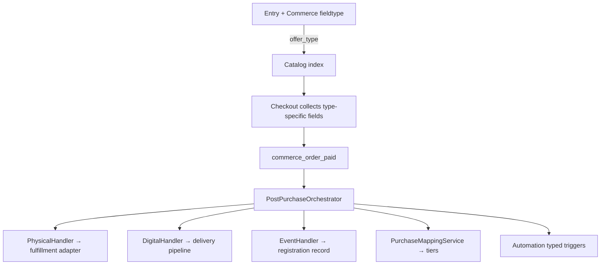

# Commerce Phase 2 — Master plan (offer types, fulfillment & growth)

**Status:** Proposed (2026-07-05) — pending human approval  
**Repo:** Birkly (primary) · Birkly-Docs  
**Baseline:** **P6.4 complete** — `plugins/commerce/` on `main` (83 test suites)  
**Immediate predecessor:** `docs/reviews/P6.5-commerce-polish-ai-plan.md` (polish + docs shelf)

---

## Executive summary

P6.4 delivered content-first commerce: one **Commerce fieldtype**, catalog, cart, checkout, discounts, import, and a **single** fulfillment path (manual export / ShipStation stub on every paid order).

Phase 2 introduces **`offer_type`** — a first-class discriminator on each sellable entry that drives:

1. **Which fields appear** in the entry editor (shipping vs download vs capacity vs none)
2. **What checkout collects** (address, attendee, email-only)
3. **What runs after payment** (fulfillment push, digital delivery, event registration, tier grant)

One flexible core, multiple **offer type handlers** — not separate plugins per product kind.



---

## Design principle: offer type, not product post type

| Anti-pattern (Woo-style) | Birkly pattern |
|--------------------------|----------------|
| Separate `product`, `download`, `event` post types | **One** `commerce` fieldtype on **any** collection |
| Different plugins per vertical | **`offer_type`** selects behavior profile |
| Hard-coded checkout | Checkout **schema** derived from cart line offer types |

Collections stay semantic (`products`, `downloads`, `workshops`) — behavior comes from `offer_type` + optional collection defaults.

---

## Offer types (v1 registry)

| `offer_type` | Entry fields (beyond price/billing) | Checkout extras | Post-purchase |
|--------------|-------------------------------------|-----------------|---------------|
| **`physical`** | `quantity_available`, weight/dimensions optional, SKU | Shipping address, optional shipping method | Fulfillment adapter push; `commerce_physical_fulfilled` |
| **`digital`** | `delivery_mode`, asset ref or URL, license optional | Email (guest ok); account link if vault | Email + signed download URL; `commerce_digital_delivered` |
| **`event`** | `quantity_available` (capacity), `starts_at` optional on entry | Attendee name(s), email | Registration record, calendar/token; `commerce_event_registered` |
| **`session`** | Slot/capacity, duration (defer detailed booking UI) | Contact + slot confirmation | Booking record; `commerce_session_booked` |
| **`membership`** | `billing: recurring`, interval | Account strongly recommended | Tier grant via mappings; `commerce_membership_started` |
| **`bundle`** | Component refs (P6.8) | Union of component checkout needs | Expand + run per-component handlers |

**Default:** `physical` if unset (backward compatible with P6.4 entries — treat as physical with shipping optional until merchant configures).

### Extensibility

Register offer types like fulfillment adapters:

```php
commerce_register_offer_type('physical', PhysicalOfferHandler::class);
```

Third-party plugins could add `rental`, `donation`, `license_seat` without forking Commerce.

---

## Commerce fieldtype evolution

### Layer 1 — P6.5 (already planned): collection controls

`commerce_settings` on schema field: enable/disable sub-fields, custom intervals, custom merchant fields.

### Layer 2 — P6.6: offer type + conditional sub-schema

**New core field on commerce value:**

```json
{
  "offer_type": "digital",
  "price_cents": 1900,
  "currency": "eur",
  "billing": "one_time",
  "quantity_available": null,
  "sku": "EBOOK-001",
  "physical": { "weight_grams": null, "requires_shipping": true },
  "digital": {
    "delivery_mode": "secure_download",
    "asset_media_id": "media-abc",
    "download_expiry_hours": 72,
    "max_downloads": 5
  },
  "event": {
    "capacity": 40,
    "starts_at": "2026-08-01T18:00:00Z",
    "venue": "Online"
  }
}
```

Only the block matching `offer_type` is required/validated; others ignored.

**Entry editor:** Radio/select for offer type → show relevant sub-panel (driven by `commerce_settings.enabled_offer_types` on collection).

**Catalog index:** Store `offer_type` + flattened flags for checkout (`requires_shipping`, `requires_registration`, etc.).

---

## Post-purchase orchestration (new core module)

Replace blunt `pushFulfillment()` on every order with:

```
PostPurchaseOrchestrator::handlePaidOrder($order)
  foreach ($order['lines'] as $line)
    $type = $line['offer_type'] ?? 'physical'
    $handler = OfferTypeRegistry::get($type)
    $handler->onPaid($line, $order)  // idempotent via order_line_fulfillment state
  PurchaseMappingService::applyPurchaseMappings($order)
  fire aggregate automation: commerce_order_fulfilled (all lines done)
```

**Per-line fulfillment state** in order store:

```json
{
  "line_id": "ln_1",
  "offer_type": "digital",
  "fulfillment_status": "delivered",
  "fulfillment_ref": "dl_token_xyz",
  "fulfillment_at": "..."
}
```

Handlers must be **idempotent** (webhook retries safe).

### Automation triggers (expand)

| Trigger | When |
|---------|------|
| `commerce_order_paid` | Payment confirmed (existing) |
| `commerce_order_line_paid` | Single line ready for handler (new, optional) |
| `commerce_physical_fulfilled` | Shipment pushed / manual mark shipped |
| `commerce_digital_delivered` | Download token issued / email sent |
| `commerce_event_registered` | Attendee record created |
| `commerce_session_booked` | Session reservation confirmed |
| `commerce_membership_started` | Recurring + tier mapped |
| `commerce_order_fulfilled` | All lines terminal state |

Automation + User plugin + Events plugin subscribe to typed events — not one generic blob.

---

## Checkout evolution

Checkout form becomes **dynamic** from cart composition:

| Cart contains | Checkout sections |
|---------------|-------------------|
| Any `physical` | Shipping address block |
| Any `digital` | Email (+ optional “create account for library”) |
| Any `event` / `session` | Attendee block per ticket qty |
| Any `membership` recurring | Account required warning/block |
| Mixed types | Union of sections; validate all |

**Shipping (P6.7):** zones + flat/weight rates stored in `commerce_shipping_zones.json`; computed at checkout before shelf charge.

**Tax (P6.9):** rules engine parallel to discounts; `tax_cents` on order lines.

---

## Phase map (implementation order)

### P6.5 — Commerce polish (approved proposal)

| Milestone | Deliverable |
|-----------|-------------|
| M1 | Fieldtype `getConfigUI` — toggles, intervals, custom fields |
| M2 | Unified `register_plugin_docs()` — AI + Help plugin section |
| M3 | Template metadata + Birkly-Docs |

**Spec:** `docs/reviews/P6.5-commerce-polish-ai-plan.md`

---

### P6.6 — Offer types foundation

**Goal:** Architecture spine — offer type on fieldtype, conditional UI, orchestrator, typed automation hooks (stubs ok).

| Task | Deliverable |
|------|-------------|
| M0-T1 | `OfferTypeRegistry` + interfaces `OfferTypeHandlerInterface` |
| M0-T2 | Built-in handlers: physical, digital, event (stub `onPaid`) |
| M0-T3 | Commerce fieldtype: `offer_type` select + conditional sub-panels |
| M0-T4 | `getConfigUI`: `enabled_offer_types` per collection |
| M0-T5 | CatalogIndexer includes `offer_type` + checkout flags |
| M0-T6 | `PostPurchaseOrchestrator` replaces direct `pushFulfillment()` |
| M0-T7 | Order line fulfillment state + idempotency keys |
| M0-T8 | Automation triggers per type (register in init.php) |
| M0-T9 | `tests/commerce_offer_types_test.php` |

**Acceptance:** Entry with `offer_type: digital` saves; paid order invokes digital handler stub; physical still hits manual fulfillment adapter.

---

### P6.7 — Physical & shipping

| Task | Deliverable |
|------|-------------|
| M1-T1 | Physical sub-fields: weight, dimensions, SKU required option |
| M1-T2 | Shipping zones admin + rate rules (flat, weight tiers v1) |
| M1-T3 | Checkout shipping address + method selection |
| M1-T4 | `PhysicalOfferHandler::onPaid` → fulfillment adapter with line items + address |
| M1-T5 | Admin order: mark shipped, tracking number |
| M1-T6 | ShipStation adapter beyond stub (when credentials present) |
| M1-T7 | Tests + docs |

---

### P6.8 — Digital delivery

| Task | Deliverable |
|------|-------------|
| M2-T1 | `delivery_mode`: `email_link`, `secure_download`, `external_url`, `automation_only` |
| M2-T2 | Media library attachment or URL field on digital sub-schema |
| M2-T3 | Signed download tokens (`commerce_downloads` store, TTL, max uses) |
| M2-T4 | Order confirmation email template (Commerce or Automation recipe) |
| M2-T5 | `DigitalOfferHandler::onPaid` — token + email + `commerce_digital_delivered` |
| M2-T6 | Template function `{commerce_download_url order_line_id}` (auth gated) |
| M2-T7 | Optional “My downloads” page pattern with User plugin |
| M2-T8 | Tests + docs |

---

### P6.9 — Event & session registration

| Task | Deliverable |
|------|-------------|
| M3-T1 | Event sub-schema: capacity, starts_at, timezone, venue/virtual flag |
| M3-T2 | Checkout attendee fields (name, email per seat) |
| M3-T3 | `EventRegistrationStore` — registrations linked to order line |
| M3-T4 | `EventOfferHandler::onPaid` — create registration, decrement capacity |
| M3-T5 | Template functions: `{commerce_event_ticket order_id}`, QR/check-in token optional |
| M3-T6 | Coexistence doc: Commerce event type vs legacy `plugins/events/` |
| M3-T7 | Session type: minimal v1 (capacity + notes); full slot picker → P6.10+ |
| M3-T8 | Tests + docs |

**Note:** Legacy Events plugin remains; paid workshops should migrate to Commerce `offer_type: event` over time (wizard in P6.11).

---

### P6.10 — Bundles

**Spec:** § Phase 6.7 in `P6.5-commerce-polish-ai-plan.md` (renumbered here to P6.10).

| Task | Deliverable |
|------|-------------|
| M4-T1 | `commerce_bundle` fieldtype OR `offer_type: bundle` on commerce field |
| M4-T2 | Component picker from catalog index |
| M4-T3 | Pricing modes: sum, discount, fixed |
| M4-T4 | Checkout expands components; orchestrator runs each handler |
| M4-T5 | Tests + docs |

---

### P6.11 — Tax, subscriptions, refunds, operational email

| Task | Deliverable |
|------|-------------|
| M5-T1 | Tax rules engine (flat %, country rules v1) |
| M5-T2 | Subscription lifecycle webhooks (cancel, renew, failed payment) |
| M5-T3 | Refund + partial refund admin + shelf |
| M5-T4 | Guest checkout mode |
| M5-T5 | Abandoned cart (session TTL + automation trigger) |
| M5-T6 | Order email pack (paid, shipped, delivered, registration confirm) |

---

### P6.12 — Migration & platform

| Task | Deliverable |
|------|-------------|
| M6-T1 | Shop/Events → Commerce migration wizards |
| M6-T2 | Gift cards / store credit (fieldtype or discount type) |
| M6-T3 | B2B quotes workflow |
| M6-T4 | Analytics dashboard widget v2 |
| M6-T5 | Marketplace scoping doc (P7+) |

---

## Edge cases & robustness rules

| Scenario | Rule |
|----------|------|
| Webhook retry | Handlers idempotent on `order_id` + `line_id` |
| Partial refund | Line-level status `refunded`; don't re-deliver digital |
| Component deleted from bundle | Checkout blocked at cart validation |
| Event sold out mid-checkout | Reservation TTL (reuse P6.4 quantity hold) + rollback |
| Digital + physical in one cart | Checkout shows both sections; orchestrator runs both handlers |
| Recurring + one-time mixed cart | **Blocked in v1** (P6.4 rule holds until P6.11 subscription cart) |
| Guest digital purchase | Email delivery only; no vault until account linked |
| Offer type changed after orders | Old orders retain snapshot on `order.lines[].offer_snapshot` |
| Inactive offer type in registry | Catalog reindex warning; checkout rejects unknown type |
| Events plugin + Commerce event | Document one canonical path; avoid double registration |

**Order line snapshot:** At checkout, copy full commerce field value + entry title into order line — never re-read live entry for fulfillment decisions.

---

## Unified plugin documentation (P6.5-M2 — applies to all phases)

Each phase ships:

- `plugins/commerce/docs/help-*.md` → Admin Help **Plugin extensions** section
- `plugins/commerce/docs/ai-context.md` → AI/MCP
- Birkly-Docs mirror per offer type guide

---

## Relationship to other plugins

| Plugin | Phase 2 relationship |
|--------|---------------------|
| **Automation** | Primary integration surface for custom post-purchase flows |
| **User Management** | Tiers, accounts, “My downloads”, attendee identity |
| **Events (legacy)** | Coexist; `offer_type: event` is canonical for new paid events |
| **Shopping Cart (legacy)** | Coexist; migrate to Commerce fieldtype |

---

## Success criteria (Phase 2 complete = through P6.11)

1. Merchant sets `offer_type` per entry; editor shows correct fields only.
2. Physical order → shipping collected → fulfillment adapter receives address.
3. Digital order → customer receives signed download within 60s of webhook.
4. Event order → registration exists; capacity decrements; typed automation fires.
5. Bundle order → component handlers run; bundle discount applied.
6. Tax and refund on physical+digital mixed order handled correctly.
7. Plugin Help + AI docs cover all offer types.
8. `php tests/run.php` green.

---

## Human decisions needed (approve before execution)

| ID | Decision | Proposal |
|----|----------|----------|
| H1 | Offer type lives **on commerce field value** | Yes — not separate fieldtype per kind |
| H2 | **`session`** separate from **`event`** in v1 | Yes — simpler handlers; merge later if redundant |
| H3 | Legacy Events plugin | Keep; migrate path in P6.12 |
| H4 | Execution | P6.5 → P6.6 → P6.7/P6.8/P6.9 (7–9 parallelizable after 6) → P6.10–12 |
| H5 | Notify human | Once per phase closure (M6-T5 pattern) |

---

## Handoff

When approved, lead-engineer:

1. Complete **P6.5** first (field controls + docs shelf — unblocks offer type UI).
2. Execute **P6.6** as architecture gate — no vertical (shipping/digital/events) before orchestrator exists.
3. Branches: `cursor/p6.[N]-m[M]-<slug>-24b5`

**Next doc after approval:** `docs/reviews/P6.6-lead-engineer-handoff.md`
