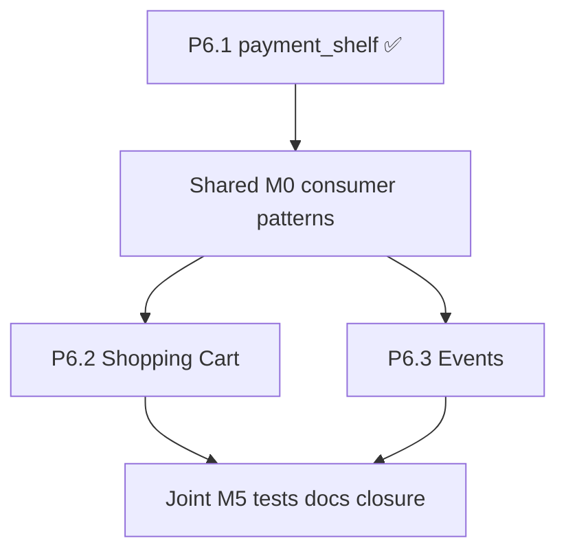

# Phase 6.2 + 6.3 — Shopping Cart & Events plugins (combined sprint)

**Status:** Approved — autonomous execution in **one sprint** (shared M0 → P6.2 + P6.3 → joint closure)  
**Repos:** Birkly (primary) · Birkly-Docs · kekaba (reference demo, post-stable)  
**Depends on:** P6.1 complete — `payment_shelf` on `main`  
**Handoff:** `docs/reviews/P6.2-P6.3-lead-engineer-handoff.md`

---

## What this delivers

Two **self-contained consumer plugins** that use `get_plugin_service('payment_shelf')` — never provider APIs directly.

| Plugin | Path | Purpose |
|--------|------|---------|
| **Shopping Cart** | `plugins/shopping_cart/` | Products, cart session, checkout, orders |
| **Events** | `plugins/events/` | Events, RSVP, capacity, paid tickets |

Both subscribe to Payments events (`payment_succeeded`, etc.) to complete their domain logic after webhooks.

---

## Design principles

| Principle | Rule |
|-----------|------|
| Self-contained | All code in each plugin folder; deactivate = no hooks/API/nav |
| Shelf only | All charges via `payment_shelf->createPayment()` with `source_plugin` + `source_ref` |
| Collection-backed | Products and events are Birkly collections (plugin seeds schemas or documents setup) |
| Payments optional | Cart paid checkout and Events paid tickets require Payments active; free RSVP works without |
| No duplication | Order/ticket state in consumer plugin; money audit stays in Payments activity log |
| Shared patterns | Same checkout return URL pattern, event subscription boilerplate, admin CSS reuse |

---

## Dependency graph



**Parallel after M0:** Cart and Events can be built on separate branches by cms-developer, merged when both green.

---

## P6.2 — Shopping Cart plugin

### Scope

| Area | v1 |
|------|-----|
| **Products** | Collection `shop_products` (seeded): title, price, currency, SKU, stock (optional), image |
| **Cart** | Session cart (guest) + merge on login (user_management if active) |
| **Checkout** | Totals → `payment_shelf->createPayment()` → redirect URL |
| **Orders** | `plugins/shopping_cart/data/orders/` — status: pending, paid, cancelled, refunded |
| **Webhook path** | Subscribe `payment_succeeded` / `payment_failed`; match `source_plugin=shopping_cart` + `source_ref=order_id` |
| **Admin** | Products link (collection), orders list, order detail |
| **Frontend** | Template functions: `cart_add`, `cart_count`, `cart_checkout_url` (minimal JS cart widget optional) |
| **Automation** | Triggers: `order_created`, `order_paid`, `order_cancelled` |

### Shelf call (checkout)

```php
$shelf = get_plugin_service('payment_shelf');
$shelf->createPayment('auto', [
  'amount_cents' => $orderTotalCents,
  'currency'     => $currency,
  'description'  => 'Order ' . $orderId,
  'metadata'     => ['order_id' => $orderId, 'line_count' => count($lines)],
], [
  'source_plugin' => 'shopping_cart',
  'source_ref'    => $orderId,
  'return_url'    => $successUrl,
  'cancel_url'    => $cancelUrl,
]);
```

### Out of scope (P6.2)

- Shipping zones, tax engine, multi-vendor
- Inventory warehouse
- Subscriptions (one-time cart only in v1)

---

## P6.3 — Events plugin

### Scope

| Area | v1 |
|------|-----|
| **Events** | Collection `events` (seeded): title, start, end, venue, capacity, visibility |
| **Ticket types** | Sub-collection or embedded JSON: name, price, capacity (0 = unlimited) |
| **RSVP (free)** | Register attendee without Payments — name, email, user_id optional |
| **Paid tickets** | `payment_shelf->createPayment()` per ticket purchase; `source_ref=registration_id` |
| **Capacity** | Enforce on RSVP and paid registration; waitlist defer v1 |
| **Admin** | Events list, registrations, export CSV |
| **Frontend** | Template functions: `upcoming_events`, `event_register_url`, `event_ticket_checkout_url` |
| **Automation** | Triggers: `event_rsvp`, `event_registration_paid`, `event_full` |

### Shelf call (paid ticket)

```php
$shelf->createPayment('auto', [
  'amount_cents' => $ticketPriceCents,
  'currency'     => $currency,
  'description'  => $eventTitle . ' — ' . $ticketTypeName,
], [
  'source_plugin' => 'events',
  'source_ref'    => $registrationId,
]);
```

### Out of scope (P6.3)

- Seating maps, recurring events series, calendar iCal export
- Refund UI (use Payments admin + Events manual status update in v1)

---

## Combined milestones

### P6.2-P6.3-M0 — Shared consumer foundation

| Task | Deliverable |
|------|-------------|
| M0-T1 | `ConsumerPaymentHelper` trait or include — shelf availability check, event subscription bootstrap |
| M0-T2 | Standard payment event handlers pattern (document in plugin README) |
| M0-T3 | `plugin.json` template: `requires_plugins: ["payments"]`, `access_payment_shelf` capability |

**Acceptance:** Both plugins scaffold; shared test fixture for mock shelf.

---

### P6.2-M1 — Cart core

| Task | Deliverable |
|------|-------------|
| P6.2-M1-T1 | Plugin scaffold + `shop_products` collection seed |
| P6.2-M1-T2 | Cart session storage + API (`add`, `update`, `remove`, `get`) |
| P6.2-M1-T3 | Order model + create pending order from cart |

---

### P6.2-M2 — Cart checkout + payment wiring

| Task | Deliverable |
|------|-------------|
| P6.2-M2-T1 | Checkout → `payment_shelf->createPayment()` |
| P6.2-M2-T2 | Subscribe `payment_succeeded` / `payment_failed` → update order status |
| P6.2-M2-T3 | Admin orders UI |
| P6.2-M2-T4 | `tests/shopping_cart_*` — cart, checkout mock shelf |

---

### P6.2-M3 — Cart frontend + automation

| Task | Deliverable |
|------|-------------|
| P6.2-M3-T1 | Template functions + minimal cart JS/CSS |
| P6.2-M3-T2 | Automation blocks: order_created, order_paid |
| P6.2-M3-T3 | design-reviewer pass |

---

### P6.3-M1 — Events core

| Task | Deliverable |
|------|-------------|
| P6.3-M1-T1 | Plugin scaffold + `events` collection seed |
| P6.3-M1-T2 | Ticket types schema + registration model |
| P6.3-M1-T3 | Free RSVP flow (no Payments) |

---

### P6.3-M2 — Events paid tickets + payment wiring

| Task | Deliverable |
|------|-------------|
| P6.3-M2-T1 | Paid registration → shelf checkout |
| P6.3-M2-T2 | Payment event handlers → confirm registration |
| P6.3-M2-T3 | Capacity enforcement |
| P6.3-M2-T4 | Admin registrations UI |

---

### P6.3-M3 — Events frontend + automation

| Task | Deliverable |
|------|-------------|
| P6.3-M3-T1 | Template functions `upcoming_events`, register URLs |
| P6.3-M3-T2 | Automation: event_rsvp, event_registration_paid, event_full |
| P6.3-M3-T3 | design-reviewer pass |

---

### P6.2-P6.3-M4 — Integration + kekaba demo (optional)

| Task | Deliverable |
|------|-------------|
| M4-T1 | End-to-end test: cart checkout + event paid ticket with mock shelf |
| M4-T2 | kekaba demo page: simple shop + event listing (if embed stable) |
| M4-T3 | Cross-plugin: Payments activity log shows `shopping_cart` + `events` sources |

---

### P6.2-P6.3-M5 — Docs, matrix, closure

| Task | Deliverable |
|------|-------------|
| M5-T1 | Birkly-Docs: Shopping Cart + Events admin guides |
| M5-T2 | Shelf consumer guide update (`payment-shelf-api.md` examples) |
| M5-T3 | `docs/reviews/P6.2-P6.3-verification-matrix.md` |
| M5-T4 | `php tests/run.php` green |
| M5-T5 | Roadmap complete; **notify human once** |

---

## Permissions

### Shopping Cart

| Permission | Access |
|------------|--------|
| `manage_shop` | Products collection, orders, settings |
| `view_shop_orders` | Read-only orders |
| `access_payment_shelf` | Required — granted at plugin activation |

### Events

| Permission | Access |
|------------|--------|
| `manage_events` | Events collection, registrations |
| `view_event_registrations` | Read-only registrations |
| `access_payment_shelf` | Required for paid tickets only |

---

## Success criteria

1. Cart: add → checkout → mock/live payment → order marked paid; activity log shows `shopping_cart`.  
2. Events: free RSVP works without Payments; paid ticket flow uses shelf.  
3. Capacity enforced on events.  
4. Both plugins self-contained; deactivate cleanly.  
5. Automation triggers registered.  
6. Tests + docs; human notified once at M5.

---

## Deferred

| Item | Phase |
|------|--------|
| User membership ↔ shelf | P6.4 |
| Birkly Marketplace | P6.5 |
| Cart subscriptions, shipping, tax | P6.2+ |
| Event waitlist, recurring | P6.3+ |
