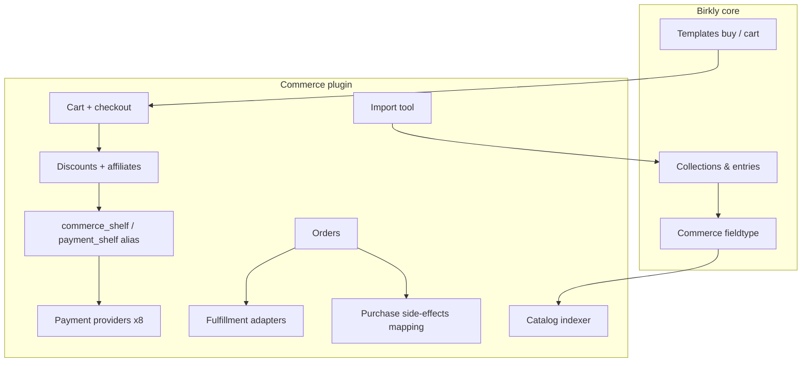

# Phase 6.4 — Commerce plugin (evolve from Payments)

**Status:** Approved — autonomous execution P6.4-M0→M6  
**Repo:** Birkly (primary) · Birkly-Docs  
**Depends on:** P6.1 complete (`plugins/payments/` on `main`); P6.2/P6.3 shipped (keep as-is during transition)  
**Handoff:** `docs/reviews/P6.4-lead-engineer-handoff.md`

---

## Executive summary

**Repurpose `plugins/payments/` → `plugins/commerce/`** — one plugin that owns payment providers, cart, checkout, orders, the **Commerce fieldtype**, catalog index, discounts/affiliates, import, and fulfillment adapters.

**Content-first commerce:** Products, events, and memberships are **entries in any collection**. The Commerce fieldtype marks how an entry is sold. No duplicate product/event collections required (existing Shop/Events plugins **remain** for now; not deleted).

---

## Architecture



---

## Design decisions (locked)

| # | Decision |
|---|----------|
| D1 | **One plugin:** `commerce` — payments + cart/checkout belong together |
| D2 | **Migrate** `plugins/payments/` → `plugins/commerce/` (settings + service aliases) |
| D3 | **Commerce fieldtype** on fieldtype shelf — not a separate Shop product model |
| D4 | **Billing:** `one_time` \| `recurring` only (no event/membership/shop modes) |
| D5 | **Quantity:** `quantity_available` — null = unlimited (stock = event capacity) |
| D6 | **No tier_id on fieldtype** — entry/collection IDs + Commerce admin **purchase mappings** for tier grants |
| D7 | **SKU optional** — merchant/import/fulfillment code; auto-fallback to entry slug |
| D8 | **Discounts/affiliates** in Commerce rule engine — not static-only on fieldtype |
| D9 | **Keep** `shopping_cart` + `events` plugins — no removal in P6.4; document coexistence |
| D10 | **`payment_shelf` alias** preserved for backward compat during transition |

---

## Commerce fieldtype schema

Registered by Commerce plugin via `register_plugin_fieldtype('commerce', ...)`.

**Stored on entry (field value):**

| Field | Type | Notes |
|-------|------|-------|
| `price_cents` | int | 0 = free (RSVP / free download) |
| `currency` | string | ISO 4217, e.g. `eur` |
| `billing` | enum | `one_time` \| `recurring` |
| `interval` | string | `month` \| `year` — required if recurring |
| `quantity_available` | int \| null | null = unlimited |
| `sku` | string \| null | optional; import/fulfillment |

**Not on fieldtype:** tier_id, discount amounts, affiliate codes, event modes.

**Editor UX:** Admin entry editor renders Commerce fieldtype block (price, billing toggle, quantity, SKU).

**Frontend:** Template functions (Commerce registers):

- `commerce_buy_url(entry, …)`  
- `commerce_add_to_cart(entry, qty)`  
- `commerce_cart_url()`

---

## Catalog indexer

**Trigger:** `after_entry_save` / `after_entry_delete` + optional full reindex admin action.

**Index store:** `plugins/commerce/data/catalog_index.json` (or sharded by collection).

**Row shape:**

```json
{
  "entry_id": "...",
  "collection_slug": "products",
  "entry_slug": "blue-shirt",
  "price_cents": 2900,
  "currency": "eur",
  "billing": "one_time",
  "quantity_available": 42,
  "sku": "SHIRT-BLU-M",
  "updated_at": "..."
}
```

**Admin → Catalog:** Filterable list (collection, low stock, billing type). Quick edit quantity/SKU without opening full entry optional in M2+.

---

## Discount & affiliate engine

**Base price** from fieldtype; **effective price** computed at checkout.

| Rule type | Example |
|-----------|---------|
| `percent_off` | 20% off entry or collection |
| `fixed_off` | €5 off |
| `coupon` | Code `SUMMER10` at checkout |
| `affiliate` | `?ref=partner1` → 15% off; stored on order |

**Storage:** `plugins/commerce/data/discount_rules.json`

**Checkout flow:**

1. Load cart lines from catalog index  
2. Apply coupon + affiliate session + entry/collection rules  
3. Persist `base_amount`, `discount_amount`, `effective_amount`, `affiliate_id` on order line  
4. Charge `effective_amount` via shelf  

---

## Cart, checkout, orders

**Move/consolidate** cart + order logic into Commerce (reuse patterns from `plugins/shopping_cart/` — do not duplicate indefinitely).

| Component | Location |
|-----------|----------|
| Cart session | `CommerceCartSession` |
| Checkout | `CommerceCheckoutService` → shelf |
| Orders | `CommerceOrderStore` |
| Reservations | Hold `quantity_available` on pending payment; confirm on webhook |

**Webhook handler:** Existing Commerce webhook router; on success update order + decrement quantity + fire `broadcast_event('commerce_order_paid', …)`.

**Purchase side-effects (admin mapping):**  
`plugins/commerce/data/purchase_mappings.json`:

```json
{
  "entry:products:premium-plan": { "grant_tier": "premium" },
  "collection:memberships": { "grant_tier_from_entry_rules": true }
}
```

User plugin subscribes to `commerce_order_paid` or Commerce calls `UserTiers` when mapping exists.

---

## Migration: Payments → Commerce

| Item | Action |
|------|--------|
| Plugin folder | `plugins/payments/` → `plugins/commerce/` |
| Plugin id | `payments` → `commerce`; accept legacy id in settings migration |
| Service | Register `commerce_shelf`; alias `get_plugin_service('payment_shelf')` → same instance |
| Settings file | Migrate `settings/plugins/payments.json` → `commerce.json` |
| Admin page | `page=payments` → `page=commerce` (redirect 302 or alias route) |
| Capabilities | Rename `manage_payments` → `manage_commerce` with alias check |
| Tests | Rename/update `tests/payments_*` → `tests/commerce_*` |
| Docs | Update Birkly-Docs; deprecate payments-only naming |

**Do not break** `shopping_cart` / `events` during M0: they depend on `payment_shelf` — alias must work until those plugins updated (optional M6).

---

## Import tool (v1)

**Admin → Commerce → Import**

| Source | v1 scope |
|--------|----------|
| **CSV upload** | Column mapping wizard → collection + entries + Commerce fieldtype values |
| **WooCommerce CSV export** | Preset mapping profile |
| **Shopify CSV export** | Preset mapping profile |

**Mapping targets:** collection (create or select), title, body, image URLs → media, price, currency, billing, quantity, sku, slug.

**Idempotency:** Match existing entries by `sku` or `external_id` column; update vs create.

**Out of v1:** Live Shopify/Woo API sync (defer P6.4+).

---

## Fulfillment integrations (v1)

**Adapter interface** (mirror payment providers):

| Adapter | v1 |
|---------|-----|
| **Manual / webhook-only** | Export order JSON; always available |
| **ShipStation** (or one chosen provider) | Push order on `order_paid`; stub + test connection if no API keys in CI |

**Storage:** `plugins/commerce/data/fulfillment_connections.json`

**Order payload:** line items with sku, quantity, shipping address (from checkout form fields — v1 billing email minimum).

---

## Coexistence with Shop & Events plugins

| Plugin | P6.4 behavior |
|--------|----------------|
| `shopping_cart` | **Keep active.** Document: legacy parallel catalog (`shop_products` collection). New sites should use Commerce fieldtype on any collection. Optional: Shop admin banner “Migrate to Commerce catalog.” No deletion. |
| `events` | **Keep active.** Same — demo `events` collection coexists. Paid registration can migrate to Commerce fieldtype entries later. |

Commerce does **not** remove or break these plugins in P6.4.

---

## Milestones

### P6.4-M0 — Migrate Payments → Commerce

| Task | Deliverable |
|------|-------------|
| M0-T1 | Rename/move plugin; migration script for settings + plugin state |
| M0-T2 | `commerce_shelf` + `payment_shelf` alias; all tests green |
| M0-T3 | Admin nav **Commerce**; connections UI unchanged functionally |
| M0-T4 | Update `plugin.json`, capabilities, roadmap note |

**Acceptance:** Existing payment provider tests pass; Shop/Events shelf tests pass via alias.

---

### P6.4-M1 — Commerce fieldtype + catalog index

| Task | Deliverable |
|------|-------------|
| M1-T1 | `fieldtypes/Commerce/` + shelf registration |
| M1-T2 | Indexer on entry save/delete |
| M1-T3 | Admin **Catalog** view (purchasable entries) |
| M1-T4 | `tests/commerce_fieldtype_test.php`, `tests/commerce_index_test.php` |

**Acceptance:** Entry with Commerce field appears in catalog; quantity/price round-trip.

---

### P6.4-M2 — Cart, checkout, orders (in Commerce)

| Task | Deliverable |
|------|-------------|
| M2-T1 | Port/adapt cart session + checkout from shopping_cart patterns |
| M2-T2 | Single-item + multi-item cart |
| M2-T3 | Order store + webhook → paid + quantity decrement + reservations |
| M2-T4 | Template functions buy/cart |
| M2-T5 | Admin **Orders** UI |

**Acceptance:** Buy entry with Commerce fieldtype → order paid (mock shelf + webhook test).

---

### P6.4-M3 — Discounts & affiliates

| Task | Deliverable |
|------|-------------|
| M3-T1 | Discount rules CRUD admin |
| M3-T2 | Coupon code at checkout |
| M3-T3 | Affiliate `?ref=` session + rule application |
| M3-T4 | Order lines store base/discount/effective amounts |
| M3-T5 | `tests/commerce_discount_test.php` |

**Acceptance:** Affiliate link changes checkout price; coupon applies; audit on order.

---

### P6.4-M4 — Import tool v1

| Task | Deliverable |
|------|-------------|
| M4-T1 | CSV upload + column mapper UI |
| M4-T2 | WooCommerce + Shopify CSV presets |
| M4-T3 | Create/update entries + Commerce field values |
| M4-T4 | Import log + dry-run mode |
| M4-T5 | `tests/commerce_import_test.php` |

**Acceptance:** Sample CSV → collection with 3 purchasable entries in catalog.

---

### P6.4-M5 — Fulfillment + purchase mappings

| Task | Deliverable |
|------|-------------|
| M5-T1 | Fulfillment adapter interface + manual export |
| M5-T2 | One live adapter (ShipStation or documented stub) |
| M5-T3 | Purchase mappings admin (entry/collection → grant_tier) |
| M5-T4 | Hook `commerce_order_paid` → UserTiers when mapped |
| M5-T5 | Automation triggers for commerce events |

**Acceptance:** Mapping grants tier on mock paid order; fulfillment adapter test connection.

---

### P6.4-M6 — Docs, matrix, closure

| Task | Deliverable |
|------|-------------|
| M6-T1 | Birkly-Docs: Commerce plugin, fieldtype, import, discounts |
| M6-T2 | Coexistence note for Shop/Events plugins |
| M6-T3 | `docs/reviews/P6.4-verification-matrix.md` |
| M6-T4 | `php tests/run.php` green |
| M6-T5 | Roadmap complete; **notify human once** |

---

## Permissions

| Capability | Access |
|------------|--------|
| `manage_commerce` | Connections, catalog, orders, discounts, import, mappings, fulfillment |
| `view_commerce_orders` | Read-only orders |
| `view_commerce_stats` | Dashboard widget |
| `access_commerce_shelf` | Consumer plugins (alias `access_payment_shelf`) |

---

## Out of scope (P6.4)

- Removing Shop/Events plugins  
- Live Shopify/Woo API sync (CSV only in v1)  
- Multi-currency cart, tax, shipping zones  
- Birkly Marketplace  
- Mixed one-time + recurring in single checkout session  

---

## Success criteria

1. Payments fully migrated to Commerce with no regression on providers/shelf.  
2. Commerce fieldtype + catalog index on any collection.  
3. Cart/checkout/orders work with discounts and affiliate param.  
4. CSV import creates purchasable entries.  
5. Fulfillment adapter + purchase tier mapping.  
6. Shop/Events plugins still activate and pass tests via shelf alias.  
7. Tests + docs; human notified once at M6.

---

## Deferred (post-P6.4)

| Item | Phase |
|------|--------|
| Shop/Events plugin consolidation or migration wizards | P6.5+ |
| User membership UX polish | P6.5+ |
| Marketplace | P6.6+ |
| Shopify/Woo live API import | P6.5+ |
