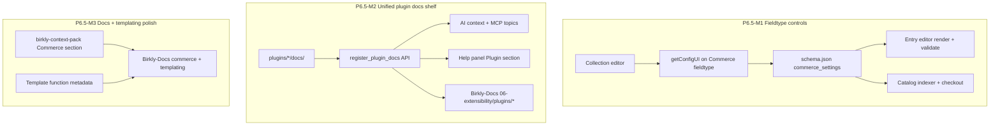

# Phase 6.5 — Commerce polish, fieldtype controls & plugin AI awareness

**Status:** **Approved (2026-07-05)** — single wave autonomous execution · **Handoff:** `docs/reviews/P6.5-lead-engineer-handoff.md`  
**Repo:** Birkly (primary) · Birkly-Docs  
**Follows:** **P6.4 complete** on `main` — `plugins/commerce/` shipped M0–M6 (83 test suites)  
**Prior spec:** `docs/reviews/P6.4-commerce-plugin-plan.md` · **Matrix:** `docs/reviews/P6.4-verification-matrix.md`

---

## Corrected platform status (2026-07-05)

| Phase | Status |
|-------|--------|
| P6.1 Payments | Complete (shim remains) |
| P6.2 Shopping Cart | Complete |
| P6.3 Events | Complete |
| **P6.4 Commerce** | **Complete** — migration, fieldtype, catalog, cart, discounts, import, fulfillment, mappings |
| **P6.5** (this plan) | Proposed — polish gaps from P6.4 + AI extensibility |

**On `main` today:**

- `plugins/commerce/` — full plugin (providers, shelf, fieldtype, cart, orders, admin)
- `plugins/payments/` — compatibility shim forwarding to Commerce
- Template functions registered: `commerce_cart_count`, `commerce_cart_url`, `commerce_buy_url`, `commerce_add_to_cart`
- Commerce fieldtype — **fixed schema** (price, currency, billing, interval month/year, quantity, SKU); **no collection-level controls**
- AI context pack — **no Commerce section**; Claude/MCP does not auto-know Commerce unless `list_plugins` is called
- Birkly-Docs — **no Commerce guide pages yet** (roadmap closure overstated; docs still needed)

---

## Problem summary

Three gaps surfaced after P6.4 delivery and architecture review:

| # | Gap | Impact |
|---|-----|--------|
| 1 | **Plugin AI awareness** | Connected AI (Claude via MCP/chat) lacks Commerce templating, fieldtype, and checkout knowledge |
| 2 | **Templating surface undocumented** | Template Shelf works but Commerce functions lack metadata; no AI/docs coverage for client sites |
| 3 | **Commerce fieldtype is rigid** | Merchants cannot configure which sub-fields appear, interval options (e.g. weekly), or add custom commerce fields per collection |

---

## Architecture — three workstreams



---

## Workstream 1 — Commerce fieldtype collection controls

### Goal

In **Collection editor**, when a field uses type `commerce`, show a **Field options** panel (via existing `getConfigUI()` API) so site builders can:

- Enable/disable built-in sub-fields (price, currency, billing, interval, quantity, SKU)
- Configure **interval options** (add `week`, remove `year`, custom labels)
- Configure **currency options** (subset of ISO list)
- Mark sub-fields required or hidden
- Add **custom fields** (merchant-defined keys) stored on the entry value and surfaced in entry editor

### Existing mechanism (reuse — no new core API)

Collection editor already loads fieldtype config UI:

```388:423:api/admin_fieldtypes.php
        case 'get_config_ui':
            // ...
                $configUI = method_exists($fieldtype, 'getConfigUI') 
                    ? $fieldtype->getConfigUI($fieldIndex, $existingData)
                    : '';
```

Core fieldtypes (Select, Number, etc.) implement `getConfigUI()`. **Commerce fieldtype currently returns empty** (`getAdminConfig(): []`, no `getConfigUI` override).

### Schema shape (stored on collection field definition)

```json
{
  "name": "pricing",
  "type": "commerce",
  "label": "Pricing",
  "commerce_settings": {
    "fields": {
      "price_cents": { "enabled": true, "required": true },
      "currency": {
        "enabled": true,
        "options": ["eur", "usd", "gbp"]
      },
      "billing": { "enabled": true },
      "interval": {
        "enabled": true,
        "visible_when": { "billing": "recurring" },
        "options": [
          { "label": "Weekly", "value": "week" },
          { "label": "Monthly", "value": "month" },
          { "label": "Yearly", "value": "year" }
        ]
      },
      "quantity_available": { "enabled": false },
      "sku": { "enabled": false }
    },
    "custom_fields": [
      {
        "key": "compare_at_cents",
        "label": "Compare-at price (cents)",
        "type": "integer",
        "required": false,
        "help": "Shown struck-through on product pages"
      },
      {
        "key": "external_product_id",
        "label": "WooCommerce ID",
        "type": "text",
        "required": false
      }
    ]
  }
}
```

### Entry value shape (extended)

Built-in keys unchanged. Custom keys stored at top level of commerce field value (namespaced by convention):

```json
{
  "price_cents": 2900,
  "currency": "eur",
  "billing": "recurring",
  "interval": "week",
  "quantity_available": null,
  "sku": null,
  "compare_at_cents": 3900,
  "external_product_id": "woo-123"
}
```

### Implementation tasks (P6.5-M1)

| Task | Deliverable |
|------|-------------|
| M1-T1 | `Commerce::getConfigUI()` — toggles, interval/currency option editors, custom field builder |
| M1-T2 | Constructor reads `commerce_settings` from field config; `render()` shows only enabled sub-fields |
| M1-T3 | `validate()` / `normalizeValue()` respect enabled fields + custom field types |
| M1-T4 | Extend billing interval enum: `week` + configurable allowlist from settings |
| M1-T5 | `CatalogIndexer` indexes known custom fields (optional columns); checkout ignores unknown keys |
| M1-T6 | `tests/commerce_fieldtype_config_test.php` — disable SKU, add week interval, custom field round-trip |
| M1-T7 | Collection editor save path persists `commerce_settings` (verify `fields[n][commerce_settings]` collection) |

### Locked decisions (proposed)

| ID | Decision |
|----|----------|
| F1 | Config lives on **collection schema field**, not global Commerce plugin settings |
| F2 | Use existing `getConfigUI()` — no new collection-editor API |
| F3 | Custom fields: `text`, `integer`, `number`, `boolean`, `select` in v1 |
| F4 | Custom field keys: `[a-z0-9_]+`, max 32 chars; no collision with built-in keys |
| F5 | Catalog/checkout use built-in keys only in v1; custom fields are display/metadata unless mapped later |
| F6 | Default when no settings: current P6.4 behavior (all built-in fields enabled, month/year intervals) |

---

## Workstream 2 — Unified plugin documentation shelf (AI + human Help)

### Goal

When a plugin is **active**, documentation flows to **both** audiences from one registration:

| Audience | Today | Target |
|----------|-------|--------|
| **AI** (chat + MCP) | Manual context-pack edits | Runtime merge from plugin folder |
| **Human** (Admin → Help) | Static `docs/help-manifest.json`; plugin topics mixed with core | **Separate “Plugins” nav section** — clearly not core Birkly docs |
| **Public** (Birkly-Docs) | Manual pages under `06-extensibility/` | Plugin registers path; published on release |

Human Help today lists Automation and User Management in the **same flat nav** as Dashboard and Settings (`admin/js/help.js` + `docs/help-manifest.json`). That blurs ownership. Plugin docs must live in a visually distinct **Plugin documentation** section with badge/label (“Extension — not part of core Birkly”).

### Current state

| Layer | Plugin-extensible? |
|-------|-------------------|
| L1 AI context pack | No — core-maintained only |
| L2 `read_birkly_docs` / MCP resources | No — hardcoded topics |
| L3 Admin Help (`help-manifest.json`) | No — core JSON; plugin entries hand-edited |
| L3 Birkly-Docs | No — separate repo, manual sync |
| `list_plugins` tool | Yes — `plugin.json` metadata only |

### Proposed API — unified docs shelf

One registration, three surfaces:

```php
// plugins/commerce/plugin.php
register_plugin_docs('commerce', [
    'title' => 'Commerce',
    'summary' => 'Content-first commerce: providers, cart, checkout, fieldtypes.',
    'badge' => 'plugin', // Help UI: shows under Plugin section
    'docs' => [
        'ai' => __DIR__ . '/docs/ai-context.md',       // L1 summary + L2 full (AI/MCP)
        'help' => __DIR__ . '/docs/help-overview.md',  // Admin Help snapshot source
        'help_topics' => [                              // Optional sub-topics
            ['id' => 'commerce-fieldtype', 'title' => 'Commerce fieldtype', 'file' => __DIR__ . '/docs/help-fieldtype.md'],
            ['id' => 'commerce-templates', 'title' => 'Template functions', 'file' => __DIR__ . '/docs/help-templating.md'],
        ],
        'public_path' => '06-extensibility/plugins/commerce.html', // Birkly-Docs mirror target
    ],
    'mcp_topic_slug' => 'commerce',
    'keywords' => ['commerce', 'cart', 'checkout', 'payments', 'stripe', 'fieldtype'],
]);
```

**Core changes:**

| File | Change |
|------|--------|
| `core/plugins/docs_shelf.php` | Registry; `get_active_plugin_docs()` |
| `api/help_manifest.php` (new) | Merges core manifest + active plugin topics; marks `source: core\|plugin` |
| `admin/js/help.js` | Two nav groups: **Birkly platform** + **Plugin extensions**; plugin badge on topics |
| `api/ai_helpers.php` | AI merge (same as before) |
| `core/mcp_protocol.php` | Dynamic MCP doc resources per active plugin |

**Help UI mock:**

```
Help
├── Birkly platform
│   ├── Getting started
│   ├── Entries & collections
│   └── …
└── Plugin extensions          ← new section header
    ├── Commerce  [Plugin]     ← only when active
    │   ├── Overview
    │   ├── Commerce fieldtype
    │   └── Template functions
    └── Automation  [Plugin]
```

Inactive plugins → section hidden entirely (no stale docs).

### Commerce doc files (shipped with plugin)

| File | Audience |
|------|----------|
| `docs/ai-context.md` | AI / MCP |
| `docs/help-overview.md` | Admin Help |
| `docs/help-fieldtype.md` | Admin Help sub-topic |
| `docs/help-templating.md` | Admin Help + kekaba examples |

Content covers: fieldtype + `commerce_settings`, template functions, admin tabs, shelf, Shop/Events coexistence.

### Implementation tasks (P6.5-M2)

| Task | Deliverable |
|------|-------------|
| M2-T1 | `core/plugins/docs_shelf.php` + `register_plugin_docs()` |
| M2-T2 | `api/help_manifest.php` — runtime merge; `source: plugin` flag |
| M2-T3 | `help.js` — split nav: Platform vs Plugin extensions |
| M2-T4 | AI + MCP merge (summaries + dynamic topics) |
| M2-T5 | Commerce registers full doc set; migrate Automation/User from static manifest to shelf (optional same PR) |
| M2-T6 | Birkly-Docs stub pages under `06-extensibility/plugins/` |
| M2-T7 | `tests/plugin_docs_shelf_test.php` |

### Locked decisions (proposed)

| ID | Decision |
|----|----------|
| A1 | One `register_plugin_docs()` — AI + Help + public path from single source |
| A2 | Help UI **must** separate plugin section — never mix with core nav without header/badge |
| A3 | Inactive plugin → docs not listed in Help or AI L1 |
| A4 | Core `help-manifest.json` remains for platform topics only |
| A5 | No plugin write MCP tools in P6.5 |

---

## Workstream 3 — Templating polish & documentation

### Goal

Client sites (kekaba, Birkly-Website) can call Commerce elements safely; AI and humans have accurate references.

### Current state — Template Shelf **already works**

Commerce registers four functions in `plugins/commerce/plugin.php` via `register_template_function()`. Client `birkly-client.js` discovers them through `api/public.php?action=template_functions_list`.

**Gaps:**

| Gap | Fix |
|-----|-----|
| No `description` / `arguments` metadata on Commerce functions | Add options array (match `user_management` pattern) |
| Not in context pack or Birkly-Docs | M3 docs tasks |
| `commerce_add_to_cart` currently aliases buy URL | Document; optional M3 fix if true add-to-cart API differs |
| No batch template function API | Deferred — performance only |

**Safe extension model (confirmed):**

- Plugins extend client templating via **Template Shelf only** — not new template grammar.
- Public API is intentionally unauthenticated; functions return data/URLs, not mutations.
- Inactive plugin → function unavailable (`get_template_function()` door policy).

### Implementation tasks (P6.5-M3)

| Task | Deliverable |
|------|-------------|
| M3-T1 | Add metadata to Commerce template function registrations |
| M3-T2 | `docs/ai/birkly-context-pack.md` — Commerce section (until AI shelf lands, keep in sync) |
| M3-T3 | Birkly-Docs: `06-extensibility/commerce-plugin.md`, `03-templating/commerce-functions.md` |
| M3-T4 | kekaba example snippet (buy button + cart badge) in docs |
| M3-T5 | `tests/commerce_template_functions_test.php` — list + call smoke |

---

## Milestones summary

| Milestone | Focus | Depends on |
|-----------|--------|------------|
| **P6.5-M1** | Commerce fieldtype collection controls (`getConfigUI`) | — |
| **P6.5-M2** | Plugin AI docs shelf + Commerce ai-context | — |
| **P6.5-M3** | Template metadata + Birkly-Docs + context pack | M1, M2 (docs reference settings) |

**Suggested execution order:** M1 and M2 in parallel → M3 docs last.

---

## Out of scope (P6.5)

- Plugin-registered MCP **write** tools
- New template language syntax / grammar hub
- Custom commerce fields driving checkout pricing (v1 = metadata/display only)
- Shop/Events migration wizards → **P6.6**
- Marketplace → **P6.7**

---

## Deferred phase renumbering

| Phase | Focus |
|-------|--------|
| **P6.5** | This plan — Commerce polish & unified plugin docs |
| **P6.6** | Shop/Events consolidation or migration wizards |
| **P6.7** | Commerce bundle fieldtype + bundle pricing rules |
| **P6.8** | Birkly Marketplace |
| **P6.9** | Live Shopify/Woo API import |

---

## Phase 6.7 (proposed) — Commerce bundle fieldtype

**Status:** Proposed — follow P6.5; depends on configurable Commerce fieldtype (M1)

### Concept (human proposal)

A second plugin fieldtype — **`commerce_bundle`** — lets merchants create **offer entries** that reference other catalog entries (which already use the `commerce` fieldtype), sum their prices, and apply bundle-specific pricing rules.

**Why it fits Birkly:** Content-first commerce treats products as entries. A bundle is just another entry in an `offers` or `bundles` collection — not a separate product type in a shop database.

### Proposed value shape

```json
{
  "items": [
    { "collection": "products", "entry_id": "abc", "quantity": 1 },
    { "collection": "memberships", "entry_id": "def", "quantity": 1 }
  ],
  "pricing_mode": "sum_with_discount",
  "bundle_discount_percent": 15,
  "fixed_price_cents": null,
  "currency": "eur",
  "billing": "one_time",
  "quantity_available": 50
}
```

| `pricing_mode` | Behavior |
|----------------|----------|
| `sum` | Checkout price = Σ(component price × qty) |
| `sum_with_discount` | Sum then apply bundle % or fixed off |
| `fixed` | Ignore component sum; use `fixed_price_cents` |

### System integration


| Component | Behavior |
|-----------|----------|
| **Entry editor** | Relation-style picker filtered to catalog index (commerce field present) |
| **CatalogIndexer** | Index bundle as purchasable; store computed `price_cents` + component refs |
| **Checkout** | Expand to component line items for fulfillment **or** single bundle line with `components[]` metadata |
| **Stock** | `min(component_qty / bundle_qty)` or independent bundle quantity |
| **DiscountEngine** | Bundle-level rules stack **after** component rules (locked: bundle discount wins on bundle SKU) |

### Caveats (locked for v1)

| Rule | Reason |
|------|--------|
| No mixed billing in one bundle | one_time + recurring in same checkout already out of scope |
| Components must share currency | No multi-currency cart yet |
| Component entry deleted → bundle shows warning; checkout blocked until fixed | Referential integrity |
| Recurring bundle = single interval on bundle entry; all components should match | Provider subscription complexity |

### Makes sense?

**Yes** — strong fit for content-first CMS. Closest analog: Craft Commerce variants/bundles or WooCommerce Product Bundles, but implemented as **entries + fieldtype** rather than custom tables. Defer to **P6.7** so P6.5 stays polish-focused.

---

## Commerce enhancement backlog (prioritized)

Beyond P6.5–P6.7, high-value additions:

| Priority | Enhancement | Notes |
|----------|-------------|-------|
| P0 | Tax / VAT rules | EU merchants; per-country or flat rate |
| P0 | Order emails | Receipt, admin notification via Automation |
| P1 | Shipping zones + flat/weight rates | Checkout form already minimal |
| P1 | Refunds + partial refunds | Shelf webhook + admin action |
| P1 | Subscription lifecycle | Cancel, upgrade, dunning (recurring billing) |
| P1 | Digital delivery | File/link on `order_paid`; Automation trigger |
| P2 | Guest checkout | Site session without User plugin |
| P2 | Abandoned cart recovery | Session TTL + email automation |
| P2 | Gift cards / store credit | New fieldtype or discount type |
| P2 | Quotes / B2B (pay later) | Order status workflow |
| P3 | Analytics dashboard | Revenue, conversion, affiliate performance |
| P3 | Product variants | Sub-entries or linked entries (size/color) |
| P3 | Multi-currency checkout | FX display vs charge currency |

---

## Platform comparison — Birkly vs other CMS commerce approaches

| Dimension | **Birkly** | **WordPress + WooCommerce** | **Shopify** | **Craft CMS + Craft Commerce** | **Ghost** |
|-----------|------------|----------------------------|-------------|-------------------------------|-----------|
| **Primary model** | Flat-file CMS; commerce = plugin layer | Shop-first; posts are secondary | Hosted store platform | Content-first + commerce plugin | Publishing + memberships |
| **Product definition** | Entry + Commerce **fieldtype** on any collection | Custom post type `product` | Product resource in Shopify | Product element type | Tier / post access |
| **Plugin system** | PHP plugins; shelves (services, fieldtypes, templates) | Huge plugin ecosystem; hooks everywhere | Apps in marketplace | Yii modules / plugins | Integrations only |
| **Templating** | Client template language + plugin template functions | PHP themes + shortcodes/blocks | Liquid themes | Twig | Handlebars |
| **AI integration** | BYOAI + MCP native; context pack (extensible) | Plugin soup; no standard AI layer | Shopify Sidekick (closed) | None built-in | Limited |
| **Data store** | Flat files + optional DB for settings | MySQL | Shopify cloud | DB (MySQL/PostgreSQL) | MySQL |
| **Checkout** | Own shelf + 8 providers | Woo gateways | Shopify Payments | Stripe/etc. via Commerce | Stripe only |
| **Bundles** | Proposed `commerce_bundle` fieldtype (P6.7) | Product Bundles plugin | Bundle apps | Line item options / bundles | N/A |
| **Best for** | Agency sites, content-led shops, multi-repo clients | Mature e-commerce at scale | Merchants who want hosted everything | Craft shops, custom content models | Newsletters / paid posts |

**Birkly differentiators:**

1. **Content-first** — sell anything that is an entry (page, event, download, membership) without forcing a `products` collection.
2. **Shelf architecture** — plugins expose services, fieldtypes, template functions, and (proposed) docs through typed registries, not ad-hoc hooks.
3. **AI-native** — MCP + context pack designed in; plugin docs shelf would extend this to extensions.
4. **Flat-file simplicity** — no database required for content; commerce state in plugin data dir.

**Where Birkly is behind:**

- Mature tax/shipping/subscription tooling (Woo/Shopify/Craft Commerce years ahead)
- Marketplace scale and payment method breadth
- Theme/storefront ecosystem
- Enterprise features (multi-store, B2B quotes, inventory warehouses)

**Closest philosophical peer:** **Craft Commerce** — commerce as an extension of content modeling, not the other way around. Birkly pushes further toward flat files and template-first client sites.

---

## Success criteria

1. Collection editor configures Commerce field: disable SKU, add weekly interval, add custom field — entry save round-trips.
2. Active Commerce plugin → AI chat includes Commerce summary; Help panel shows **Plugin extensions → Commerce** section (separate from core).
3. Template function list shows Commerce functions with descriptions/arguments.
4. Birkly-Docs commerce pages under `06-extensibility/plugins/`.
5. `php tests/run.php` green.

---

## Handoff note

When approved, lead-engineer executes P6.5-M1→M3 on branches `cursor/p6.5-m[N]-<slug>-24b5`. Notify human once at M3 closure.
