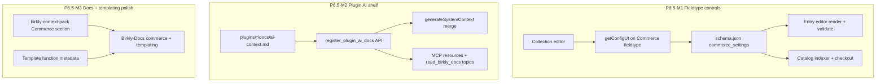

# Phase 6.5 — Commerce polish, fieldtype controls & plugin AI awareness

**Status:** Proposed (2026-07-05) — pending human approval  
**Repo:** Birkly (primary) · Birkly-Docs  
**Follows:** **P6.4 complete** on `main` — `plugins/commerce/` shipped M0–M6 (83 test suites)  
**Prior spec:** `docs/reviews/P6.4-commerce-plugin-plan.md` · **Matrix:** `docs/reviews/P6.4-verification-matrix.md`

---

## Corrected platform status (2026-07-05)

| Phase | Status |
|-------|--------|
| P6.1 Payments | Complete (shim remains) |
| P6.2 Shopping Cart | Complete |
| P6.3 Events | Complete |
| **P6.4 Commerce** | **Complete** — migration, fieldtype, catalog, cart, discounts, import, fulfillment, mappings |
| **P6.5** (this plan) | Proposed — polish gaps from P6.4 + AI extensibility |

**On `main` today:**

- `plugins/commerce/` — full plugin (providers, shelf, fieldtype, cart, orders, admin)
- `plugins/payments/` — compatibility shim forwarding to Commerce
- Template functions registered: `commerce_cart_count`, `commerce_cart_url`, `commerce_buy_url`, `commerce_add_to_cart`
- Commerce fieldtype — **fixed schema** (price, currency, billing, interval month/year, quantity, SKU); **no collection-level controls**
- AI context pack — **no Commerce section**; Claude/MCP does not auto-know Commerce unless `list_plugins` is called
- Birkly-Docs — **no Commerce guide pages yet** (roadmap closure overstated; docs still needed)

---

## Problem summary

Three gaps surfaced after P6.4 delivery and architecture review:

| # | Gap | Impact |
|---|-----|--------|
| 1 | **Plugin AI awareness** | Connected AI (Claude via MCP/chat) lacks Commerce templating, fieldtype, and checkout knowledge |
| 2 | **Templating surface undocumented** | Template Shelf works but Commerce functions lack metadata; no AI/docs coverage for client sites |
| 3 | **Commerce fieldtype is rigid** | Merchants cannot configure which sub-fields appear, interval options (e.g. weekly), or add custom commerce fields per collection |

---

## Architecture — three workstreams



---

## Workstream 1 — Commerce fieldtype collection controls

### Goal

In **Collection editor**, when a field uses type `commerce`, show a **Field options** panel (via existing `getConfigUI()` API) so site builders can:

- Enable/disable built-in sub-fields (price, currency, billing, interval, quantity, SKU)
- Configure **interval options** (add `week`, remove `year`, custom labels)
- Configure **currency options** (subset of ISO list)
- Mark sub-fields required or hidden
- Add **custom fields** (merchant-defined keys) stored on the entry value and surfaced in entry editor

### Existing mechanism (reuse — no new core API)

Collection editor already loads fieldtype config UI:

```388:423:api/admin_fieldtypes.php
        case 'get_config_ui':
            // ...
                $configUI = method_exists($fieldtype, 'getConfigUI') 
                    ? $fieldtype->getConfigUI($fieldIndex, $existingData)
                    : '';
```

Core fieldtypes (Select, Number, etc.) implement `getConfigUI()`. **Commerce fieldtype currently returns empty** (`getAdminConfig(): []`, no `getConfigUI` override).

### Schema shape (stored on collection field definition)

```json
{
  "name": "pricing",
  "type": "commerce",
  "label": "Pricing",
  "commerce_settings": {
    "fields": {
      "price_cents": { "enabled": true, "required": true },
      "currency": {
        "enabled": true,
        "options": ["eur", "usd", "gbp"]
      },
      "billing": { "enabled": true },
      "interval": {
        "enabled": true,
        "visible_when": { "billing": "recurring" },
        "options": [
          { "label": "Weekly", "value": "week" },
          { "label": "Monthly", "value": "month" },
          { "label": "Yearly", "value": "year" }
        ]
      },
      "quantity_available": { "enabled": false },
      "sku": { "enabled": false }
    },
    "custom_fields": [
      {
        "key": "compare_at_cents",
        "label": "Compare-at price (cents)",
        "type": "integer",
        "required": false,
        "help": "Shown struck-through on product pages"
      },
      {
        "key": "external_product_id",
        "label": "WooCommerce ID",
        "type": "text",
        "required": false
      }
    ]
  }
}
```

### Entry value shape (extended)

Built-in keys unchanged. Custom keys stored at top level of commerce field value (namespaced by convention):

```json
{
  "price_cents": 2900,
  "currency": "eur",
  "billing": "recurring",
  "interval": "week",
  "quantity_available": null,
  "sku": null,
  "compare_at_cents": 3900,
  "external_product_id": "woo-123"
}
```

### Implementation tasks (P6.5-M1)

| Task | Deliverable |
|------|-------------|
| M1-T1 | `Commerce::getConfigUI()` — toggles, interval/currency option editors, custom field builder |
| M1-T2 | Constructor reads `commerce_settings` from field config; `render()` shows only enabled sub-fields |
| M1-T3 | `validate()` / `normalizeValue()` respect enabled fields + custom field types |
| M1-T4 | Extend billing interval enum: `week` + configurable allowlist from settings |
| M1-T5 | `CatalogIndexer` indexes known custom fields (optional columns); checkout ignores unknown keys |
| M1-T6 | `tests/commerce_fieldtype_config_test.php` — disable SKU, add week interval, custom field round-trip |
| M1-T7 | Collection editor save path persists `commerce_settings` (verify `fields[n][commerce_settings]` collection) |

### Locked decisions (proposed)

| ID | Decision |
|----|----------|
| F1 | Config lives on **collection schema field**, not global Commerce plugin settings |
| F2 | Use existing `getConfigUI()` — no new collection-editor API |
| F3 | Custom fields: `text`, `integer`, `number`, `boolean`, `select` in v1 |
| F4 | Custom field keys: `[a-z0-9_]+`, max 32 chars; no collision with built-in keys |
| F5 | Catalog/checkout use built-in keys only in v1; custom fields are display/metadata unless mapped later |
| F6 | Default when no settings: current P6.4 behavior (all built-in fields enabled, month/year intervals) |

---

## Workstream 2 — Plugin AI documentation shelf

### Goal

When a plugin is **active**, connected AI (admin chat + MCP agents) automatically knows how that plugin works — templating functions, admin URLs, fieldtypes, shelf services — without manual edits to `birkly-context-pack.md` for every plugin release.

### Current state

| Layer | Plugin-extensible? |
|-------|-------------------|
| L1 context pack (`docs/ai/birkly-context-pack.md`) | No — core-maintained only |
| L2 `read_birkly_docs` topics | No — hardcoded topic map in `api/ai_helpers.php` |
| MCP `birkly://docs/*` resources | No — static list in `core/mcp_protocol.php` |
| `list_plugins` tool | Yes — returns `plugin.json` only |
| MCP / AI tools | No — static `core/ai_tool_registry.php` |

Automation plugin documents the **manual** pattern: add a section to context pack in same PR (`plugins/automation/README.md`).

### Proposed API — AI docs shelf

Mirror Template Shelf / Service Shelf pattern:

```php
// In plugin.php (Commerce example)
register_plugin_ai_docs('commerce', [
    'summary' => 'Content-first commerce: providers, cart, checkout, Commerce fieldtype.',
    'topics' => [
        'overview' => __DIR__ . '/docs/ai-context.md',
        'templating' => __DIR__ . '/docs/ai-templating.md',
    ],
    'mcp_topic_slugs' => ['commerce'], // exposes read_birkly_docs topic + MCP resource
]);
```

**Core changes (minimal):**

| File | Change |
|------|--------|
| `core/plugins/ai_docs_shelf.php` | Registry + `get_active_plugin_ai_docs()` |
| `api/ai_helpers.php` | Merge active plugin docs into `generateSystemContext()` slice; extend `readBirklyDocsTopic()` from shelf |
| `core/mcp_protocol.php` | Register dynamic `birkly://docs/{plugin_slug}` resources for active plugins |
| `core/ai_tool_registry.php` | Optional v2: `list_active_plugin_docs` tool (read-only) |

**Runtime merge strategy (token budget):**

1. Always inject **short summary** per active plugin (~200 tokens each) into system prompt.
2. Full plugin doc loaded only via `read_birkly_docs` topic or MCP resource (L2 on demand).
3. Cap: max 8 active plugin summaries in L1; overflow listed as “call read_birkly_docs”.

### Commerce AI doc content (shipped with plugin)

`plugins/commerce/docs/ai-context.md` should cover:

- Commerce fieldtype schema + collection `commerce_settings`
- Template functions: `commerce_cart_count`, `commerce_cart_url`, `commerce_buy_url`, `commerce_add_to_cart` with examples
- Admin: `?page=commerce` tabs (Connections, Catalog, Orders, Discounts, Import)
- Shelf: `commerce_shelf` / `payment_shelf` alias
- Coexistence with `shopping_cart` and `events` plugins

### Implementation tasks (P6.5-M2)

| Task | Deliverable |
|------|-------------|
| M2-T1 | `core/plugins/ai_docs_shelf.php` + load from `core/plugins.php` |
| M2-T2 | `register_plugin_ai_docs()` hook; Commerce registers docs |
| M2-T3 | `generateSystemContext()` appends active plugin summaries |
| M2-T4 | Dynamic `read_birkly_docs` topics from shelf |
| M2-T5 | MCP resources list includes active plugin doc URIs |
| M2-T6 | `tests/ai_plugin_docs_shelf_test.php` |
| M2-T7 | P5.4 D5/D6 preserved — CI gate when Commerce docs change |

### Locked decisions (proposed)

| ID | Decision |
|----|----------|
| A1 | Plugins ship docs **in plugin folder**; core merges at runtime for **active** plugins only |
| A2 | L1 = summary only; L2 = full doc on demand |
| A3 | No plugin registration of write MCP tools in P6.5 (read-only docs only) |
| A4 | Fallback: manual context-pack sections remain valid for core platform topics |

---

## Workstream 3 — Templating polish & documentation

### Goal

Client sites (kekaba, Birkly-Website) can call Commerce elements safely; AI and humans have accurate references.

### Current state — Template Shelf **already works**

Commerce registers four functions in `plugins/commerce/plugin.php` via `register_template_function()`. Client `birkly-client.js` discovers them through `api/public.php?action=template_functions_list`.

**Gaps:**

| Gap | Fix |
|-----|-----|
| No `description` / `arguments` metadata on Commerce functions | Add options array (match `user_management` pattern) |
| Not in context pack or Birkly-Docs | M3 docs tasks |
| `commerce_add_to_cart` currently aliases buy URL | Document; optional M3 fix if true add-to-cart API differs |
| No batch template function API | Deferred — performance only |

**Safe extension model (confirmed):**

- Plugins extend client templating via **Template Shelf only** — not new template grammar.
- Public API is intentionally unauthenticated; functions return data/URLs, not mutations.
- Inactive plugin → function unavailable (`get_template_function()` door policy).

### Implementation tasks (P6.5-M3)

| Task | Deliverable |
|------|-------------|
| M3-T1 | Add metadata to Commerce template function registrations |
| M3-T2 | `docs/ai/birkly-context-pack.md` — Commerce section (until AI shelf lands, keep in sync) |
| M3-T3 | Birkly-Docs: `06-extensibility/commerce-plugin.md`, `03-templating/commerce-functions.md` |
| M3-T4 | kekaba example snippet (buy button + cart badge) in docs |
| M3-T5 | `tests/commerce_template_functions_test.php` — list + call smoke |

---

## Milestones summary

| Milestone | Focus | Depends on |
|-----------|--------|------------|
| **P6.5-M1** | Commerce fieldtype collection controls (`getConfigUI`) | — |
| **P6.5-M2** | Plugin AI docs shelf + Commerce ai-context | — |
| **P6.5-M3** | Template metadata + Birkly-Docs + context pack | M1, M2 (docs reference settings) |

**Suggested execution order:** M1 and M2 in parallel → M3 docs last.

---

## Out of scope (P6.5)

- Plugin-registered MCP **write** tools
- New template language syntax / grammar hub
- Custom commerce fields driving checkout pricing (v1 = metadata/display only)
- Shop/Events migration wizards → **P6.6**
- Marketplace → **P6.7**

---

## Deferred phase renumbering

| Phase | Focus |
|-------|--------|
| **P6.5** | This plan — Commerce polish & AI extensibility |
| **P6.6** | Shop/Events consolidation or migration wizards |
| **P6.7** | Birkly Marketplace |
| **P6.8** | Live Shopify/Woo API import |

---

## Success criteria

1. Collection editor configures Commerce field: disable SKU, add weekly interval, add custom field — entry save round-trips.
2. Active Commerce plugin → AI chat system prompt includes Commerce summary; `read_birkly_docs` topic `commerce` works.
3. Template function list shows Commerce functions with descriptions/arguments.
4. Birkly-Docs commerce + templating pages published.
5. `php tests/run.php` green.

---

## Handoff note

When approved, lead-engineer executes P6.5-M1→M3 on branches `cursor/p6.5-m[N]-<slug>-24b5`. Notify human once at M3 closure.
