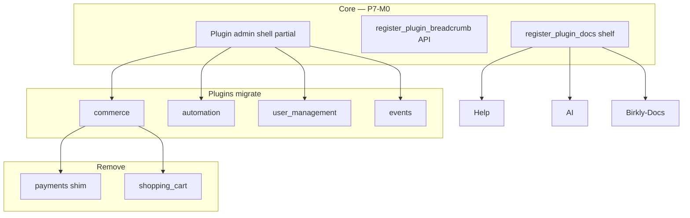

# Phase 7 — Plugin platform, UX unification & ecosystem

**Status:** Proposed (2026-07-06) — pending human approval  
**Repo:** Birkly (primary) · Birkly-Docs  
**Baseline:** P6.4 complete · **P6.5 approved but not executed** (handoff only on `main`)  
**Trigger:** Live feedback — wrong plugin breadcrumbs, inconsistent layouts, AI lacks Commerce docs, User plugin broken, legacy plugins still present

---

## Current status (verified 2026-07-06)

| Item | State |
|------|--------|
| **P6.4 Commerce** | Shipped — `plugins/commerce/` functional (screenshot: Connections, Catalog, etc.) |
| **P6.5 Commerce Wave** | **Approved, not coded** — fieldtype v2, fulfillment, variants still pending |
| **payments plugin** | Shim still in repo + sidebar |
| **shopping_cart plugin** | Still active — superseded by Commerce |
| **Plugin breadcrumbs** | Wrong — `Settings › Commerce`, `Settings › Automation`, `Dashboard › User Management` |
| **Plugin titles** | Duplicate — breadcrumb in topbar + `<h1>` in page body |
| **Header padding** | Extra `page-header` padding; breadcrumbs hoisted to topbar but page headers remain |
| **register_plugin_docs()** | **Not implemented** — AI reads old context pack only (Automation + User Management mentions) |
| **User Management** | **Broken on live** — tabs visible, content empty (layout/CSS/JS regression) |
| **Events** | Basic registration list — no fieldtype, no calendar, no Commerce-native event model |
| **Automation** | Form-based editor — no node canvas |
| **Tests** | 84 suites green |

---

## Phase goal

One **plugin platform layer** in core + unified admin experience across all plugins, remove legacy commerce plugins, fix User Management, evolve Events & Automation — while **completing P6.5 Commerce Wave** on the new shell.

**Design reference:** `admin/templates/entries.html`, `entry-editor.html`, `content.html` — breadcrumbs only, `main-actions-bar`, smart-table patterns, no duplicate titles.

---

## Architecture



---

## Locked decisions (proposed)

| ID | Decision |
|----|----------|
| P1 | Plugin breadcrumb root = **plugin name**, never Settings or Dashboard |
| P2 | Sub-pages: `Commerce › Orders`, `Site Users › Tiers` — max depth 3 |
| P3 | **No duplicate `<h1>`** in plugin body — topbar breadcrumb is the title |
| P4 | Remove horizontal padding mismatch — plugin pages use same content width as entries |
| P5 | **Remove** `plugins/payments/` and `plugins/shopping_cart/` after migration + test pass |
| P6 | `register_plugin_docs()` — **all active plugins** ship Help + AI docs before phase closure |
| P7 | Events: **event fieldtype** + indexer (parallel to Commerce catalog pattern) |
| P8 | Automation node editor — **new UI**; keep form editor as fallback export/import |
| P9 | P6.5 Commerce Wave **still required** — execute on new plugin shell (not cancelled) |

---

## P7-M0 — Plugin admin shell (core)

**Goal:** One layout contract for every plugin admin page.

| Task | Deliverable |
|------|-------------|
| M0-T1 | `admin/partials/plugin_page_shell.php` or documented HTML contract matching entries layout |
| M0-T2 | `register_plugin_admin_meta($plugin_id, ['title', 'tabs', 'breadcrumb_root'])` in `core/plugins.php` |
| M0-T3 | Breadcrumb hoisting: plugin root from meta; sub-tabs update breadcrumb segment via JS |
| M0-T4 | CSS: `.plugin-page` uses content-area padding; drop redundant `.page-header` side padding |
| M0-T5 | `docs/PLUGIN_ADMIN_UI_GUIDE.md` — mandatory for plugin authors |
| M0-T6 | `tests/plugin_admin_shell_test.php` |

**Breadcrumb examples after M0:**

| Page | Breadcrumb |
|------|------------|
| Commerce → Connections | `Commerce` |
| Commerce → Orders tab | `Commerce › Orders` |
| Site Users → Tiers | `Site Users › Tiers` |
| Automation | `Automation` |
| Events → Calendar | `Events › Calendar` |

---

## P7-M1 — Plugin docs shelf (fixes AI gap)

**Goal:** Connected AI and Help know every active plugin (screenshot issue).

| Task | Deliverable |
|------|-------------|
| M1-T1 | `core/plugins/docs_shelf.php` + `register_plugin_docs()` |
| M1-T2 | `api/help_manifest.php` — merge core + plugin topics |
| M1-T3 | `help.js` — **Platform** vs **Plugin extensions** nav sections |
| M1-T4 | Each plugin ships `docs/ai-context.md` + `docs/help-*.md` |
| M1-T5 | `generateSystemContext()` + MCP dynamic topics |
| M1-T6 | `tests/plugin_docs_shelf_test.php` |

**Plugins required to register in M1:** commerce, automation, user_management, events

---

## P7-M2 — Remove legacy commerce plugins

| Task | Deliverable |
|------|-------------|
| M2-T1 | Audit `payments` shim — ensure 100% forward to commerce |
| M2-T2 | Migrate any `settings/plugins.json` state; activation UI shows Commerce only |
| M2-T3 | Remove `plugins/payments/` folder (or empty stub with deactivate message one release — prefer clean remove) |
| M2-T4 | Remove `plugins/shopping_cart/` — cart lives in Commerce |
| M2-T5 | Update tests: delete `shopping_cart_*` or redirect to commerce; shelf alias tests remain |
| M2-T6 | Sidebar nav: drop Payments, Shopping Cart entries |
| M2-T7 | Birkly-Docs: legacy plugins deprecated notice |

**Acceptance:** `php tests/run.php` green; no active site requires shopping_cart or payments plugin id.

---

## P7-M3 — User Management repair & shell migration

**Goal:** Fix broken Site Users page; align with platform UX.

| Task | Deliverable |
|------|-------------|
| M3-T1 | **Root cause** — CSS not loaded / tab pane hidden / JS init on hoisted breadcrumb layout |
| M3-T2 | Split `site_users.html` (2000+ lines) into partials or tab lazy-load |
| M3-T3 | Migrate to plugin shell; breadcrumb `Site Users › {tab}` |
| M3-T4 | Remove inline styles; use `btn`, `main-actions-bar`, `smart-table` |
| M3-T5 | Goals review doc: registration, tiers, collection permissions still match P3/P5 values |
| M3-T6 | `tests/user_plugin_admin_test.php` — HTTP smoke tab content renders |

---

## P7-M4 — Plugin UI migration (Commerce, Automation, Events)

| Task | Deliverable |
|------|-------------|
| M4-T1 | Commerce admin → plugin shell; remove Settings breadcrumb + duplicate h1 |
| M4-T2 | Automation admin → plugin shell |
| M4-T3 | Events admin → plugin shell |
| M4-T4 | Shared tab component (match settings/content tab styling) |
| M4-T5 | design-reviewer pass on all four plugin pages |

---

## P7-M5 — P6.5 Commerce Wave (on new shell)

**Execute** `docs/reviews/P6.5-lead-engineer-handoff.md` M1–M6 on the P7-M0 shell.

Commerce admin tabs gain: Fieldtypes, Shipping (from handoff). Do not duplicate M4 Commerce shell work.

---

## P7-M6 — Events plugin v2

**Goal:** Content-first events with fieldtype + plugin dashboard (not separate events collection only).

### Event fieldtype

Register `event` fieldtype (Events plugin) on entries in **any** collection:

| Field group | Purpose |
|-------------|---------|
| Schedule | `starts_at`, `ends_at`, timezone, recurrence optional (defer) |
| Location | `venue`, `virtual_url`, hybrid flag |
| Capacity | `quantity_available` or link to Commerce `fulfillment: register` |
| Commerce link | Optional relation to commerce field on same entry OR paid via Commerce field on entry |

**Indexer:** `EventIndexer` — all entries with event fieldtype → `plugins/events/data/events_index.json`

### Events admin (plugin page)

| Tab | Feature |
|-----|---------|
| **Overview** | Upcoming/past counts, revenue from Commerce orders (filter register) |
| **Calendar** | Month/week view from index |
| **Events list** | Filterable table → drill to entry editor |
| **Attendees** | Registrations from Commerce `EventRegistrationStore` (P6.5) + legacy events plugin data |
| **Messages** | Bulk email / attendee notes (v1: export + Automation trigger) |

### Commerce connection

| Mode | Behavior |
|------|----------|
| **Free RSVP** | Event fieldtype only; register without Commerce |
| **Paid ticket** | Same entry has Commerce field `fulfillment: register` — Commerce owns money |
| **Legacy** | Old `events` collection + Events plugin registrations — migration wizard (M6-T7) |

### What else makes sense (included / deferred)

| Feature | Phase |
|---------|--------|
| Check-in QR / door list | P7-M6 v1 export |
| Waitlist when full | P7-M6 v1 |
| iCal feed per event | P7-M6 |
| Recurring events series | Deferred |
| Seating maps | Deferred |
| Event-specific email templates | Automation recipes |
| Public calendar template functions | `upcoming_events` extend to index |

| Task | Deliverable |
|------|-------------|
| M6-T1 | Event fieldtype + shelf registration |
| M6-T2 | EventIndexer + admin Calendar/Overview |
| M6-T3 | Attendees tab (Commerce + legacy merge view) |
| M6-T4 | Attendee messages → Automation trigger `events_message_attendees` |
| M6-T5 | Template functions update |
| M6-T6 | Tests + plugin docs |
| M6-T7 | Coexistence + migration note from legacy events collection |

---

## P7-M7 — Automation node editor

**Goal:** Visual node-based workflow editor (comprehensive, not replacement of runtime engine).

| Task | Deliverable |
|------|-------------|
| M7-T1 | Canvas UI (SVG or DOM nodes) — triggers, conditions, actions as nodes |
| M7-T2 | Edge connections; validate acyclic flow |
| M7-T3 | Serialize to existing automation JSON schema (backward compatible) |
| M7-T4 | Import/export; form view toggle for power users |
| M7-T5 | Node palette: Commerce triggers, Events triggers, User triggers, webhooks |
| M7-T6 | Tests + docs |

**Lean guardrail:** Runtime engine unchanged — editor is a new view over same JSON.

**Scope note:** M7 is the largest milestone — may split to P7.5 if needed; minimum viable: linear node chain before branching.

---

## Execution order (recommended)

```text
P7-M0 Shell ──┬── P7-M1 Docs shelf
              ├── P7-M3 User fix (parallel)
              └── P7-M4 UI migration
P7-M2 Remove legacy (after Commerce tests pass)
P7-M5 P6.5 Commerce Wave
P7-M6 Events v2
P7-M7 Automation nodes
```

**Human notify:** once at P7 closure (after M7 or agreed subset).

---

## Out of scope (P7)

- Birkly Marketplace
- Full tax/refund/subscription lifecycle (P6.5/P6.11 backlog)
- Removing Events plugin entirely (evolve, don't delete in P7)
- Third-party plugin marketplace UI

---

## Success criteria

1. All plugin pages: breadcrumb root = plugin name; no Settings parent; no duplicate h1.
2. AI chat answers Commerce questions via `register_plugin_docs` without `list_plugins` guesswork.
3. Help → Plugin extensions lists Commerce, Automation, User Management, Events.
4. payments + shopping_cart removed; tests green.
5. Site Users tabs render and save.
6. P6.5 scenario matrix passes (yoga, coffee, course, community).
7. Events calendar + attendees from indexed fieldtype entries.
8. Automation node editor saves workflows readable by existing engine.

---

## Relationship to existing docs

| Doc | Role |
|-----|------|
| `P6.5-lead-engineer-handoff.md` | Commerce Wave — **P7-M5** |
| `P6-commerce-scenarios-and-model.md` | Commerce content model — unchanged |
| `P6.5-commerce-polish-ai-plan.md` | Docs shelf spec — **P7-M1** |
| `PLUGIN_CSS_GUIDE.md` | Superseded in part by **PLUGIN_ADMIN_UI_GUIDE** |

---

## Handoff

When approved: `docs/reviews/P7-lead-engineer-handoff.md`  
Branches: `cursor/p7-m[N]-<slug>-24b5`
