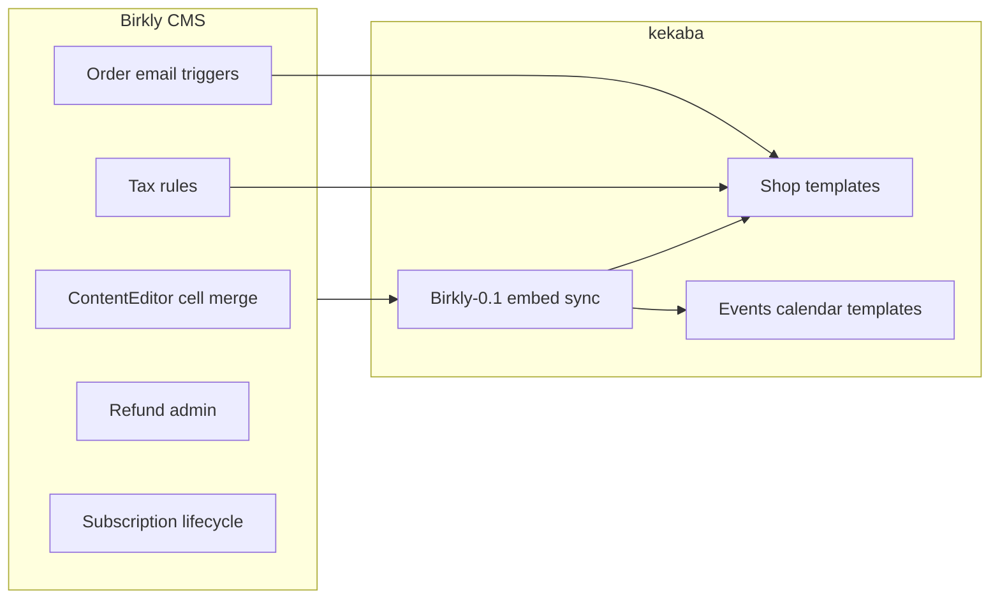

# Phase 8 — Reference site, commerce production & ContentEditor cell merge

**Status:** **Approved (2026-07-06, Keven)** — autonomous execution P8-M0→M6  
**Repos:** Birkly (primary) · kekaba · Birkly-Docs  
**Baseline:** P6.1–P6.7 + P7 complete on `main` — **92 test suites** green  
**Handoff:** `docs/reviews/P8-lead-engineer-handoff.md`  
**Roadmap:** `docs/roadmap/ROADMAP.md` § Phase 8

---

## Current status (verified 2026-07-06)

| Item | State |
|------|--------|
| **P7 Plugin platform** | Complete — admin shell, docs shelf, Events v2, Automation node editor |
| **Commerce** | Fieldtype v2, fulfillment, variants, PostPurchaseRouter, bundles, CSV import + rollback |
| **kekaba embed** | **Stale** — `Birkly-0.1/` missing `commerce` + `events` plugins; pre-P7 admin assets |
| **Live deploy** | `birkly.kekaba.com` — human `git pull` smoke pending post-P7 |
| **Commerce ops** | No tax rules UI, order emails, refund admin, or subscription lifecycle |
| **ContentEditor tables** | Visual studio shipped (P5.5); **cell merge/split still deferred** |
| **Tests** | 92 suites green |

---

## Phase goal

1. **Prove the stack on a real client site** — sync kekaba embed, add shop + events front-end templates.
2. **Make commerce production-usable** — tax, order emails, refunds, subscription cancel/status.
3. **Complete table layout power** — cell merge/split in ContentEditor (portable HTML via `colspan`/`rowspan`).

Marketplace (P7.0) and live Shopify/Woo API import (P7.1) remain **post-P8** backlog.

---

## Locked decisions (Keven 2026-07-06)

| ID | Decision |
|----|----------|
| P8-D1 | **Kekaba scope** — embed sync + demo collections/pages (shop + events); no full content migration |
| P8-D2 | **Tax v1** — flat rate + optional per-country rule table at checkout; no full tax engine |
| P8-D3 | **Refunds v1** — full + partial via provider shelf; admin action on order detail |
| P8-D4 | **Subscriptions v1** — cancel + status display + failed-payment flag; no plan upgrades yet |
| P8-D5 | **Order emails** — receipt + admin notification via Automation triggers on `order_paid` |
| P8-D6 | **Cell merge** — `colspan`/`rowspan` in saved HTML; merge + split in layout inspector; strip editor chrome on save |
| P8-D7 | **Grid rules unchanged** — fluid inline tracks; no `@media` in entry HTML |
| P8-D8 | **CMS first** — Birkly changes merge before kekaba template work |
| P8-D9 | **Human touchpoint** — notify **once** at P8-M6 closure; human deploys live via `git pull` |

---

## Architecture



---

## Milestones

### P8-M0 — Roadmap & baseline sync

- Update `docs/roadmap/ROADMAP.md` current-state table (P7 complete, 92 tests, active plugins)
- This plan + handoff on `main`

**Acceptance:** Roadmap reflects post-P7 reality; handoff copy-paste prompt ready.

---

### P8-M1 — kekaba embed sync

**Repos:** Birkly → kekaba

- Run `./scripts/sync-client-embed.sh /path/to/kekaba` from Birkly root
- Verify `Birkly-0.1/plugins/` includes `commerce`, `events`, `automation`, `user_management`
- Commit kekaba embed update on branch `cursor/p8-m1-embed-sync-24b5`
- Document deploy steps in `docs/reviews/P8-deploy-checklist.md`

**Acceptance:** kekaba embed matches CMS plugin set; sync script exits 0; no runtime data committed.

---

### P8-M2 — Client templates (shop + events)

**Repos:** kekaba · Birkly-Docs (examples)

- Demo **products** collection with Commerce fieldtype entries (physical + digital + register)
- Demo **events** collection with Event fieldtype (including one recurring series)
- Front-end pages: shop listing, product detail (variant picker), cart/checkout integration, events calendar/list, single event + iCal subscribe link
- Use existing `birkly-client.js` + Commerce/Events template functions
- Birkly-Docs: short “Reference site patterns” section or update commerce/events template docs

**Acceptance:** Static/demo pages render with baked or hydrate path; variant selection works; calendar shows recurring occurrence.

---

### P8-M3 — Commerce ops v1

**Repo:** Birkly (`plugins/commerce/`)

| Task | Detail |
|------|--------|
| Tax rules | Settings tab or checkout config: default rate + optional country → rate map |
| Checkout | Apply tax line item; persist on order |
| Order emails | Automation triggers: `commerce_order_receipt` (customer), `commerce_order_admin_notify` (site admin) |
| Refunds | Admin order detail: full/partial refund → provider shelf; update order status |

**Tests:** `tests/commerce_tax_test.php`, `tests/commerce_refund_test.php`, extend order fixture tests

**Acceptance:** Checkout shows tax; refund updates order; automation can fire on order paid with order payload.

---

### P8-M4 — Subscription lifecycle v1

**Repo:** Birkly (`plugins/commerce/`)

- Recurring `purchase_options` → subscription record on successful checkout
- Admin: subscription list + detail (status, next billing, cancel action)
- Webhook/cron hook: mark `past_due` / `canceled` on provider events (mock in tests)
- Template function: `commerce_subscription_status` for account pages (User plugin optional consumer)

**Tests:** `tests/commerce_subscription_test.php`

**Acceptance:** Cancel stops renewal flag; status visible in admin; no upgrade/downgrade UI in P8.

---

### P8-M5 — ContentEditor cell merge / split

**Repo:** Birkly (`fieldtypes/ContentEditor/` only)

- Multi-cell selection in `table.content-editor-table`
- Merge → single cell with `colspan`/`rowspan`; split restores grid
- Layout inspector: Merge / Split buttons when selection valid
- Save sanitization: portable HTML only; no editor metadata
- Tests: `fieldtypes/ContentEditor/tests/table_merge_test.php`

**Acceptance:** 2×2 table → merge top row → save → reload → merge persisted; split restores; front-end HTML valid.

---

### P8-M6 — Verification, docs & closure

- `docs/reviews/P8-verification-matrix.md`
- `docs/reviews/P8-phase-closure-checklist.md`
- Birkly-Docs updates for tax, refunds, subscriptions, cell merge
- AI context pack snippet for new commerce ops + table merge
- `php tests/run.php` green
- Roadmap P8 complete; daily report; **notify human once**

---

## Execution order

```
M0 (docs) → M1 (embed) → M2 (templates) ─┐
         → M3 (commerce ops) ─────────────┼→ M6 (closure)
         → M4 (subscriptions) ────────────┤
         → M5 (cell merge) — parallel after M0 ─┘
```

**Branches:** `cursor/p8-m[N]-<slug>-24b5`

---

## Out of scope (post-P8)

| Item | Former ID |
|------|-----------|
| Birkly Marketplace | P7.0 → P9 |
| Live Shopify/Woo API import | P7.1 → P9 |
| Gift cards, B2B quotes, analytics | P7.2+ |
| Subscription upgrades / dunning emails | P8.1 |
| Nested tables / grid-in-grid | Deferred |
| Full Help → Birkly-Docs wiring | Deferred |

---

## Success criteria

1. kekaba `Birkly-0.1/` includes commerce + events; demo shop and events pages work.
2. Checkout applies tax; admin can refund; order triggers automation email hooks.
3. Recurring purchase can be canceled; status visible in admin.
4. ContentEditor table cell merge/split round-trips in saved HTML.
5. `php tests/run.php` green; P8 verification matrix complete.
