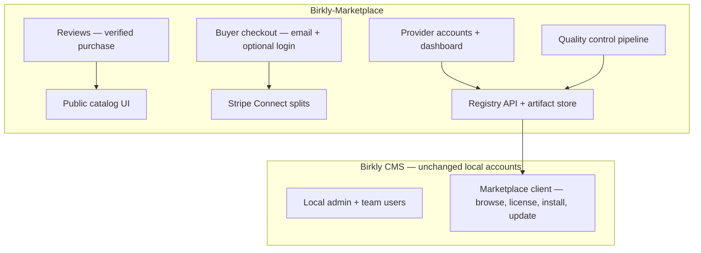

# Phase 9 — Birkly Marketplace

**Status:** **Approved (2026-07-07, Keven)** — autonomous execution P9-M0→M7  
**Repos:** **Birkly-Marketplace** (primary) · Birkly · Birkly-Docs · Birkly-Website  
**Baseline:** P8 complete on `main` — **96 test suites** green  
**Handoff:** `docs/reviews/P9-lead-engineer-handoff.md`  
**Roadmap:** `docs/roadmap/ROADMAP.md` § Phase 9

---

## Locked decisions (Keven 2026-07-07)

| ID | Decision |
|----|----------|
| P9-D1 | **CMS accounts stay local only** — no change to Birkly onboarding or auth |
| P9-D2 | **Provider account** required on marketplace to list offers and receive payouts |
| P9-D3 | **Buyer identity** = email at checkout; optional marketplace login for “My purchases” (not CMS SSO) |
| P9-D4 | **Licenses** activate per CMS `installation_id` + seat limits (single / multi-site tiers) |
| P9-D5 | **Stripe Connect** — provider is seller; Birkly application fee (platform split) |
| P9-D6 | **QC pipeline** — automated preflight + manual review for verified tier |
| P9-D7 | **Reviews** — verified purchase only |
| P9-D8 | **New repo:** `Raaakete/Birkly-Marketplace` — standalone app + registry API |
| P9-D9 | **Legal posture** — platform intermediary; Provider Agreement; not MoR for third-party goods |
| P9-D10 | Human notified **once** at P9-M7 closure |

---

## Architecture



| Repo | Responsibility |
|------|----------------|
| **Birkly-Marketplace** | Catalog, provider/buyer commerce, payments, reviews, QC, artifacts, registry API |
| **Birkly** | Thin client: marketplace tab, license key, install/update, `installation_id` |
| **Birkly-Website** | Links + featured offers |
| **Birkly-Docs** | Provider publishing guide, buyer license/install docs |

---

## Account model (marketplace only)

### CMS — no changes

- Onboarding creates **local admin** (name, email, password on that install).
- Team invites remain **per-install** local users.
- Works offline; Birkly cloud does not store CMS user passwords.

### Provider account (required to sell)

- Email + password on **marketplace site only**.
- Stripe Connect Express onboarding (KYC, payouts).
- Tax/business info as required by Stripe and jurisdiction.
- **Provider Agreement** acceptance (seller liability, content warranty, indemnity).
- Dashboard: offers, versions, sales, payouts, review replies.

### Buyer identity (no CMS account)

| Mode | Use |
|------|-----|
| **Guest checkout** | Email + payment → receipt + license key to email |
| **Buyer login** (optional) | Same marketplace site — “My purchases”, subscriptions, re-download, Stripe customer portal |

Buyer email may match a CMS admin email by coincidence — **not linked** in the database.

### Installation identity (not a user account)

Each CMS install generates stable **`installation_id`** (local, sent only for license activate/update):

```
license_key + installation_id → marketplace validates seat → allow install/update
```

---

## Offer types (v1)

| Type | Artifact | Billing |
|------|----------|---------|
| Plugin | Versioned `.zip` | One-time / subscription |
| Theme | Template bundle | One-time / subscription |
| Template pack | Export / files | One-time |

Listing fields: slug, title, summary, category, tags, pricing tiers, license seats, screenshots, compatibility (`requires_birkly`, `requires_php`, `capabilities[]`), changelog per release.

---

## Payments & revenue split

**Stripe Connect** — provider as connected account (seller).

```
Buyer pays gross price
  → Stripe processing fee
  → Birkly application fee (platform % — configure at launch)
  → Remainder to provider Connect account
```

| Topic | v1 policy |
|-------|-----------|
| Refunds | Provider primary; platform policy for disputes/chargebacks |
| Subscriptions | Stripe Billing; renewals split on each charge |
| Tax | Stripe Tax or provider responsibility — legal review before launch |
| MoR | Birkly is **not** merchant of record for third-party offers |

---

## Reviews & ratings

- **Verified purchase only** (license/order match).
- Star rating + text review; provider may reply once.
- Platform moderation queue (hide spam/abuse).
- v1 defer: multi-criteria scores, helpful votes.

---

## Quality control

### Before listing (submit → review → publish)

| Stage | Check |
|-------|--------|
| Automated preflight | Valid `plugin.json`, zip structure, semver, declared capabilities, SHA-256 |
| Security scan | Best-effort malware / obvious dangerous patterns |
| Compatibility | Birkly + PHP version range |
| Manual review (verified) | Human checklist for first release and major updates |
| Legal | Provider Agreement on file; prohibited content rules |

### While listed

- User abuse reports → review queue.
- Each new version re-runs preflight (auto) + manual for verified tier when required.
- Version yank / provider suspension policies documented.
- **“Verified”** = passed technical review — **not** a product guarantee or endorsement.

---

## Update system

| Layer | Behavior |
|-------|----------|
| Registry API | `releases[]` per offer: version, date, sha256, changelog, min_birkly |
| CMS installed plugins | Store `marketplace_slug`, version, license ref |
| Update check | Periodic call to registry; compare semver |
| Install/upgrade | Download → verify checksum → CMS preflight → extract |
| Offline CMS | Last installed version continues; update check fails gracefully |

---

## CMS integration (Birkly — minimal)

| Feature | Detail |
|---------|--------|
| Setting | `marketplace_url` default `https://marketplace.birkly.com` |
| Plugins admin | **Marketplace** tab — browse/search (read-only API) |
| Install | Enter license key; optional deep-link token from buyer session (stretch) |
| Updates | Badge + one-click upgrade for marketplace-sourced plugins |
| Preflight | Reuse `validate_plugin()`, capability preview, dependency checks |

**No changes** to `users/`, onboarding, or local session auth.

---

## Milestones

| ID | Focus | Repo |
|----|--------|------|
| **P9-M0** | Repo scaffold, manifest schema v1, AGENTS.md, env docs | Marketplace + Birkly docs |
| **P9-M1** | Provider signup + Stripe Connect + Provider Agreement | Marketplace |
| **P9-M2** | Offer CRUD, artifact upload, registry API | Marketplace |
| **P9-M3** | Public catalog + offer detail pages | Marketplace |
| **P9-M4** | Buyer checkout (guest + optional login) + license issuance | Marketplace |
| **P9-M5** | Reviews + QC pipeline v1 | Marketplace |
| **P9-M6** | CMS marketplace client (browse, license, install, update) | Birkly |
| **P9-M7** | Seed catalog, Website links, Birkly-Docs, verification matrix, closure | All |

**Order:** M0 → M1–M2 → M3–M5 (parallel) → M6 → M7

**Branches:** `cursor/p9-m[N]-<slug>-24b5`

---

## Out of scope (post-P9)

- Public self-service developer submissions without review
- Paid marketplace fee tiers beyond flat application fee
- CMS cloud SSO / connected accounts
- Live Shopify/Woo API import (P7.1)
- Gift cards, B2B quotes on CMS commerce

---

## Success criteria

1. Provider can publish a verified plugin with versioned artifact.
2. Buyer can purchase via email checkout and receive license key.
3. CMS can activate license on `installation_id` and install/update from registry.
4. Verified purchase review appears on listing.
5. Stripe Connect split reaches provider minus platform fee.
6. Provider Agreement + buyer ToS published; QC blocks unsafe zip.
7. `php tests/run.php` green on Birkly; marketplace test suite green.
